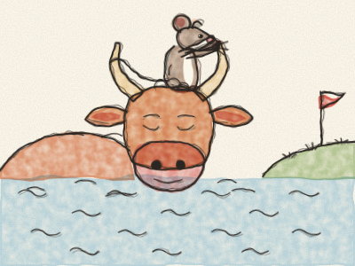
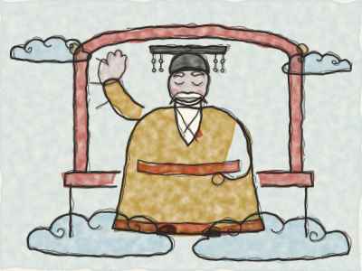
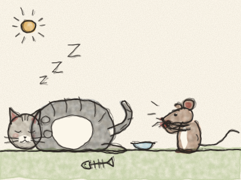
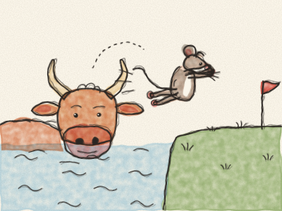
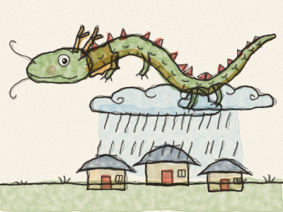

# The Great Race

Long, long ago, in China, the years had no names. The Jade Emperor, who ruled the sky, stroked his long beard and thought. “I know!” he said. “I will give each year the name of an animal.”

So he sent a message to every animal in the land: “Come to my Great Race! You must cross the wide river. The first twelve animals to reach the other side will each give their name to a year.”

The animals were very excited. Tiger stretched, Horse stamped his hooves, and Monkey turned three somersaults. Everybody wanted to win.

Now, Rat and Cat were best friends. But they had a problem. “We are so small,” said Cat, “and we can’t swim very well.”

Rat thought, and thought, and twitched his whiskers. Then he had a clever idea. He ran to see Ox, who was big and strong and very kind.

“Dear Ox,” he said in his sweetest voice, “you are such a wonderful swimmer. May my friend Cat and I ride on your back?”

“Of course,” said Ox slowly. “Moo. There is plenty of room.”

On the day of the race, Cat ate a big lunch: fish, more fish, and a little bowl of cream. His tummy was round and full. “I’ll just have a tiny nap before the race,” he yawned.

*Purr… purr… Zzzzz…*

“Cat! Wake up! It’s time!” called Rat. But Cat only rolled over and purred, “Five more minutes…” And Rat had to run, or he would miss the race.

At the riverbank, the Jade Emperor raised his hand. *Bong!* went the big gong. *Splash! Splash! SPLASH!* In jumped all the animals.

Quick as a wink, Rat climbed onto Ox’s head and held on to his horns. Ox swam slowly and steadily through the waves. *Swish… swish… swish…* He was ahead of everybody!

Rat watched the other bank come closer and closer. Just as Ox was about to step out of the water, Rat took a big breath, and… *Hop!* He jumped off Ox’s nose and landed on the grass.

“Rat is first!” said the Jade Emperor. “The first year will be the year of the Rat!”

Ox climbed out, dripping. He wasn’t cross at all. “Clever little Rat,” he chuckled. “Moo! I am second, and that is very good too.”

Then came Tiger, third, panting and soaking wet, because he had swum through the biggest waves. Rabbit came fourth. He couldn’t swim, so he hopped from stone to stone, then onto a floating log that drifted to the shore. *Hop, hop, hop!*

Then everyone looked up at the sky. Dragon came gliding down, long and green, with his whiskers waving. “Dragon!” said the Emperor. “You can fly! Why are you only fifth?”

“On my way, I saw a village where the fields were dry and the people were thirsty,” said Dragon. “So I stopped to make some rain.” The Emperor smiled. “That was very kind.”

*Clip-clop!* Horse came galloping… but Snake had hidden on Horse’s hoof! “Hiss!” Snake slid off, and Horse jumped in surprise. So Snake was sixth, and Horse seventh. Goat, Monkey and Rooster arrived together on a little raft: eighth, ninth and tenth. Dog, who had splashed and played in the water, was eleventh. And last of all came Pig, twelfth, who had stopped for a snack and a nap.

Rat, Ox, Tiger, Rabbit, Dragon, Snake, Horse, Goat, Monkey, Rooster, Dog and Pig! *(Count them on your fingers!)*

And Cat? He woke up much too late. “Rat! You didn’t wake me!” And that, they say, is why cats still chase rats to this day… just for fun, in a great big game of tag.

*(Constance was born in the year of the Tiger!)*

> Being clever is good, and being kind is even better.
