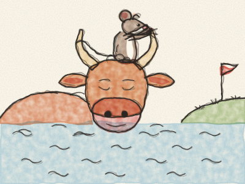
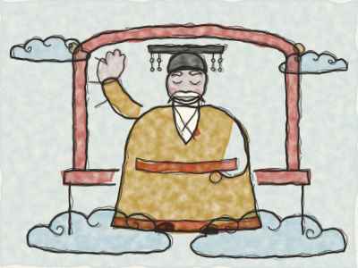
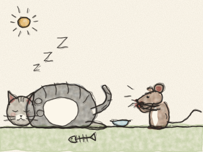
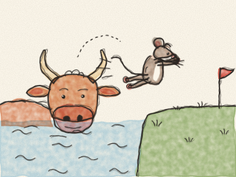
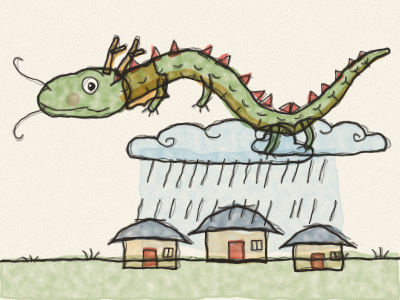

# La Grande Course

Il y a très, très longtemps, en Chine, les années n’avaient pas de nom. L’Empereur de Jade, qui régnait sur le ciel, caressa sa longue barbe et réfléchit. « J’ai une idée ! dit-il. Je vais donner à chaque année le nom d’un animal. »

Alors il envoya un message à tous les animaux du pays : « Venez à ma Grande Course ! Il faudra traverser la large rivière. Les douze premiers animaux arrivés sur l’autre rive donneront chacun leur nom à une année. »

Les animaux étaient tout excités. Le Tigre s’étira, le Cheval tapa du sabot et le Singe fit trois galipettes. Tout le monde voulait gagner.

Or, le Rat et le Chat étaient les meilleurs amis du monde. Mais ils avaient un problème. « Nous sommes tout petits, dit le Chat, et nous ne savons pas bien nager. »

Le Rat réfléchit, réfléchit encore, et remua ses moustaches. Puis il eut une idée maligne. Il courut voir le Bœuf, qui était grand, fort et très gentil.

« Cher Bœuf, dit-il de sa voix la plus douce, vous nagez si merveilleusement bien ! Mon ami le Chat et moi, pourrions-nous monter sur votre dos ? »

« Bien sûr, répondit lentement le Bœuf. Meuh. Il y a plein de place. »

Le jour de la course, le Chat mangea un énorme déjeuner : du poisson, encore du poisson, et un petit bol de crème. Son ventre était tout rond. « Je vais juste faire une toute petite sieste avant la course », bâilla-t-il.

*Ronron… ronron… Zzzzz…*

« Chat ! Réveille-toi ! C’est l’heure ! » cria le Rat. Mais le Chat se retourna en ronronnant : « Encore cinq minutes… » Et le Rat dut partir en courant, sinon il allait rater la course.

Au bord de la rivière, l’Empereur de Jade leva la main. *Bong !* fit le grand gong. *Plouf ! Plouf ! PLOUF !* Tous les animaux sautèrent dans l’eau.

Vif comme l’éclair, le Rat grimpa sur la tête du Bœuf et s’accrocha à ses cornes. Le Bœuf nageait lentement, sans jamais s’arrêter. *Flic… flac… flic…* Il était devant tout le monde !

Le Rat voyait l’autre rive se rapprocher, de plus en plus près. Juste au moment où le Bœuf allait sortir de l’eau, le Rat prit une grande inspiration, et… *Hop !* Il sauta de la tête du Bœuf et atterrit dans l’herbe.

« Le Rat est le premier ! dit l’Empereur de Jade. La première année sera l’année du Rat ! »

Le Bœuf sortit de l’eau, tout dégoulinant. Il n’était pas fâché du tout. « Malin, ce petit Rat ! dit-il en riant. Meuh ! Je suis deuxième, et c’est très bien aussi. »

Puis arriva le Tigre, troisième, essoufflé et trempé, car il avait nagé à travers les plus grosses vagues. Le Lapin arriva quatrième. Il ne savait pas nager : il sauta de pierre en pierre, puis sur un tronc flottant qui dériva jusqu’à la rive. *Hop, hop, hop !*

Alors tout le monde leva les yeux vers le ciel. Le Dragon descendait en planant, long et vert, ses moustaches flottant au vent. « Dragon ! dit l’Empereur. Tu sais voler ! Pourquoi n’es-tu que cinquième ? »

« En chemin, j’ai vu un village où les champs étaient secs et où les gens avaient soif, dit le Dragon. Alors je me suis arrêté pour faire pleuvoir. » L’Empereur sourit. « C’était très gentil. »

*Cataclop !* Le Cheval arriva au galop… mais le Serpent s’était caché sur son sabot ! « Sss ! » Le Serpent glissa par terre, et le Cheval fit un bond de surprise. Le Serpent fut donc sixième, et le Cheval septième. La Chèvre, le Singe et le Coq arrivèrent ensemble sur un petit radeau : huitième, neuvième et dixième. Le Chien, qui avait barboté et joué dans l’eau, fut onzième. Et tout à la fin arriva le Cochon, douzième, qui s’était arrêté pour un goûter et une sieste.

Le Rat, le Bœuf, le Tigre, le Lapin, le Dragon, le Serpent, le Cheval, la Chèvre, le Singe, le Coq, le Chien et le Cochon ! *(Compte-les sur tes doigts !)*

Et le Chat ? Il se réveilla bien trop tard. « Rat ! Tu ne m’as pas réveillé ! » Et c’est pour cela, dit-on, que les chats courent encore après les rats aujourd’hui… juste pour rire, comme dans une grande partie de chat !

*(Constance est née l’année du Tigre !)*

> Être malin, c’est bien ; être gentil, c’est encore mieux.
