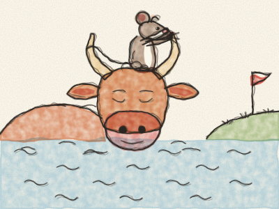
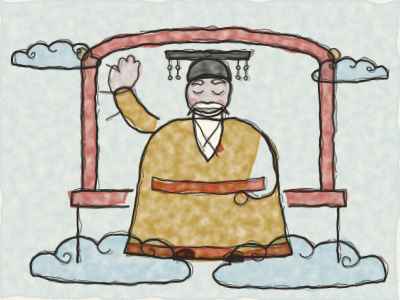
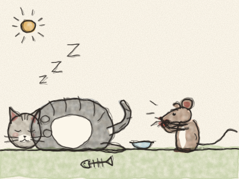
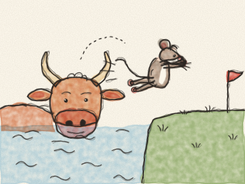
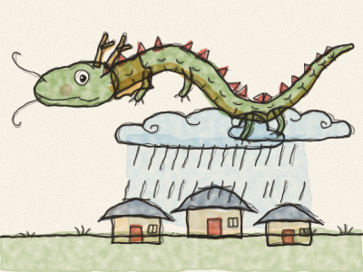

# A Grande Corrida

Há muito, muito tempo, na China, os anos não tinham nome. O Imperador de Jade, que reinava no céu, afagou a sua longa barba e pôs-se a pensar. — Já sei! — disse ele. — Vou dar a cada ano o nome de um animal.

Então mandou uma mensagem a todos os animais do país: — Venham à minha Grande Corrida! Têm de atravessar o largo rio. Os doze primeiros animais a chegar à outra margem darão, cada um, o seu nome a um ano.

Os animais ficaram muito entusiasmados. O Tigre espreguiçou-se, o Cavalo bateu com os cascos e o Macaco deu três cambalhotas. Toda a gente queria ganhar.

Ora, o Rato e o Gato eram os melhores amigos do mundo. Mas tinham um problema. — Somos tão pequenos — disse o Gato — e não sabemos nadar muito bem.

O Rato pensou, pensou mais um bocadinho e mexeu os bigodes. Depois teve uma ideia esperta. Correu a falar com o Boi, que era grande, forte e muito simpático.

— Querido Boi — disse ele, com a sua voz mais doce —, nada tão bem! Eu e o meu amigo Gato podemos ir às suas costas?

— Claro que sim — respondeu o Boi devagar. — Muuu. Há muito espaço.

No dia da corrida, o Gato comeu um almoço enorme: peixe, mais peixe e uma tacinha de natas. Ficou com a barriga redondinha. — Vou só dormir uma sestazinha antes da corrida — bocejou.

*Ron… ron… Zzzzz…*

— Gato! Acorda! Está na hora! — chamou o Rato. Mas o Gato só se virou para o outro lado, a ronronar: — Só mais cinco minutos… — E o Rato teve de ir a correr, senão perdia a corrida.

Na margem do rio, o Imperador de Jade levantou a mão. *Bong!* fez o grande gongo. *Chape! Chape! CHAPE!* Todos os animais saltaram para a água.

Rápido como um relâmpago, o Rato subiu para a cabeça do Boi e agarrou-se aos chifres dele. O Boi nadava devagar, sem nunca parar. *Chuá… chuá… chuá…* Ia à frente de toda a gente!

O Rato via a outra margem cada vez mais perto. Mesmo quando o Boi ia a sair da água, o Rato encheu o peito de ar e… *Upa!* Saltou do focinho do Boi e aterrou na relva.

— O Rato é o primeiro! — disse o Imperador de Jade. — O primeiro ano será o ano do Rato!

O Boi saiu da água, todo a pingar. Não ficou nada zangado. — Que esperto, este Ratinho! — disse ele a rir. — Muuu! Sou o segundo, e isso também é muito bom.

Depois chegou o Tigre, em terceiro, ofegante e encharcado, porque tinha nadado pelas ondas maiores. O Coelho chegou em quarto. Não sabia nadar, por isso saltou de pedra em pedra e depois para cima de um tronco a boiar, que foi levado até à margem. *Hop, hop, hop!*

Então toda a gente olhou para o céu. O Dragão vinha a descer, a planar, comprido e verde, com os bigodes a ondular ao vento. — Dragão! — disse o Imperador. — Tu sabes voar! Porque é que só chegaste em quinto?

— Pelo caminho, vi uma aldeia onde os campos estavam secos e as pessoas tinham sede — disse o Dragão. — Por isso parei para fazer chover. — O Imperador sorriu. — Foi muito bondoso da tua parte.

*Tloc-tloc, tloc-tloc!* O Cavalo chegou a galope… mas a Serpente tinha-se escondido no casco dele! — Sss! — A Serpente deslizou para o chão, e o Cavalo deu um salto de susto. Assim, a Serpente ficou em sexto e o Cavalo em sétimo. A Cabra, o Macaco e o Galo chegaram juntos numa pequena jangada: em oitavo, nono e décimo. O Cão, que tinha andado a chapinhar e a brincar na água, foi o décimo primeiro. E por último chegou o Porco, o décimo segundo, que tinha parado para lanchar e dormir uma sesta.

O Rato, o Boi, o Tigre, o Coelho, o Dragão, a Serpente, o Cavalo, a Cabra, o Macaco, o Galo, o Cão e o Porco! *(Conta-os pelos dedos!)*

E o Gato? Acordou tarde demais. — Rato! Não me acordaste! — E é por isso, dizem, que os gatos ainda hoje correm atrás dos ratos… só a brincar, como num grande jogo da apanhada.

*(A Constance nasceu no ano do Tigre!)*

> Ser esperto é bom, e ser bondoso é ainda melhor.
