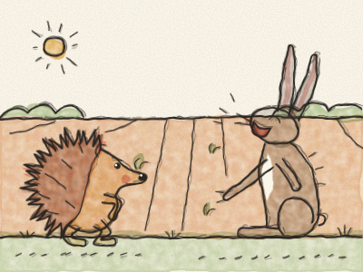
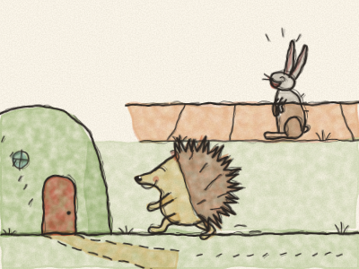
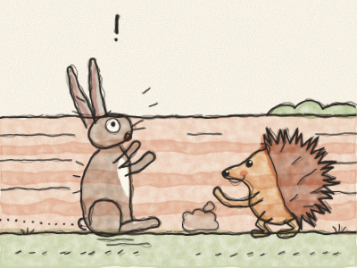
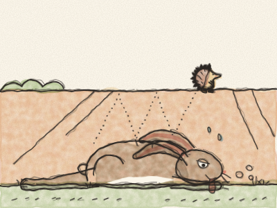
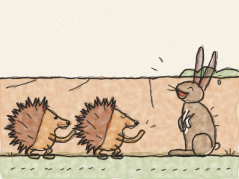

# The Hare and the Hedgehog

Once upon a time, on a bright Sunday morning, a little Hedgehog went out to look at the turnips in the big field next to his house. The field was ploughed into long, straight lines called furrows.

There he met Hare, who was tall and fast and very, very proud of himself.

“Good morning, Hare,” said Hedgehog politely.

Hare looked down his long nose. “Well, well, Prickles! Going for a walk on those short, crooked little legs? Ha ha! You’ll be lucky to reach the end of the field by bedtime!”

Now, Hedgehog’s legs were short and crooked. That was just how he was made. But he did not like being teased about them. Not one little bit.

“My legs may be short,” he said, “but I bet I can beat you in a race.”

“YOU? Beat ME?” Hare laughed so hard that his ears flapped. *Ha ha ha!* “All right, Prickles. Ready when you are!”

“First I’ll go home for my breakfast,” said Hedgehog. “Meet me here in half an hour.” And off he trotted. *Trot, trot, trot.*

At home, Hedgehog whispered a secret into Mrs Hedgehog’s ear. *Psst, psst, psst.* Mrs Hedgehog giggled. Then she tiptoed off down a little path behind the hedge, and nobody saw where she went.

Back at the field, Hedgehog said, “You run down that furrow, and I’ll run down this one, all the way to the far end.”

“Ready…” said Hare. “Steady… GO!”

*Zoom!* Off shot Hare like the wind. *Whoosh! Whoosh! Whoosh!* Hedgehog took three little steps… and then he crouched down in his furrow, as still as a stone, and smiled.

Hare reached the far end of the field, puffing and panting. And there, in the next furrow, a little hedgehog popped up its prickly head.

“I’m already here!”

Hare’s ears shot straight up. “What? How? That’s impossible!” *(Pause, and let Constance guess how Hedgehog did it.)*

“Again!” cried Hare. “Back up the field! Ready, steady, GO!” *Zoom! Whoosh!* He raced all the way to the top. And there, in the next furrow, a little hedgehog popped up its prickly head.

“I’m already here!”

Down ran Hare. “I’m already here!” Up ran Hare. “I’m already here!” Down, up, down, up, faster and faster… and every single time: “I’m already here!”

At last, Hare’s legs went wobbly. His ears went floppy. His tongue hung out. He flopped down on the soft grass in the middle of the field. *Flump!* “I can’t… run… any more,” he puffed.

Then two little hedgehogs walked up to him, side by side, holding paws. They had the same prickles, the same pointy noses and the same short, crooked legs.

“Good morning, Hare,” said Hedgehog. “Meet Mrs Hedgehog.”

“Hello!” said Mrs Hedgehog, with a wink. “I waited at the bottom of the field, and my husband waited at the top.”

Hare stared at them. Then he began to laugh: a big, tired, friendly laugh. “There are two of you! You tricked me! Oh, you clever, clever hedgehogs!”

“And what do you say about my short, crooked legs now?” asked Hedgehog.

“I say they are very fine legs,” said Hare, “and I will never tease anybody about their legs again.”

And he never did. From that day on, whenever Hare met Hedgehog in the field, he bowed and said, “Good morning, my clever friend.” Then Mr and Mrs Hedgehog went home together for a second breakfast. *Munch, munch, munch.*

> Never laugh at someone for the way they look. A clever head beats fast legs!
