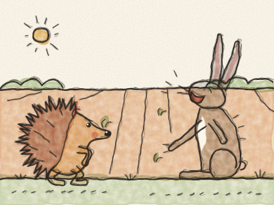
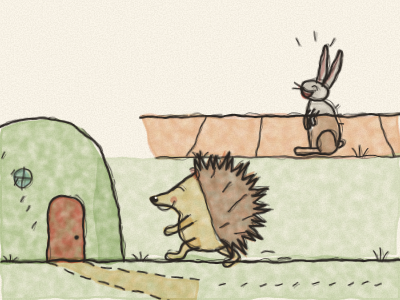
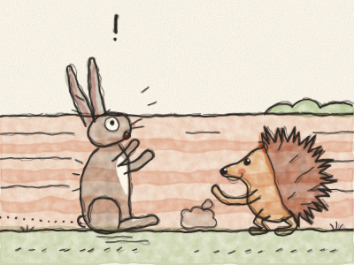
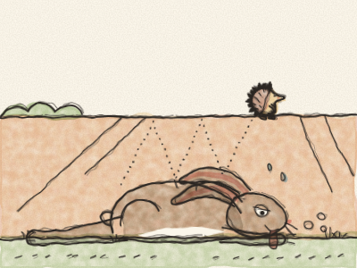
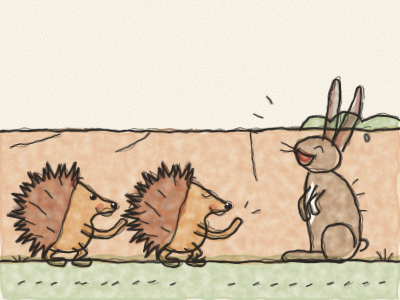

# Le Lièvre et le Hérisson

Il était une fois, par un beau dimanche matin, un petit Hérisson qui sortit voir les navets dans le grand champ à côté de sa maison. Le champ était labouré en longues lignes bien droites, qu’on appelle des sillons.

Là, il rencontra Lièvre, qui était grand, rapide, et très, très fier de lui.

« Bonjour, Lièvre », dit poliment Hérisson.

Lièvre le regarda de haut, par-dessus son long nez. « Tiens, tiens, voilà Piquant ! Tu te promènes sur tes petites pattes courtes et tordues ? Ha ha ! Tu auras de la chance si tu arrives au bout du champ avant l’heure du coucher ! »

Il faut dire que Hérisson avait les pattes courtes et tordues. Il était fait comme ça. Mais il n’aimait pas du tout qu’on se moque de lui. Mais alors pas du tout.

« J’ai peut-être les pattes courtes, dit-il, mais je parie que je peux te battre à la course. »

« TOI ? Me battre, MOI ? » Lièvre rit si fort que ses oreilles battaient. *Ha ha ha !* « D’accord, Piquant. Quand tu veux ! »

« D’abord, je rentre prendre mon petit déjeuner, dit Hérisson. Rendez-vous ici dans une demi-heure. » Et il partit en trottinant. *Trotte, trotte, trotte.*

À la maison, Hérisson chuchota un secret à l’oreille de Madame Hérisson. *Psst, psst, psst.* Madame Hérisson pouffa de rire. Puis elle s’en alla sur la pointe des pattes par un petit chemin derrière la haie, et personne ne vit où elle allait.

De retour au champ, Hérisson dit : « Toi, tu cours dans ce sillon-là, et moi, je cours dans celui-ci, jusqu’au bout du champ. »

« À vos marques… » dit Lièvre. « Prêts… PARTEZ ! »

*Zoum !* Lièvre fila comme le vent. *Fiou ! Fiou ! Fiou !* Hérisson fit trois petits pas… puis il se blottit au fond de son sillon, immobile comme une pierre, et sourit.

Lièvre arriva au bout du champ, tout essoufflé. Et là, dans le sillon d’à côté, un petit hérisson sortit sa tête pleine de piquants.

« Je suis déjà là ! »

Les oreilles de Lièvre se dressèrent d’un coup. « Quoi ? Comment ? C’est impossible ! » *(Faites une pause, et laissez Constance deviner comment Hérisson a fait.)*

« Encore ! » cria Lièvre. « On remonte le champ ! À vos marques, prêts, PARTEZ ! » *Zoum ! Fiou !* Il courut jusqu’en haut. Et là, dans le sillon d’à côté, un petit hérisson sortit sa tête pleine de piquants.

« Je suis déjà là ! »

Lièvre descendit en courant. « Je suis déjà là ! » Lièvre remonta en courant. « Je suis déjà là ! » En bas, en haut, en bas, en haut, de plus en plus vite… et à chaque fois : « Je suis déjà là ! »

À la fin, les pattes de Lièvre se mirent à trembler. Ses oreilles devinrent toutes molles. Sa langue pendait. Il s’effondra dans l’herbe douce, au milieu du champ. *Flop !* « Je ne peux… plus… courir », souffla-t-il.

Alors deux petits hérissons s’approchèrent de lui, côte à côte, en se tenant par la patte. Ils avaient les mêmes piquants, le même petit nez pointu et les mêmes pattes courtes et tordues.

« Bonjour, Lièvre, dit Hérisson. Je te présente Madame Hérisson. »

« Coucou ! » dit Madame Hérisson avec un clin d’œil. « Moi, j’attendais en bas du champ, et mon mari attendait en haut. »

Lièvre les regarda, bouche bée. Puis il se mit à rire : un grand rire fatigué et gentil. « Vous êtes deux ! Vous m’avez bien eu ! Oh, les malins, les petits malins de hérissons ! »

« Et maintenant, que dis-tu de mes pattes courtes et tordues ? » demanda Hérisson.

« Je dis que ce sont de très belles pattes, répondit Lièvre, et que je ne me moquerai plus jamais des pattes de personne. »

Et il ne le fit plus jamais. À partir de ce jour-là, chaque fois que Lièvre croisait Hérisson dans le champ, il s’inclinait et disait : « Bonjour, mon ami si malin. » Puis Monsieur et Madame Hérisson rentrèrent ensemble à la maison pour un deuxième petit déjeuner. *Miam, miam, miam.*

> Ne te moque jamais de quelqu’un pour son allure. Une tête maligne vaut mieux que des pattes rapides !
