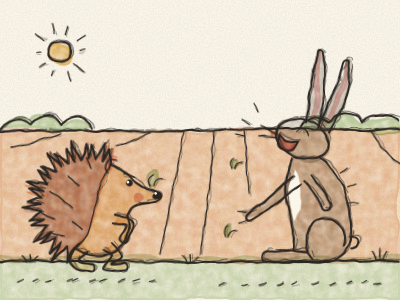
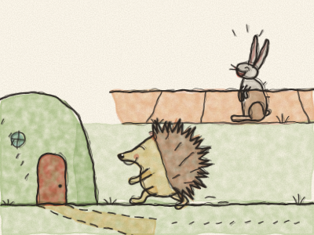
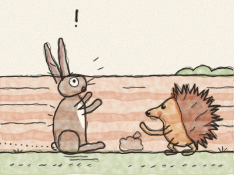
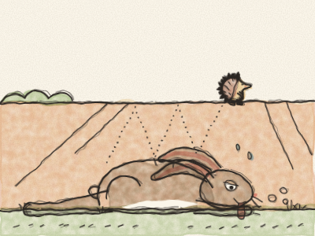
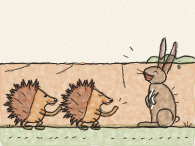

# A Lebre e o Ouriço

Era uma vez, numa linda manhã de domingo, um pequeno Ouriço que saiu para ver os nabos no grande campo ao lado da sua casa. O campo estava lavrado em linhas compridas e muito direitas, chamadas sulcos.

Ali encontrou a Lebre, que era alta e rápida, e muito, muito vaidosa.

— Bom dia, Lebre — disse o Ouriço, com educação.

A Lebre olhou para ele de cima do seu nariz comprido. — Ora, ora, o Picos! Vais passear nessas perninhas curtas e tortas? Ah ah! Tens sorte se chegares ao fim do campo antes da hora de dormir!

É verdade que o Ouriço tinha as pernas curtas e tortas. Era assim que ele era. Mas não gostava nada que fizessem troça dele. Mas mesmo nada.

— Posso ter as pernas curtas — disse ele —, mas aposto que te ganho numa corrida.

— TU? Ganhares-ME a MIM? — A Lebre riu-se tanto que as orelhas abanavam. *Ah ah ah!* — Está bem, Picos. Quando quiseres!

— Primeiro vou a casa tomar o pequeno-almoço — disse o Ouriço. — Encontramo-nos aqui daqui a meia hora. — E lá foi ele, a trotar. *Trote, trote, trote.*

Em casa, o Ouriço segredou uma coisa ao ouvido da Senhora Ouriço. *Psst, psst, psst.* A Senhora Ouriço riu-se baixinho. Depois saiu em bicos de pés por um caminho estreito atrás da sebe, e ninguém viu para onde ela foi.

De volta ao campo, o Ouriço disse: — Tu corres por aquele sulco, e eu corro por este, até ao fundo do campo.

— Aos vossos lugares… — disse a Lebre. — Preparados… JÁ!

*Zum!* A Lebre disparou como o vento. *Fiu! Fiu! Fiu!* O Ouriço deu três passinhos… e depois agachou-se no seu sulco, quieto como uma pedra, e sorriu.

A Lebre chegou ao fundo do campo, a arfar. E ali, no sulco ao lado, um pequeno ouriço espreitou com a sua cabeça cheia de picos.

— Eu já cá estou!

As orelhas da Lebre puseram-se logo em pé. — O quê? Como? É impossível! *(Faça uma pausa e deixe a Constance adivinhar como é que o Ouriço fez.)*

— Outra vez! — gritou a Lebre. — Para cima do campo! Aos vossos lugares, preparados, JÁ! — *Zum! Fiu!* Correu até lá acima. E ali, no sulco ao lado, um pequeno ouriço espreitou com a sua cabeça cheia de picos.

— Eu já cá estou!

A Lebre correu para baixo. — Eu já cá estou! — A Lebre correu para cima. — Eu já cá estou! — Para baixo, para cima, para baixo, para cima, cada vez mais depressa… e de todas as vezes: — Eu já cá estou!

Por fim, as pernas da Lebre começaram a tremer. As orelhas ficaram todas moles. A língua ficou de fora. Caiu na erva macia, no meio do campo. *Pumba!* — Já não… consigo… correr mais — arfou ela.

Então dois pequenos ouriços aproximaram-se dela, lado a lado, de mão dada. Tinham os mesmos picos, o mesmo narizinho bicudo e as mesmas pernas curtas e tortas.

— Bom dia, Lebre — disse o Ouriço. — Apresento-te a Senhora Ouriço.

— Olá! — disse a Senhora Ouriço, piscando o olho. — Eu esperei no fundo do campo, e o meu marido esperou lá em cima.

A Lebre ficou a olhar para eles de boca aberta. Depois começou a rir-se: uma grande gargalhada, cansada e simpática. — São dois! Enganaram-me! Ai, que ouriços tão espertos, tão espertos!

— E agora, o que dizes das minhas pernas curtas e tortas? — perguntou o Ouriço.

— Digo que são umas pernas muito bonitas — respondeu a Lebre — e que nunca mais vou fazer troça das pernas de ninguém.

E nunca mais fez. A partir desse dia, sempre que a Lebre encontrava o Ouriço no campo, fazia uma vénia e dizia: — Bom dia, meu amigo esperto. — Depois, o Senhor e a Senhora Ouriço voltaram juntos para casa, para um segundo pequeno-almoço. *Nham, nham, nham.*

> Nunca te rias de alguém pela sua aparência. Mais vale uma cabeça esperta do que pernas rápidas!
