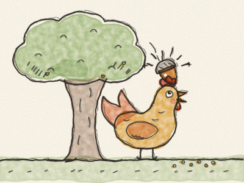
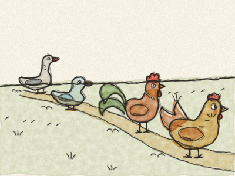
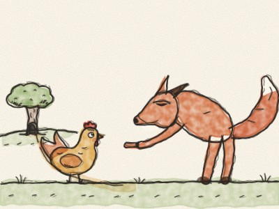
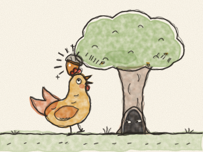
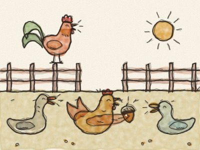

# Henny Penny

Once upon a time, there was a little hen called Henny Penny. One morning, she was pecking for corn under a big oak tree. *Peck, peck, peck.*

Suddenly — *BONK!* — something fell on her head.

“Goodness gracious me!” cried Henny Penny. “The sky is falling! The sky is falling! I must go and tell the King!”

So off she went, as fast as her little legs could carry her. *Scurry, scurry, scurry.*

She had not gone far when she met Cocky Locky the cockerel. “Where are you going, Henny Penny?” asked Cocky Locky.

“Oh, Cocky Locky, the sky is falling, and I am going to tell the King!”

“May I come with you?” said Cocky Locky.

“Certainly!” said Henny Penny.

So Henny Penny and Cocky Locky went along, and along, and along, until they met Ducky Lucky the duck. *Quack, quack!*

“Where are you going, Henny Penny and Cocky Locky?”

“Oh, Ducky Lucky, the sky is falling, and we are going to tell the King!”

“May I come with you?” said Ducky Lucky. “Certainly!”

So they went along, and along, and along, until they met Goosey Loosey the goose. *Honk, honk!* And Goosey Loosey came too. And then they met Turkey Lurkey the turkey. *Gobble, gobble!* And Turkey Lurkey came too.

*(Ask Constance: can you remember all their names?)*

Henny Penny, Cocky Locky, Ducky Lucky, Goosey Loosey and Turkey Lurkey went along, and along, and along, until they met… Foxy Loxy.

Foxy Loxy bowed very low. “Good morning, my fine feathered friends,” he said, in a smooth, sweet voice. “And where are you all going, in such a hurry?”

“Oh, Foxy Loxy, the sky is falling, and we are going to tell the King!”

“But you are going the wrong way!” said Foxy Loxy, with a sly smile. “I know a short cut to the King’s palace. Follow me!”

“Oh, thank you, Foxy Loxy!” they all said.

So Foxy Loxy led them through the wood, along a narrow little path, to a dark hole under a big tree. It was not the King’s palace at all. It was Foxy Loxy’s den!

“In you go, my dears,” said Foxy Loxy, licking his lips. “The King is waiting inside.”

Henny Penny was just about to go in, when — *BONK!* — something fell on her head again.

She looked down. It was a little brown acorn, with a little brown cap. Then she looked up. Above the den stood a big oak tree, full of acorns.

“Wait!” cried Henny Penny. “It isn’t the sky at all! It’s only an acorn! And this isn’t a palace. It’s a fox’s den!”

“RUN!” shouted Cocky Locky. “*Cock-a-doodle-doo!*”

And they all ran. *Scurry, flap, waddle, honk, gobble!* Out of the wood, along the path, and all the way home to the farmyard. Foxy Loxy was left all alone at his door, with nothing at all for his dinner.

When they had caught their breath, Henny Penny held up the little acorn. “Fancy that!” she said. “We ran all that way because of this!”

And all five friends laughed, and laughed, and laughed. And the sky? It stayed exactly where it was, high above them, blue and bright.

> Before you believe something, look carefully, and check that it is true.
