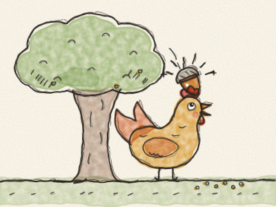
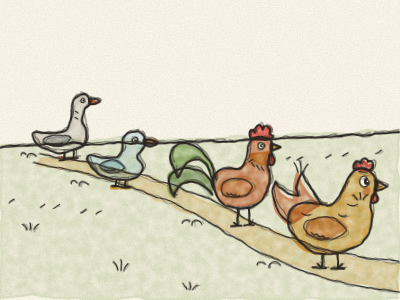
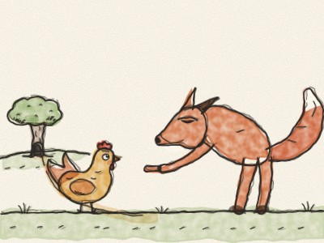
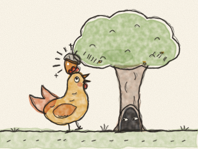
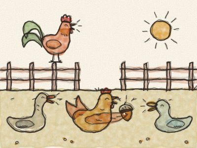

# Poule Poulette

Il était une fois une petite poule qui s’appelait Poule Poulette. Un matin, elle picorait du grain sous un grand chêne. *Pic, pic, pic.*

Tout à coup — *BOUM !* — quelque chose lui tomba sur la tête.

« Ciel de ciel ! s’écria Poule Poulette. Le ciel nous tombe sur la tête ! Le ciel nous tombe sur la tête ! Il faut que j’aille prévenir le Roi ! »

Et elle partit, aussi vite que ses petites pattes pouvaient la porter. *Trotte, trotte, trotte.*

Elle n’était pas allée bien loin quand elle rencontra Coq Coquet le coq. « Où vas-tu, Poule Poulette ? » demanda Coq Coquet.

« Oh, Coq Coquet, le ciel nous tombe sur la tête, et je vais prévenir le Roi ! »

« Je peux venir avec toi ? » demanda Coq Coquet.

« Bien sûr ! » dit Poule Poulette.

Alors Poule Poulette et Coq Coquet marchèrent, marchèrent, marchèrent, jusqu’à ce qu’ils rencontrent Cane Canette la cane. *Coin, coin !*

« Où allez-vous, Poule Poulette et Coq Coquet ? »

« Oh, Cane Canette, le ciel nous tombe sur la tête, et nous allons prévenir le Roi ! »

« Je peux venir avec vous ? » demanda Cane Canette. « Bien sûr ! »

Alors ils marchèrent, marchèrent, marchèrent, jusqu’à ce qu’ils rencontrent Oie Oisette l’oie. *Cacarda, cacarda !* Et Oie Oisette vint aussi. Puis ils rencontrèrent Dinde Dondon la dinde. *Glou, glou !* Et Dinde Dondon vint aussi.

*(Demandez à Constance : te souviens-tu de tous leurs noms ?)*

Poule Poulette, Coq Coquet, Cane Canette, Oie Oisette et Dinde Dondon marchèrent, marchèrent, marchèrent, jusqu’à ce qu’ils rencontrent… Renard Roublard.

Renard Roublard fit une grande révérence. « Bonjour, mes beaux amis à plumes, dit-il d’une voix douce et sucrée. Et où allez-vous donc, si pressés ? »

« Oh, Renard Roublard, le ciel nous tombe sur la tête, et nous allons prévenir le Roi ! »

« Mais vous allez du mauvais côté ! dit Renard Roublard avec un sourire rusé. Je connais un raccourci jusqu’au palais du Roi. Suivez-moi ! »

« Oh, merci, Renard Roublard ! » dirent-ils tous.

Alors Renard Roublard les mena à travers le bois, le long d’un petit sentier étroit, jusqu’à un trou sombre sous un grand arbre. Ce n’était pas du tout le palais du Roi. C’était le terrier de Renard Roublard !

« Entrez, mes chéris, dit Renard Roublard en se léchant les babines. Le Roi vous attend à l’intérieur. »

Poule Poulette allait entrer quand — *BOUM !* — quelque chose lui tomba encore sur la tête.

Elle regarda par terre. C’était un petit gland marron, avec son petit chapeau marron. Puis elle leva les yeux. Au-dessus du terrier se dressait un grand chêne, plein de glands.

« Attendez ! s’écria Poule Poulette. Ce n’est pas du tout le ciel ! Ce n’est qu’un gland ! Et ceci n’est pas un palais. C’est le terrier d’un renard ! »

« SAUVONS-NOUS ! cria Coq Coquet. *Cocorico !* »

Et ils se sauvèrent tous. *Trotte, flap, dandine, cacarde, glougloute !* Hors du bois, le long du sentier, et jusqu’à la cour de la ferme. Renard Roublard resta tout seul devant sa porte, sans rien du tout pour son dîner.

Quand ils eurent repris leur souffle, Poule Poulette montra le petit gland. « Ça alors ! dit-elle. Nous avons couru tout ce chemin à cause de ça ! »

Et les cinq amis rirent, rirent, rirent. Et le ciel ? Il resta exactement là où il était, tout là-haut, bleu et lumineux.

> Avant de croire quelque chose, regarde bien, et vérifie que c’est vrai.
