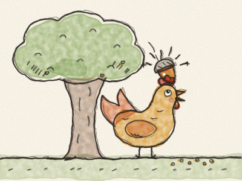
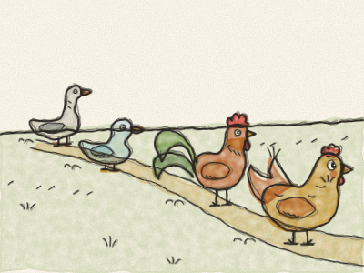
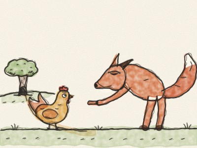
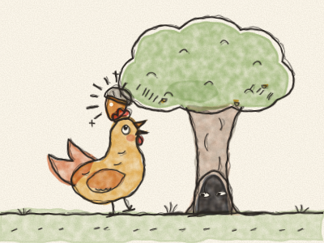
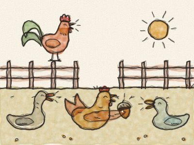

# A Galinha Mariquinha

Era uma vez uma galinha pequenina chamada Galinha Mariquinha. Uma manhã, estava a debicar milho debaixo de um grande carvalho. *Pic, pic, pic.*

De repente — *PUMBA!* — uma coisa caiu-lhe na cabeça.

— Ai, minha nossa! — gritou a Galinha Mariquinha. — O céu está a cair! O céu está a cair! Tenho de ir contar ao Rei!

E lá foi ela, tão depressa quanto as suas perninhas conseguiam. *Corre, corre, corre.*

Não tinha ido muito longe quando encontrou o Galo Gonçalo. — Aonde vais, Galinha Mariquinha? — perguntou o Galo Gonçalo.

— Ai, Galo Gonçalo, o céu está a cair, e eu vou contar ao Rei!

— Posso ir contigo? — perguntou o Galo Gonçalo.

— Claro que sim! — disse a Galinha Mariquinha.

Então a Galinha Mariquinha e o Galo Gonçalo andaram, andaram, andaram, até que encontraram a Pata Renata. *Quá, quá!*

— Aonde vão, Galinha Mariquinha e Galo Gonçalo?

— Ai, Pata Renata, o céu está a cair, e vamos contar ao Rei!

— Posso ir convosco? — perguntou a Pata Renata. — Claro que sim!

Então andaram, andaram, andaram, até que encontraram a Gansa Mansa. *Grasna, grasna!* E a Gansa Mansa foi também. Depois encontraram o Peru Lulu. *Glu, glu!* E o Peru Lulu foi também.

*(Pergunte à Constance: lembras-te dos nomes todos?)*

A Galinha Mariquinha, o Galo Gonçalo, a Pata Renata, a Gansa Mansa e o Peru Lulu andaram, andaram, andaram, até que encontraram… a Raposa Manhosa.

A Raposa Manhosa fez uma grande vénia. — Bom dia, meus belos amigos de penas — disse ela, com uma voz doce como mel. — E aonde vão todos com tanta pressa?

— Ai, Raposa Manhosa, o céu está a cair, e vamos contar ao Rei!

— Mas estão a ir pelo lado errado! — disse a Raposa Manhosa, com um sorriso matreiro. — Eu conheço um atalho até ao palácio do Rei. Sigam-me!

— Ai, obrigado, Raposa Manhosa! — disseram todos.

Então a Raposa Manhosa levou-os pelo bosque, por um carreirinho estreito, até um buraco escuro debaixo de uma grande árvore. Não era o palácio do Rei. Era a toca da Raposa Manhosa!

— Entrem, meus queridos — disse a Raposa Manhosa, a lamber os beiços. — O Rei está à vossa espera lá dentro.

A Galinha Mariquinha estava quase a entrar quando — *PUMBA!* — uma coisa lhe caiu outra vez na cabeça.

Olhou para o chão. Era uma bolotinha castanha, com o seu chapeuzinho castanho. Depois olhou para cima. Por cima da toca havia um grande carvalho, cheio de bolotas.

— Esperem! — gritou a Galinha Mariquinha. — Afinal não é o céu! É só uma bolota! E isto não é um palácio. É a toca de uma raposa!

— FUJAM! — gritou o Galo Gonçalo. — *Cocorocó!*

E fugiram todos. *Corre, bate asas, bamboleia, grasna, glu-glu!* Para fora do bosque, pelo carreiro, e até ao pátio da quinta. A Raposa Manhosa ficou sozinha à porta, sem nada para o jantar.

Quando recuperaram o fôlego, a Galinha Mariquinha mostrou a bolotinha. — Vejam só! — disse ela. — Corremos este caminho todo por causa disto!

E os cinco amigos riram, riram, riram. E o céu? Ficou exatamente onde estava, lá no alto, azul e luminoso.

> Antes de acreditares numa coisa, olha bem e confirma se é verdade.
