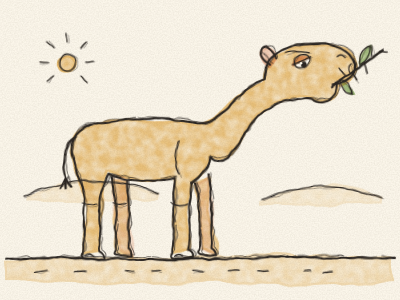
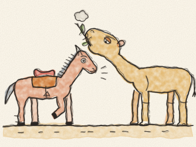
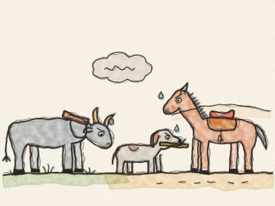
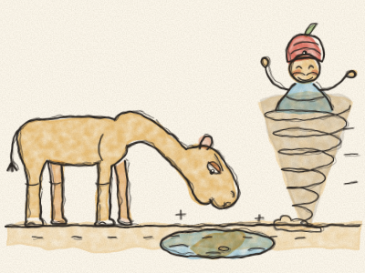
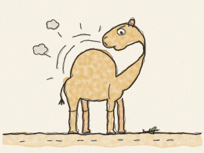

# How the Camel Got His Hump

A long, long time ago, when the world was brand new, the animals were just beginning to work for people. But in the middle of a Howling Desert lived a Camel who did not want to work at all. Not one bit. He ate sticks and thorns and prickles, and he was most dreadfully lazy. Whenever anybody spoke to him, he said just one word: “Humph!” Just “Humph!” and nothing more.

On Monday morning, the Horse came trotting up, with a saddle on his back. “Camel, oh Camel,” said the Horse, “come out and trot like the rest of us.”

“Humph!” said the Camel. And the Horse went away and told the Man.

Then the Dog came, with a stick in his mouth. “Camel, oh Camel,” said the Dog, “come and fetch and carry like the rest of us.”

“Humph!” said the Camel. And the Dog went away and told the Man.

Then the Ox came, with the yoke on his neck. “Camel, oh Camel,” said the Ox, “come and pull the plough like the rest of us.”

“Humph!” said the Camel. And the Ox went away and told the Man.

At the end of the day, the Man called the Horse and the Dog and the Ox together. “Three, oh Three,” he said, “I’m very sorry, but the Camel will not work. So you must work double, to make up for him.”

Well! The Three were very cross indeed. They met at the edge of the desert and grumbled. *Grumble, grumble, grumble.* Along came the Camel, chewing a twig, and he laughed at them. “Humph!” he said, and off he went again.

Just then, a great whirl of dust came spinning across the sand. *Whoooosh!* It was the Djinn in charge of All Deserts, a magic spirit who travels on the wind.

“Djinn of All Deserts,” said the Horse, “is it right for anyone to be lazy, when the world is so new and there is so much to do?”

“Certainly not,” said the Djinn.

“Well,” said the Horse, “there’s a creature in the middle of your Howling Desert, with a long neck and long legs, and he won’t do a stroke of work. He just says Humph!”

“Whew!” whistled the Djinn. “That’s my Camel. Leave him to me.”

The Djinn found the Camel looking at his own reflection in a pool of water, very pleased with himself.

“My long and bubbling friend,” said the Djinn, “what’s this I hear about you doing no work?”

“Humph!” said the Camel.

The Djinn sat down, with his chin in his hand, and began to think a Great Magic. “Because of you, the Three have been working double since Monday morning,” he said. “I shouldn’t say Humph again, if I were you. You might say it once too often.”

But the Camel said it again: “Humph!”

And at once, his back began to puff up, and puff up, and puff up… *Pouf!* Into a great big lolloping humph!

“Do you see that?” said the Djinn. “That is your very own humph, which you brought upon your very own self by not working. But don’t worry, it is a useful humph. You can live on it for three whole days without eating. So now, off you go, and work with the Three.”

So the Camel went to join the Horse, the Dog and the Ox, and he worked hard, and the work was lighter for everyone. They were all much happier. And to this very day, the Camel still wears his humph. We call it a “hump” now, so as not to hurt his feelings.

> When everybody helps, the work is lighter for all.
