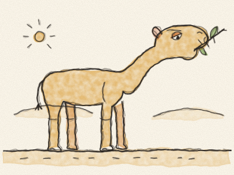
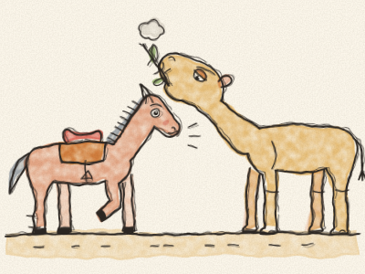
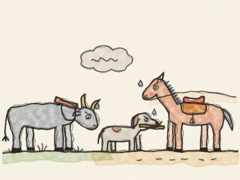
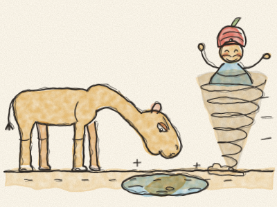
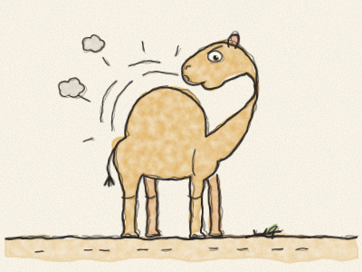

# Comment le Chameau eut sa Bosse

Il y a très, très longtemps, quand le monde était tout neuf, les animaux commençaient tout juste à travailler pour les hommes. Mais au milieu d’un Désert Hurlant vivait un Chameau qui ne voulait pas travailler du tout. Pas même un tout petit peu. Il mangeait des bâtons, des épines et des piquants, et il était terriblement paresseux. Chaque fois qu’on lui parlait, il ne disait qu’un seul mot : « Hmpf ! » Juste « Hmpf ! », et rien de plus.

Le lundi matin, le Cheval arriva au trot, une selle sur le dos. « Chameau, ô Chameau, » dit le Cheval, « viens trotter avec nous autres. »

« Hmpf ! » dit le Chameau. Et le Cheval s’en alla le dire à l’Homme.

Puis le Chien arriva, un bâton dans la gueule. « Chameau, ô Chameau, » dit le Chien, « viens chercher et porter des choses avec nous autres. »

« Hmpf ! » dit le Chameau. Et le Chien s’en alla le dire à l’Homme.

Puis le Bœuf arriva, le joug sur le cou. « Chameau, ô Chameau, » dit le Bœuf, « viens tirer la charrue avec nous autres. »

« Hmpf ! » dit le Chameau. Et le Bœuf s’en alla le dire à l’Homme.

À la fin de la journée, l’Homme appela le Cheval, le Chien et le Bœuf. « Les Trois, ô les Trois, » dit-il, « je suis bien désolé, mais le Chameau ne veut pas travailler. Alors il faudra que vous travailliez deux fois plus, à sa place. »

Oh là là ! Les Trois étaient très, très fâchés. Ils se réunirent au bord du désert et ils ronchonnèrent. *Ronchon, ronchon, ronchon.* Le Chameau passa par là en mâchonnant une brindille, et il se moqua d’eux. « Hmpf ! » dit-il, et il repartit.

Juste à ce moment, un grand tourbillon de poussière arriva en tournoyant sur le sable. *Fouuuuuh !* C’était le Djinn de Tous les Déserts, un esprit magique qui voyage sur le vent.

« Djinn de Tous les Déserts, » dit le Cheval, « est-ce bien d’être paresseux, quand le monde est si neuf et qu’il y a tant à faire ? »

« Certainement pas, » dit le Djinn.

« Eh bien, » dit le Cheval, « il y a au milieu de ton Désert Hurlant une bête au long cou et aux longues jambes, qui ne fait rien de rien. Elle dit juste Hmpf ! »

« Fiou ! » siffla le Djinn. « C’est mon Chameau. Laissez-moi faire. »

Le Djinn trouva le Chameau en train de regarder son reflet dans une mare, très content de lui.

« Mon long ami qui gargouille, » dit le Djinn, « qu’est-ce que j’entends ? Tu ne fais rien de la journée ? »

« Hmpf ! » dit le Chameau.

Le Djinn s’assit, le menton dans la main, et se mit à penser une Grande Magie. « À cause de toi, les Trois travaillent deux fois plus depuis lundi matin, » dit-il. « À ta place, je ne dirais plus Hmpf. Tu pourrais le dire une fois de trop. »

Mais le Chameau le redit : « Hmpf ! »

Et aussitôt, son dos se mit à gonfler, et gonfler, et gonfler… *Pouf !* Jusqu’à devenir une énorme bosse toute ballottante !

« Tu vois ça ? » dit le Djinn. « C’est ta bosse à toi, que tu t’es faite tout seul en ne travaillant pas. Mais ne t’inquiète pas, c’est une bosse bien utile. Grâce à elle, tu peux rester trois jours entiers sans manger. Alors maintenant, file, et va travailler avec les Trois. »

Alors le Chameau alla rejoindre le Cheval, le Chien et le Bœuf, et il travailla bien, et le travail fut plus léger pour tout le monde. Ils étaient tous bien plus heureux. Et aujourd’hui encore, le Chameau porte toujours sa bosse. Mais il ne dit presque plus jamais « Hmpf ! ».

> Quand tout le monde aide, le travail est plus léger pour chacun.
