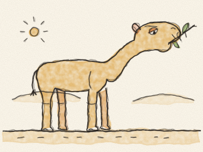
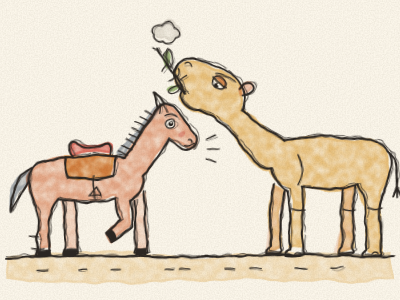
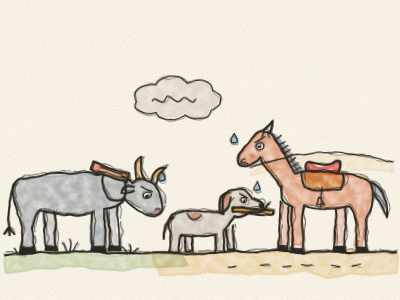
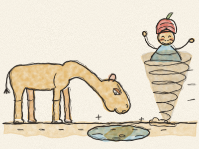
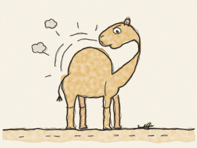

# Como o Camelo Ganhou a Bossa

Há muito, muito tempo, quando o mundo era novinho em folha, os animais estavam a começar a trabalhar para as pessoas. Mas no meio de um Deserto Uivante vivia um Camelo que não queria trabalhar nada. Nem um bocadinho. Comia paus, espinhos e picos, e era terrivelmente preguiçoso. Sempre que alguém lhe falava, ele dizia só uma palavra: — Humpf! — Só «Humpf!» e mais nada.

Na segunda-feira de manhã, chegou o Cavalo a trote, com uma sela no lombo. — Camelo, ó Camelo — disse o Cavalo —, anda trotar como nós todos.

— Humpf! — disse o Camelo. E o Cavalo foi-se embora e contou ao Homem.

Depois chegou o Cão, com um pau na boca. — Camelo, ó Camelo — disse o Cão —, anda buscar e carregar coisas como nós todos.

— Humpf! — disse o Camelo. E o Cão foi-se embora e contou ao Homem.

Depois chegou o Boi, com a canga ao pescoço. — Camelo, ó Camelo — disse o Boi —, anda puxar o arado como nós todos.

— Humpf! — disse o Camelo. E o Boi foi-se embora e contou ao Homem.

Ao fim do dia, o Homem chamou o Cavalo, o Cão e o Boi. — Ó Três — disse ele —, tenho muita pena, mas o Camelo não quer trabalhar. Por isso, vão ter de trabalhar a dobrar, no lugar dele.

Ora bem! Os Três ficaram mesmo muito zangados. Juntaram-se à beira do deserto e resmungaram. *Resmungo, resmungo, resmungo.* O Camelo passou por ali, a mastigar um raminho, e riu-se deles. — Humpf! — disse ele, e foi-se embora outra vez.

Nesse instante, um grande remoinho de pó veio a rodopiar pela areia. *Fuuuuuuu!* Era o Génio de Todos os Desertos, um espírito mágico que viaja no vento.

— Génio de Todos os Desertos — disse o Cavalo —, achas bem alguém ser preguiçoso, quando o mundo é tão novo e há tanto para fazer?

— Claro que não — disse o Génio.

— Pois — disse o Cavalo —, há no meio do teu Deserto Uivante um bicho de pescoço comprido e pernas compridas, que não faz nada de nada. Só diz Humpf!

— Fiu! — assobiou o Génio. — É o meu Camelo. Deixem isso comigo.

O Génio encontrou o Camelo a olhar para o seu reflexo numa poça de água, todo vaidoso.

— Meu amigo comprido e gorgolejante — disse o Génio —, que história é essa de não fazeres nada?

— Humpf! — disse o Camelo.

O Génio sentou-se, com o queixo na mão, e começou a pensar numa Grande Magia. — Por tua causa, os Três andam a trabalhar a dobrar desde segunda-feira de manhã — disse ele. — Se fosse a ti, não dizia Humpf outra vez. Podes dizê-lo uma vez a mais.

Mas o Camelo disse outra vez: — Humpf!

E logo as costas dele começaram a inchar, e a inchar, e a inchar… *Puf!* Até ficarem com uma bossa enorme e abanona!

— Estás a ver isto? — disse o Génio. — É a tua bossa, só tua, que arranjaste sozinho por não trabalhares. Mas não te preocupes, é uma bossa muito útil. Com ela, podes passar três dias inteiros sem comer. Por isso, agora, vai lá trabalhar com os Três.

E o Camelo foi juntar-se ao Cavalo, ao Cão e ao Boi, e trabalhou muito, e o trabalho ficou mais leve para todos. Ficaram todos muito mais felizes. E ainda hoje o Camelo anda com a sua bossa. Mas quase nunca mais diz «Humpf!».

> Quando todos ajudam, o trabalho fica mais leve para cada um.
