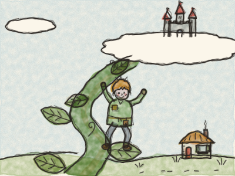
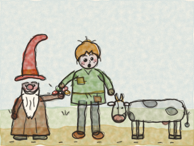
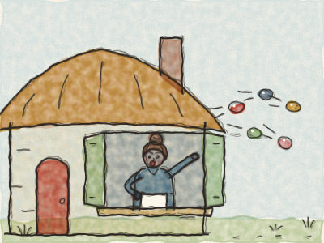
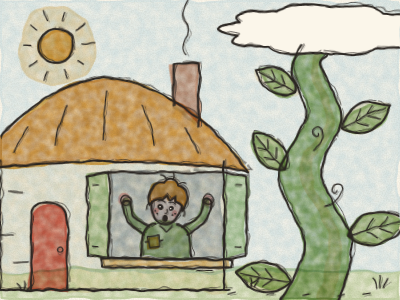
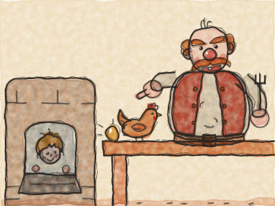
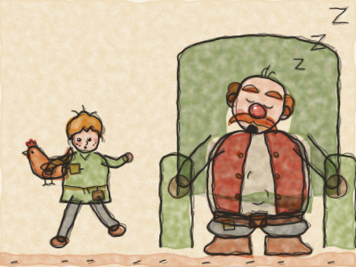
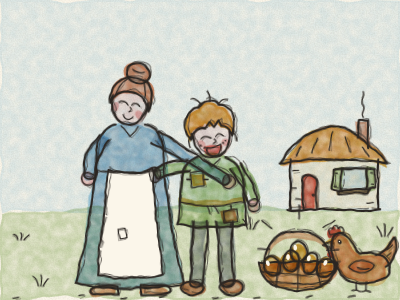
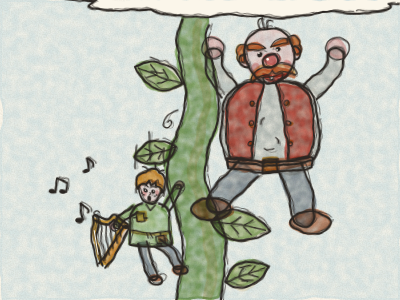

# Jack and the Beanstalk

Once upon a time, there was a boy called Jack who lived with his mother in a little cottage. They were very poor. All they had in the world was one old cow, called Milky-White.

One morning, Milky-White gave no milk. Not one drop. *Moooo,* she said sadly.

“Oh dear,” said Jack’s mother. “There is no milk, and no bread, and no money left in the jar. Jack, you must take Milky-White to market and sell her. And mind you get a good price!”

So Jack tied a rope round Milky-White’s neck, and off they went down the road together, *clip-clop, clip-clop*.

They had not gone far when they met a funny little old man with a long white beard and a tall, crooked hat.

“Good morning, Jack,” said the little man. “Where are you off to with that fine cow?”

“To market, to sell her,” said Jack.

The little man opened his hand. In it were five beans. But they were not ordinary beans. They shone like jewels: red, and purple, and speckled gold. “These are magic beans,” he whispered. “Plant them tonight, and by morning they will grow right up to the sky. All five are yours, for your cow.”

Jack’s eyes grew big and round. Magic beans! “It’s a deal!” he said. He gave the little man the rope, put the beans in his pocket, and ran all the way home.

“Back already?” said his mother. “How much did you get for Milky-White?”

“Something much better than money!” said Jack, and he opened his hand. “Five magic beans!”

“BEANS?” cried his mother. “You sold our only cow for a handful of BEANS? Oh, Jack, Jack, Jack!” She was so cross that she threw the beans out of the window — *whizz!* — and sent Jack up to bed without any supper.

Poor Jack. He lay in bed, his tummy rumbled, *grrr-rumble-rumble*, and he felt very silly indeed. At last he fell asleep.

When Jack woke up the next morning, his room was all green and shady. He ran to the window and — oh my! — the beans had grown in the night. There in the garden stood an enormous beanstalk. It was as thick as a tree, with leaves as big as umbrellas, and it went up, and up, and up, right into the clouds.

“The little man was right!” said Jack. “I wonder what is at the top?”

So he climbed out of the window onto the beanstalk, and he began to climb. He climbed and he climbed and he climbed. *(Climb with your hands: up, up, up!)* The cottage grew smaller and smaller below him, until it looked like a tiny toy.

At last Jack reached the very top. He stepped off the beanstalk onto a soft white cloud. In front of him was a long road, and at the end of the road stood a castle. It was the biggest castle he had ever seen. Its door was as tall as a house!

Jack knocked. *BOOM, BOOM, BOOM!* The door creaked open, and there stood a lady. A very, very big lady. She was a giant!

“Goodness me, a little boy!” she said. “You must go away at once. My husband is a Giant, and he is very grumpy before his breakfast.”

“Please,” said Jack, “I’m so hungry.” The Giant’s wife was kind. She gave him a slice of bread as big as a pillow and a cup of milk as big as a bucket.

But Jack had only taken two bites when — *THUMP! THUMP! THUMP!* — the whole castle began to shake. “Quick! He’s coming!” said the Giant’s wife, and she hid Jack in the big cold oven.

In stomped the Giant. He sniffed the air. *Sniff, sniff, SNIFF!* “FEE-FI-FO-FUM! I smell somebody small! Who is in my house?”

“Nonsense, dear,” said his wife. “That’s just the sausages. Sit down and eat your breakfast.”

So the Giant ate forty sausages and twelve loaves of bread. Then he said, “Wife! Bring me my hen!” His wife brought a little brown hen and put her on the table. “LAY!” roared the Giant. And the hen laid an egg — an egg of pure, shining gold. *Plink!*

Jack watched from the oven with his mouth wide open. The Giant yawned. His head nodded. Soon he was snoring so loudly that the plates rattled: *HRRRONK… pfffff… HRRRONK… pfffff…*

“Psst, Jack,” whispered the Giant’s wife. “That hen does not belong to us, and neither does the golden harp up on the shelf. My husband took them long ago from the people down in the valley, and he never, ever gives anything back. Take the hen home, where she belongs.”

So Jack tiptoed out of the oven, tucked the little hen under his arm, and ran. He ran along the road, he climbed down the beanstalk, and he jumped into the garden. “Mother! Look!” he cried. “Lay, please,” he said politely to the hen. And she laid a golden egg. *Plink!*

Jack’s mother hugged him tight. “Oh, Jack, I’m sorry I was cross.” With the golden eggs they bought bread and milk and a new cow, and they shared with all their hungry neighbours too.

But Jack could not stop thinking about the castle in the clouds, and about the golden harp that the Giant had taken. A harp that could sing all by itself!

So one morning, Jack climbed up the beanstalk again. He crept into the castle and hid behind the bread bin. There was the Giant, snoring in his chair. And beside him on the table stood the little golden harp, singing a soft, sad song.

Jack tiptoed to the table and picked up the harp. But the harp was so happy to be going home that it began to play a loud, merry tune: *Tring-a-ling-a-ling! Tring-a-ling!*

The Giant woke up with a start. “WHO’S THERE?” he roared. He saw Jack running off with the harp. “COME BACK HERE!”

Jack ran as fast as he could, and the Giant ran after him, *THUMP! THUMP! THUMP!* Jack slid down the beanstalk, *whoosh!* The Giant climbed down after him, and the whole beanstalk shook and swayed.

“Mother!” shouted Jack. “Quick! Bring me the axe!”

Jack jumped down into the garden, took the axe, and chopped. *Chop! Chop! CHOP!* The beanstalk began to wobble. It wobbled and wiggled and creaked.

When the Giant felt it wobble, he got such a fright that he scrambled back up into the clouds as fast as he could go. And just in time! With a great *CRRRAAACK!*, the beanstalk fell down — *CRASH!* — right across the garden.

The Giant never came down again. And Jack and his mother lived happily ever after, with the hen who laid golden eggs and the harp who sang them to sleep every night.

And sometimes, when you hear thunder rumbling up in the clouds, it is only the Giant, grumbling because he has lost his hen and his harp.

> Curious and brave little people can do very big things.
