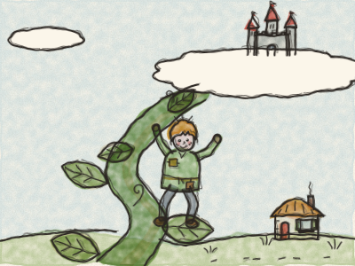
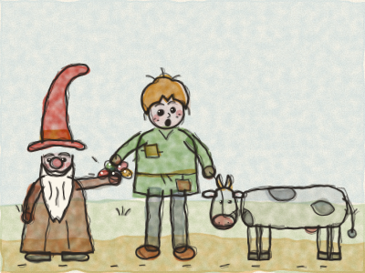
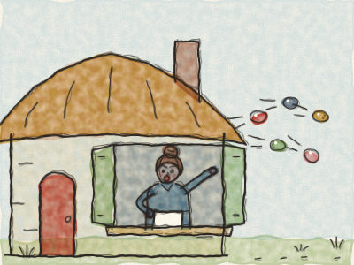
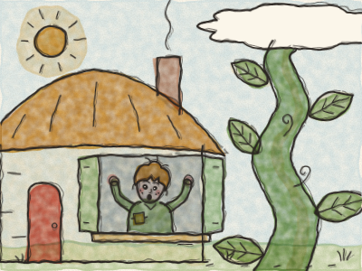
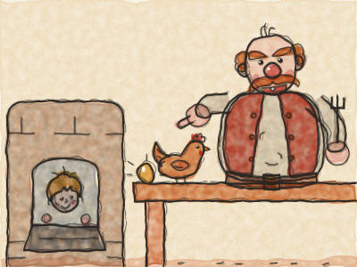
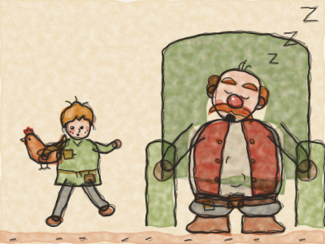
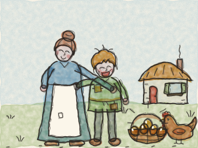
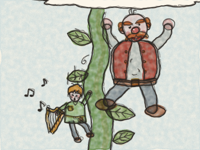

# Jack et le Haricot magique

Il était une fois un garçon qui s’appelait Jack et qui vivait avec sa maman dans une petite maison. Ils étaient très pauvres. Tout ce qu’ils avaient au monde, c’était une vieille vache, qui s’appelait Blanche-Lait.

Un matin, Blanche-Lait ne donna pas de lait. Pas une goutte. *Meuuuh*, fit-elle tristement.

« Oh là là », dit la maman de Jack. « Il n’y a plus de lait, plus de pain, et plus un sou dans le pot. Jack, tu dois emmener Blanche-Lait au marché et la vendre. Et tâche d’en tirer un bon prix ! »

Alors Jack attacha une corde au cou de Blanche-Lait, et ils partirent ensemble sur la route, *cloc, cloc, cloc, cloc*.

Ils n’étaient pas allés bien loin quand ils rencontrèrent un drôle de petit vieux avec une longue barbe blanche et un grand chapeau tout de travers.

« Bonjour, Jack », dit le petit homme. « Où vas-tu donc avec cette belle vache ? »

« Au marché, pour la vendre », répondit Jack.

Le petit homme ouvrit la main. Dedans, il y avait cinq haricots. Mais ce n’étaient pas des haricots ordinaires. Ils brillaient comme des bijoux : rouges, violets et tachetés d’or. « Ce sont des haricots magiques », chuchota-t-il. « Plante-les ce soir, et demain matin ils auront poussé jusqu’au ciel. Les cinq sont à toi, en échange de ta vache. »

Les yeux de Jack devinrent tout grands et tout ronds. Des haricots magiques ! « Marché conclu ! » dit-il. Il donna la corde au petit homme, mit les haricots dans sa poche et rentra chez lui en courant.

« Déjà rentré ? » dit sa maman. « Combien t’a-t-on donné pour Blanche-Lait ? »

« Quelque chose de bien mieux que de l’argent ! » dit Jack en ouvrant la main. « Cinq haricots magiques ! »

« Des HARICOTS ? » s’écria sa maman. « Tu as vendu notre seule vache pour une poignée de HARICOTS ? Oh, Jack, Jack, Jack ! » Elle était si fâchée qu’elle jeta les haricots par la fenêtre — *ziouuu !* — et envoya Jack au lit sans dîner.

Pauvre Jack. Couché dans son lit, il entendait son ventre gargouiller, *grrr-gloup-gloup*, et il se sentait vraiment bête. Enfin, il s’endormit.

Quand Jack se réveilla le lendemain matin, sa chambre était toute verte et pleine d’ombre. Il courut à la fenêtre et — oh là là ! — les haricots avaient poussé pendant la nuit. Là, dans le jardin, se dressait un haricot géant. Il était aussi gros qu’un arbre, avec des feuilles grandes comme des parapluies, et il montait, montait, montait, jusque dans les nuages.

« Le petit homme avait raison ! » dit Jack. « Qu’est-ce qu’il peut bien y avoir en haut ? »

Alors il passa par la fenêtre, attrapa le haricot et commença à grimper. Il grimpa, et grimpa, et grimpa encore. *(Grimpez avec les mains : en haut, en haut, en haut !)* En bas, la maison devenait de plus en plus petite, jusqu’à ressembler à un petit jouet.

Enfin, Jack arriva tout en haut. Il descendit du haricot et posa le pied sur un nuage blanc et moelleux. Devant lui, il y avait une longue route, et au bout de la route se dressait un château. C’était le plus grand château qu’il ait jamais vu. Sa porte était aussi haute qu’une maison !

Jack frappa. *BOUM, BOUM, BOUM !* La porte s’ouvrit en grinçant, et là se tenait une dame. Une très, très grande dame. C’était une géante !

« Ça alors, un petit garçon ! » dit-elle. « Va-t’en vite. Mon mari est un Géant, et il est très grognon avant son petit déjeuner. »

« S’il vous plaît », dit Jack, « j’ai tellement faim. » La femme du Géant était gentille. Elle lui donna une tartine grande comme un oreiller et une tasse de lait grande comme un seau.

Mais Jack n’avait pris que deux bouchées quand — *BOUM ! BOUM ! BOUM !* — tout le château se mit à trembler. « Vite ! Le voilà ! » dit la femme du Géant, et elle cacha Jack dans le grand four froid.

Le Géant entra à grands pas. Il renifla l’air. *Snif, snif, SNIF !* « FI-FA-FO-FUM ! Ça sent quelqu’un de tout petit ! Qui est dans ma maison ? »

« Mais non, mon chéri », dit sa femme. « Ce sont les saucisses. Assieds-toi et mange ton petit déjeuner. »

Alors le Géant mangea quarante saucisses et douze miches de pain. Puis il dit : « Femme ! Apporte-moi ma poule ! » Sa femme apporta une petite poule rousse et la posa sur la table. « PONDS ! » rugit le Géant. Et la poule pondit un œuf — un œuf d’or pur et brillant. *Plink !*

Jack regardait depuis le four, la bouche grande ouverte. Le Géant bâilla. Sa tête dodelina. Bientôt, il ronflait si fort que les assiettes tremblaient : *RRRONK… pfffff… RRRONK… pfffff…*

« Psst, Jack », chuchota la femme du Géant. « Cette poule n’est pas à nous, et la harpe d’or sur l’étagère non plus. Mon mari les a prises il y a longtemps aux gens de la vallée, et il ne rend jamais rien. Ramène la poule chez elle, là où elle doit être. »

Alors Jack sortit du four sur la pointe des pieds, mit la petite poule sous son bras, et courut. Il courut sur la route, il descendit le long du haricot et sauta dans le jardin. « Maman ! Regarde ! » cria-t-il. « Ponds, s’il te plaît », dit-il poliment à la poule. Et elle pondit un œuf d’or. *Plink !*

La maman de Jack le serra très fort. « Oh, Jack, pardon de m’être fâchée. » Avec les œufs d’or, ils achetèrent du pain, du lait et une nouvelle vache, et ils partagèrent aussi avec tous leurs voisins qui avaient faim.

Mais Jack n’arrêtait pas de penser au château dans les nuages, et à la harpe d’or que le Géant avait prise. Une harpe qui chantait toute seule !

Alors un matin, Jack grimpa de nouveau le long du haricot. Il se glissa dans le château et se cacha derrière la boîte à pain. Le Géant était là, endormi dans son fauteuil. Et à côté de lui, sur la table, il y avait la petite harpe d’or, qui chantait une chanson douce et triste.

Jack s’approcha sur la pointe des pieds et prit la harpe. Mais la harpe était si contente de rentrer chez elle qu’elle se mit à jouer un air joyeux, très fort : *Dring-a-ling-a-ling ! Dring-a-ling !*

Le Géant se réveilla en sursaut. « QUI EST LÀ ? » rugit-il. Il vit Jack s’enfuir avec la harpe. « REVIENS ICI ! »

Jack courut aussi vite qu’il put, et le Géant courut derrière lui, *BOUM ! BOUM ! BOUM !* Jack se laissa glisser le long du haricot, *zioup !* Le Géant descendit derrière lui, et tout le haricot tremblait et se balançait.

« Maman ! » cria Jack. « Vite ! Apporte-moi la hache ! »

Jack sauta dans le jardin, prit la hache et se mit à couper. *Tchac ! Tchac ! TCHAC !* Le haricot commença à vaciller. Il vacilla, il se tortilla, il craqua.

Quand le Géant le sentit vaciller, il eut si peur qu’il remonta dans les nuages aussi vite qu’il le put. Et juste à temps ! Avec un grand *CRRRAAAC !*, le haricot tomba — *BADABOUM !* — en travers du jardin.

Le Géant ne redescendit jamais. Et Jack et sa maman vécurent heureux pour toujours, avec la poule qui pondait des œufs d’or et la harpe qui les endormait en chantant tous les soirs.

Et parfois, quand on entend le tonnerre gronder là-haut dans les nuages, ce n’est que le Géant qui ronchonne, parce qu’il a perdu sa poule et sa harpe.

> Les petits curieux courageux peuvent faire de très grandes choses.
