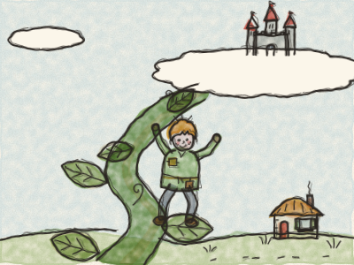
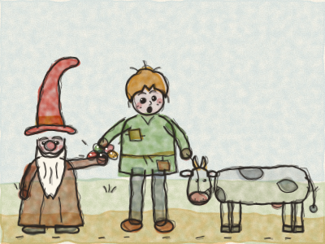
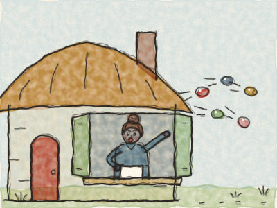
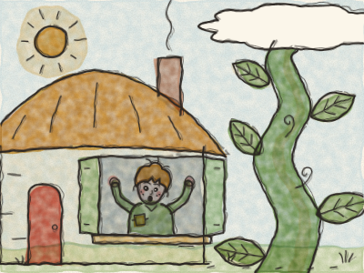
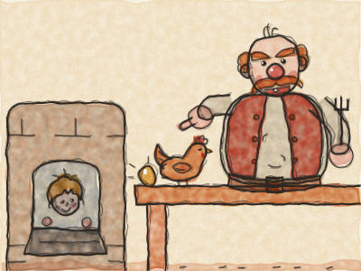
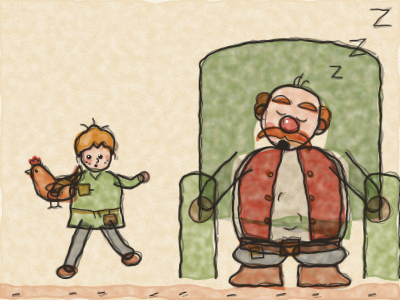
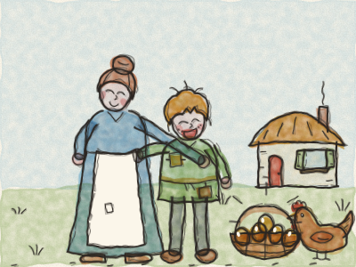
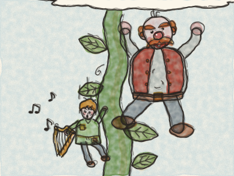

# O João e o Pé de Feijão

Era uma vez um rapaz chamado João, que vivia com a mãe numa casinha pequena. Eram muito pobres. Tudo o que tinham no mundo era uma vaca velha, chamada Branca-de-Leite.

Uma manhã, a Branca-de-Leite não deu leite. Nem uma gota. *Muuuu*, disse ela, triste.

— Ai, ai — disse a mãe do João. — Não há leite, nem pão, nem um tostão no frasco. João, tens de levar a Branca-de-Leite à feira e vendê-la. E vê lá se consegues um bom preço!

Então o João atou uma corda ao pescoço da Branca-de-Leite, e lá foram os dois pela estrada fora, *cloc, cloc, cloc, cloc*.

Ainda não tinham ido muito longe quando encontraram um velhote engraçado, com uma barba branca comprida e um chapéu alto, todo torto.

— Bom dia, João — disse o homenzinho. — Aonde vais com essa vaca tão bonita?

— À feira, para a vender — respondeu o João.

O homenzinho abriu a mão. Lá dentro estavam cinco feijões. Mas não eram feijões quaisquer. Brilhavam como joias: vermelhos, roxos e às pintinhas douradas. — São feijões mágicos — sussurrou ele. — Planta-os esta noite e, de manhã, terão crescido até ao céu. São os cinco teus, em troca da tua vaca.

Os olhos do João ficaram enormes e redondos. Feijões mágicos! — Negócio fechado! — disse ele. Deu a corda ao homenzinho, guardou os feijões no bolso e foi a correr para casa.

— Já de volta? — disse a mãe. — Quanto te deram pela Branca-de-Leite?

— Uma coisa muito melhor do que dinheiro! — disse o João, e abriu a mão. — Cinco feijões mágicos!

— FEIJÕES? — gritou a mãe. — Vendeste a nossa única vaca por um punhado de FEIJÕES? Ai, João, João, João! — Estava tão zangada que atirou os feijões pela janela fora — *zuuum!* — e mandou o João para a cama sem jantar.

Pobre João. Deitado na cama, ouvia a barriga a roncar, *grrr-ronc-ronc*, e sentia-se mesmo tolo. Por fim, adormeceu.

Quando o João acordou na manhã seguinte, o quarto estava todo verde e cheio de sombra. Correu para a janela e — ena! — os feijões tinham crescido durante a noite. Ali no quintal estava um pé de feijão enorme. Era grosso como uma árvore, com folhas do tamanho de guarda-chuvas, e subia, subia, subia, até às nuvens.

— O homenzinho tinha razão! — disse o João. — O que haverá lá em cima?

Então saiu pela janela para o pé de feijão e começou a trepar. Trepou, trepou e trepou. *(Trepem com as mãos: para cima, para cima, para cima!)* Lá em baixo, a casinha ficava cada vez mais pequena, até parecer um brinquedo minúsculo.

Por fim, o João chegou lá ao cimo. Saiu do pé de feijão e pôs o pé numa nuvem branca e fofinha. À frente dele havia uma estrada comprida e, ao fundo da estrada, um castelo. Era o maior castelo que ele alguma vez tinha visto. A porta era tão alta como uma casa!

O João bateu. *BUM, BUM, BUM!* A porta abriu-se a ranger, e ali estava uma senhora. Uma senhora muito, muito grande. Era uma giganta!

— Valha-me Deus, um rapazinho! — disse ela. — Vai-te já embora. O meu marido é um Gigante, e fica muito rabugento antes do pequeno-almoço.

— Por favor — disse o João —, tenho tanta fome. — A mulher do Gigante era bondosa. Deu-lhe uma fatia de pão do tamanho de uma almofada e uma caneca de leite do tamanho de um balde.

Mas o João só tinha dado duas dentadas quando — *TUM! TUM! TUM!* — o castelo inteiro começou a tremer. — Depressa! Ele vem aí! — disse a mulher do Gigante, e escondeu o João no grande forno frio.

O Gigante entrou a pisar com toda a força. Farejou o ar. *Snif, snif, SNIF!* — FI-FA-FO-FUM! Cheira-me a alguém pequenino! Quem está na minha casa?

— Que disparate, querido — disse a mulher. — São só as salsichas. Senta-te e come o teu pequeno-almoço.

Então o Gigante comeu quarenta salsichas e doze pães. Depois disse: — Mulher! Traz-me a minha galinha! — A mulher trouxe uma galinha castanha pequenina e pô-la em cima da mesa. — PÕE! — rugiu o Gigante. E a galinha pôs um ovo — um ovo de ouro puro, a brilhar. *Plim!*

O João espreitava do forno, de boca aberta. O Gigante bocejou. A cabeça começou a cair-lhe. Pouco depois ressonava tão alto que os pratos abanavam: *RRRONC… pfffff… RRRONC… pfffff…*

— Psst, João — sussurrou a mulher do Gigante. — Aquela galinha não é nossa, e a harpa de ouro na prateleira também não. O meu marido tirou-as há muito tempo às pessoas do vale, e nunca, nunca devolve nada. Leva a galinha para casa, que é lá o lugar dela.

Então o João saiu do forno em bicos de pés, pôs a galinha pequenina debaixo do braço e correu. Correu pela estrada, desceu pelo pé de feijão e saltou para o quintal. — Mãe! Olha! — gritou ele. — Põe, por favor — disse ele à galinha, com boas maneiras. E ela pôs um ovo de ouro. *Plim!*

A mãe do João deu-lhe um abraço apertado. — Ai, João, desculpa ter-me zangado. — Com os ovos de ouro compraram pão, leite e uma vaca nova, e partilharam também com todos os vizinhos que tinham fome.

Mas o João não parava de pensar no castelo nas nuvens, e na harpa de ouro que o Gigante tinha levado. Uma harpa que cantava sozinha!

Então, uma manhã, o João voltou a trepar pelo pé de feijão. Esgueirou-se para dentro do castelo e escondeu-se atrás da caixa do pão. Lá estava o Gigante, a dormir na cadeira. E ao lado dele, em cima da mesa, estava a pequena harpa de ouro, a cantar uma canção suave e triste.

O João aproximou-se em bicos de pés e pegou na harpa. Mas a harpa estava tão contente por voltar para casa que começou a tocar uma música alegre, muito alto: *Trrim-lim-lim-lim! Trrim-lim!*

O Gigante acordou num sobressalto. — QUEM ESTÁ AÍ? — rugiu ele. Viu o João a fugir com a harpa. — ANDA CÁ!

O João correu o mais depressa que pôde, e o Gigante correu atrás dele, *TUM! TUM! TUM!* O João escorregou pelo pé de feijão abaixo, *zás!* O Gigante desceu atrás dele, e o pé de feijão inteiro abanava e baloiçava.

— Mãe! — gritou o João. — Depressa! Traz-me o machado!

O João saltou para o quintal, pegou no machado e começou a cortar. *Tchac! Tchac! TCHAC!* O pé de feijão começou a abanar. Abanou, torceu-se e estalou.

Quando o Gigante o sentiu abanar, assustou-se tanto que subiu outra vez para as nuvens o mais depressa que pôde. E mesmo a tempo! Com um grande *CRRRAAAC!*, o pé de feijão caiu — *CATRAPUM!* — de través no quintal.

O Gigante nunca mais desceu. E o João e a mãe viveram felizes para sempre, com a galinha que punha ovos de ouro e a harpa que os adormecia a cantar todas as noites.

E às vezes, quando se ouve a trovoada a ribombar lá em cima nas nuvens, é só o Gigante a resmungar, porque perdeu a galinha e a harpa.

> Os pequenos curiosos e corajosos podem fazer coisas muito grandes.
