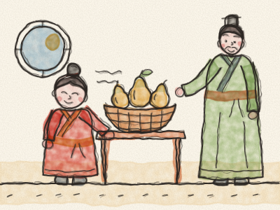
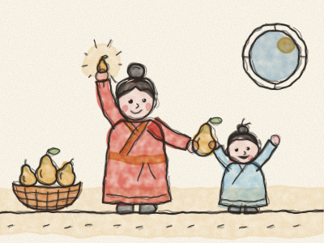

# Kong Rong and the Pears

A long, long time ago in China, there lived a little boy called Kong Rong. He was four years old, and he lived in a big house full of people: his father, his mother, five big brothers and one little brother, who was only two.

One autumn evening, Father came home carrying a round basket. *Sniff, sniff.* What a lovely smell!

“Pears!” cried the brothers. “Golden pears!”

There were big pears and small pears, fat pears and thin pears, and they all smelled as sweet as honey.

Father put the basket on the low table. “Kong Rong,” he said, “you may choose first.”

The big brothers held their breath. The little brother waved his little hands. Which pear would Kong Rong take? *(Pause, and let Constance guess.)*

Kong Rong looked at all the pears. He looked for a long, long time. Then he reached into the basket and took… the smallest pear of all.

Father was surprised. “Kong Rong, why did you take the smallest one?”

“Because I am little,” said Kong Rong. “My big brothers are bigger than me, so they should have the big pears.”

“But your little brother is smaller than you,” said Father. “Why not give him the small one?”

Kong Rong smiled. “Because I am bigger than him. So he should have a big pear too!”

Father laughed and gave him a big hug. And the little brother took a big bite of his pear. *Crunch!* The juice ran down his chin.

That evening, the whole family ate their pears together. And everyone agreed that Kong Rong’s little pear was the sweetest of all.

> When we think of others first, everyone’s heart grows a little bigger.
