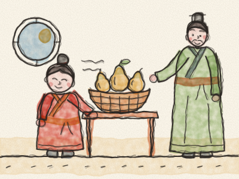
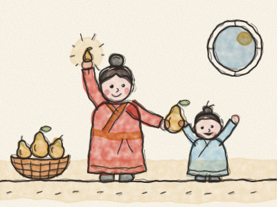

# Kong Rong et les poires

Il y a très, très longtemps, en Chine, vivait un petit garçon qui s’appelait Kong Rong. Il avait quatre ans, et il habitait une grande maison pleine de monde : son papa, sa maman, cinq grands frères et un petit frère qui n’avait que deux ans.

Un soir d’automne, Papa rentra avec un panier rond. *Snif, snif.* Quelle bonne odeur !

« Des poires ! » s’écrièrent les frères. « Des poires dorées ! »

Il y avait des grosses poires et des petites poires, des poires rondes et des poires toutes fines, et elles sentaient toutes bon comme le miel.

Papa posa le panier sur la table basse. « Kong Rong, dit-il, c’est toi qui choisis le premier. »

Les grands frères retinrent leur souffle. Le petit frère agita ses petites mains. Quelle poire Kong Rong allait-il prendre ? *(Faire une pause, et laisser Constance deviner.)*

Kong Rong regarda toutes les poires. Il les regarda très, très longtemps. Puis il plongea la main dans le panier et prit… la plus petite poire de toutes.

Papa fut étonné. « Kong Rong, pourquoi as-tu pris la plus petite ? »

« Parce que je suis petit, répondit Kong Rong. Mes grands frères sont plus grands que moi, alors ils doivent avoir les grosses poires. »

« Mais ton petit frère est plus petit que toi, dit Papa. Pourquoi ne pas lui donner la petite ? »

Kong Rong sourit. « Parce que moi, je suis plus grand que lui. Alors lui aussi doit avoir une grosse poire ! »

Papa éclata de rire et le serra dans ses bras. Et le petit frère croqua dans sa poire. *Crac !* Le jus coula sur son menton.

Ce soir-là, toute la famille mangea les poires ensemble. Et tout le monde fut d’accord : la petite poire de Kong Rong était la plus douce de toutes.

> Quand on pense d’abord aux autres, le cœur de chacun grandit un peu.
