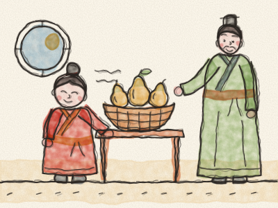
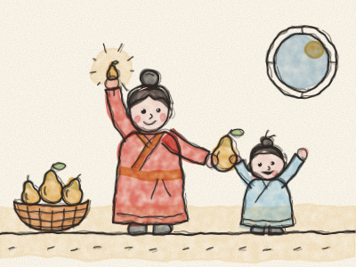

# Kong Rong e as peras

Há muito, muito tempo, na China, vivia um menino chamado Kong Rong. Tinha quatro anos e morava numa casa grande, cheia de gente: o pai, a mãe, cinco irmãos mais velhos e um irmão mais novo, que só tinha dois anos.

Numa tarde de outono, o pai chegou a casa com um cesto redondo. *Snif, snif.* Que cheirinho tão bom!

— Peras! — gritaram os irmãos. — Peras douradas!

Havia peras grandes e peras pequenas, peras gordas e peras magrinhas, e todas cheiravam docinho, como o mel.

O pai pousou o cesto na mesa baixa. — Kong Rong — disse ele —, és tu que escolhes primeiro.

Os irmãos mais velhos sustiveram a respiração. O irmão mais novo abanou as mãozinhas. Que pera iria o Kong Rong escolher? *(Fazer uma pausa e deixar a Constance adivinhar.)*

O Kong Rong olhou para todas as peras. Olhou durante muito, muito tempo. Depois meteu a mão no cesto e tirou… a pera mais pequena de todas.

O pai ficou admirado. — Kong Rong, porque escolheste a mais pequena?

— Porque eu sou pequeno — respondeu o Kong Rong. — Os meus irmãos mais velhos são maiores do que eu, por isso devem ficar com as peras grandes.

— Mas o teu irmão mais novo é mais pequeno do que tu — disse o pai. — Porque não lhe dás a pequena?

O Kong Rong sorriu. — Porque eu sou maior do que ele. Por isso, ele também deve ficar com uma pera grande!

O pai riu-se e deu-lhe um grande abraço. E o irmão mais novo deu uma dentada na sua pera. *Crac!* O sumo escorreu-lhe pelo queixo.

Nessa noite, a família toda comeu as peras em conjunto. E todos concordaram: a pera pequenina do Kong Rong era a mais doce de todas.

> Quando pensamos primeiro nos outros, o coração de cada um fica um bocadinho maior.
