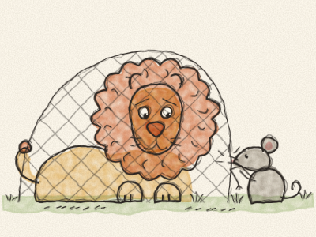
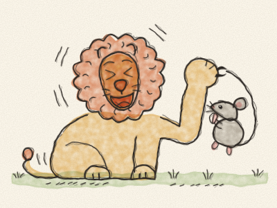
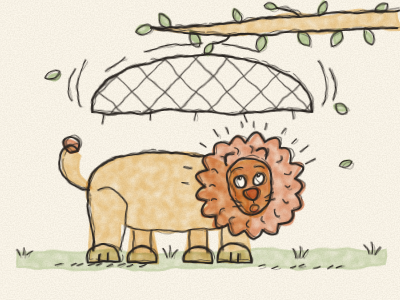
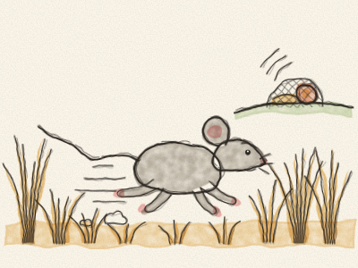
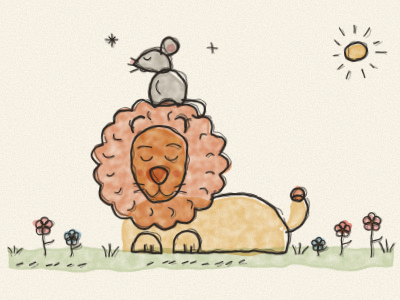

# Le Lion et la Souris

Très, très loin d’ici, dans un pays de hautes herbes dorées, vivait un grand Lion avec une grande crinière. Quand Lion rugissait, *ROOOAAAR !*, les oiseaux s’envolaient des arbres et les zèbres partaient au galop.

Un après-midi bien chaud, Lion faisait la sieste à l’ombre d’un rocher. Il ronflait : *Rrrrr… pfff… Rrrrr… pfff…*

Juste à ce moment-là, une toute petite Souris grise passa en trottinant. Elle était si pressée qu’elle ne regardait pas où elle allait, et — *oups !* — elle grimpa sur la queue de Lion, courut le long de son dos et arriva tout au bout de son nez.

Lion ouvrit un œil. Puis l’autre œil. Et d’une énorme patte — *PAF !* — il attrapa la petite Souris par la queue.

« Tiens, tiens », gronda Lion en se léchant les babines. « Qu’est-ce que nous avons là ? Un petit goûter ! »

« Oh, s’il vous plaît, Monsieur le Lion, ne me mangez pas ! » couina la Souris. « Je suis si petite que je ne ferais même pas une bouchée ! Si vous me laissez partir, je vous promets qu’un jour, je vous aiderai. »

Lion éclata de rire. « Ho ho ho ! TOI ? M’aider, MOI ? Une toute petite souris qui aide le Roi des animaux ? C’est la chose la plus drôle que j’aie jamais entendue ! »

Il rit tellement que son ventre en tremblotait. Et comme elle l’avait fait rire, il se sentit gentil. Il leva sa patte et la laissa partir. « Allez, file, petite. »

« Merci, Monsieur le Lion ! Je ne l’oublierai pas ! » couina la Souris, et elle s’enfuit en courant.

Quelques jours plus tard, Lion se promenait dans la forêt quand — *FLOUF !* — un grand filet de corde lui tomba dessus du haut des arbres. Des chasseurs avaient tendu un piège !

Lion tira. Lion poussa. Lion se roula et se tortilla. Mais plus il se débattait, plus les cordes s’emmêlaient autour de ses pattes et de sa crinière. Il était coincé.

« ROOOAAAR ! » rugit-il, si fort que toute la forêt l’entendit. Mais cette fois, son rugissement était plus triste qu’effrayant.

Très loin, une petite Souris grise l’entendit aussi. Ses oreilles se dressèrent. « Je connais ce rugissement », dit-elle. « C’est mon ami le Lion ! » Et elle courut aussi vite que ses petites pattes le lui permettaient, *trip-trap, trip-trap, trip-trap*, jusqu’au filet.

« Ne vous inquiétez pas, Monsieur le Lion », dit-elle. « Je suis là. »

« Toi ? » dit Lion tristement. « Que peut faire une petite souris ? »

La Souris ne répondit pas. Elle était bien trop occupée. Elle trouva la corde la plus épaisse et se mit à la grignoter avec ses petites dents pointues. *Cric, cric, cric… Clac !* Une corde se cassa. *Cric, cric, cric… Clac !* Une autre se cassa. *Cric, cric… Clac ! Clac ! Clac !*

Elle grignota, grignota, jusqu’à faire un trou assez grand pour un lion. Lion se tortilla pour sortir, secoua sa crinière et s’étira au soleil. Il était libre !

Lion regarda longtemps la petite Souris. « Vous vous êtes moqué de moi », dit la Souris, « mais j’ai tenu ma promesse. »

« C’est vrai », dit doucement Lion. « Merci, mon amie. Aujourd’hui, le plus petit animal de la forêt a sauvé le plus grand. »

Et à partir de ce jour-là, Lion et Souris devinrent les meilleurs amis du monde. Parfois, on pouvait les voir ensemble : Lion allongé dans l’herbe, et Souris assise tout en haut de sa tête, comme une petite couronne.

> On a souvent besoin d’un plus petit que soi. Et une gentillesse, même toute petite, n’est jamais perdue.
