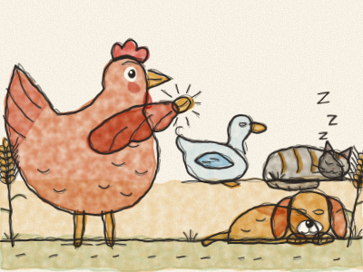
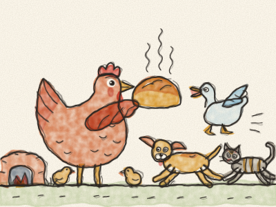

# The Little Red Hen

Once upon a time, on a little farm, there lived a Little Red Hen, a lazy Cat, a sleepy Dog and a noisy Duck. One morning, the Little Red Hen found a grain of wheat.

“Who will help me plant this wheat?” she asked. “Not I,” said the Cat. “Not I,” said the Dog. “Not I,” quacked the Duck. “Then I will do it myself,” said the Little Red Hen. And she did. *Scratch, scratch, plop!*

The wheat grew tall and golden. “Who will help me cut the wheat?” “Not I,” said the Cat. “Not I,” said the Dog. “Not I,” quacked the Duck. “Then I will do it myself.” And she did. *Snip, snip, snip!*

“Who will help me take the wheat to the mill?” *(Let Constance answer!)* “Not I! Not I! Not I!” So she carried it all by herself, and the miller made it into flour.

“Who will help me bake the bread?” “Not I! Not I! Not I!” So she baked it herself. Soon a lovely smell floated over the farm. *Mmm!*

“And who will help me EAT the bread?” asked the Little Red Hen. “I will!” said the Cat. “I will!” said the Dog. “I will!” quacked the Duck.

“Oh no,” said the Little Red Hen. “You did not help me plant, or cut, or carry, or bake. I did it all by myself, so my chicks and I will eat it.” And they did, every crumb.

The next spring, when she found another grain of wheat, the Cat, the Dog and the Duck all shouted, “We will help!”

> Those who help with the work can share the treat.
