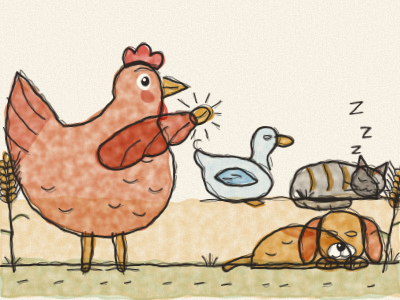
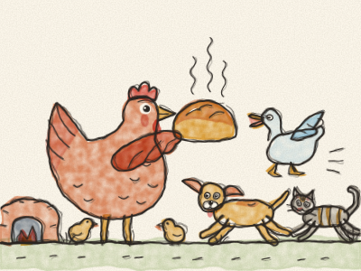

# La Petite Poule rousse

Il était une fois, dans une petite ferme, une Petite Poule rousse, un Chat paresseux, un Chien endormi et un Canard bavard. Un matin, la Petite Poule rousse trouva un grain de blé.

« Qui veut m’aider à planter ce blé ? » demanda-t-elle. « Pas moi », dit le Chat. « Pas moi », dit le Chien. « Pas moi », cancana le Canard. « Alors je le ferai toute seule », dit la Petite Poule rousse. Et c’est ce qu’elle fit. *Gratte, gratte, plop !*

Le blé poussa, grand et doré. « Qui veut m’aider à couper le blé ? » « Pas moi », dit le Chat. « Pas moi », dit le Chien. « Pas moi », cancana le Canard. « Alors je le ferai toute seule. » Et elle le fit. *Clic, clic, clic !*

« Qui veut m’aider à porter le blé au moulin ? » *(Laissez Constance répondre !)* « Pas moi ! Pas moi ! Pas moi ! » Alors elle le porta toute seule, et le meunier en fit de la farine.

« Qui veut m’aider à faire le pain ? » « Pas moi ! Pas moi ! Pas moi ! » Alors elle le fit toute seule. Bientôt, une délicieuse odeur flotta sur toute la ferme. *Mmm !*

« Et qui veut m’aider à MANGER le pain ? » demanda la Petite Poule rousse. « Moi ! » dit le Chat. « Moi ! » dit le Chien. « Moi ! » cancana le Canard.

« Oh non, dit la Petite Poule rousse. Vous ne m’avez aidée ni à planter, ni à couper, ni à porter, ni à faire le pain. J’ai tout fait toute seule, alors mes poussins et moi, nous allons le manger. » Et ils le mangèrent, jusqu’à la dernière miette.

Au printemps suivant, quand elle trouva un autre grain de blé, le Chat, le Chien et le Canard crièrent tous : « Nous allons t’aider ! »

> Qui aide au travail peut partager le goûter.
