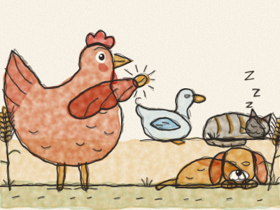
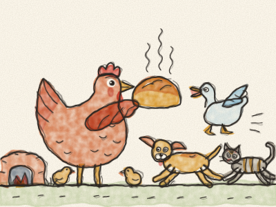

# A Galinha Ruiva

Era uma vez, numa pequena quinta, uma Galinha Ruiva, um Gato preguiçoso, um Cão dorminhoco e um Pato barulhento. Certa manhã, a Galinha Ruiva encontrou um grão de trigo.

— Quem me ajuda a semear este trigo? — perguntou ela. — Eu não — disse o Gato. — Eu não — disse o Cão. — Eu não — grasnou o Pato. — Então semeio-o eu sozinha — disse a Galinha Ruiva. E assim fez. *Esgaravata, esgaravata, plop!*

O trigo cresceu, alto e dourado. — Quem me ajuda a cortar o trigo? — Eu não — disse o Gato. — Eu não — disse o Cão. — Eu não — grasnou o Pato. — Então corto-o eu sozinha. — E assim fez. *Zás, zás, zás!*

— Quem me ajuda a levar o trigo ao moinho? *(Deixe a Constance responder!)* — Eu não! Eu não! Eu não! — Então levou-o ela sozinha, e o moleiro fez farinha.

— Quem me ajuda a cozer o pão? — Eu não! Eu não! Eu não! — Então cozeu-o ela sozinha. Pouco depois, um cheirinho delicioso espalhou-se pela quinta inteira. *Mmm!*

— E quem me ajuda a COMER o pão? — perguntou a Galinha Ruiva. — Eu! — disse o Gato. — Eu! — disse o Cão. — Eu! — grasnou o Pato.

— Ah, não — disse a Galinha Ruiva. — Não me ajudaram a semear, nem a cortar, nem a levar, nem a cozer. Fiz tudo sozinha, por isso eu e os meus pintainhos vamos comê-lo. — E comeram-no todo, até à última migalha.

Na primavera seguinte, quando ela encontrou outro grão de trigo, o Gato, o Cão e o Pato gritaram todos: — Nós ajudamos!

> Quem ajuda no trabalho pode partilhar o lanche.
