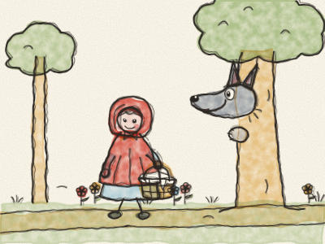
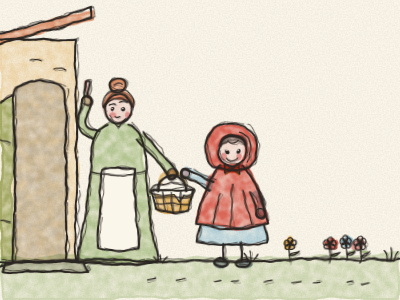
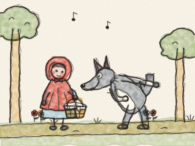
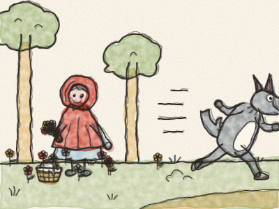
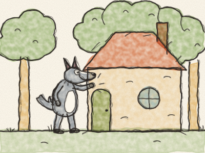
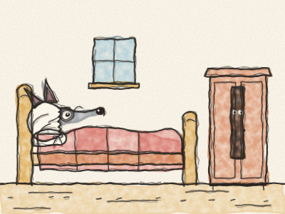
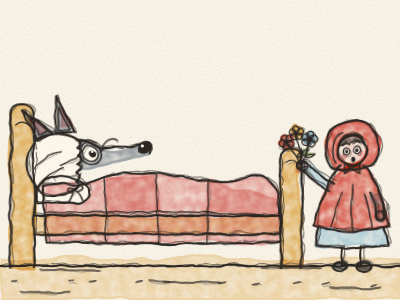
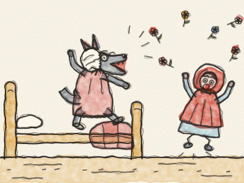
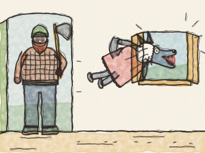
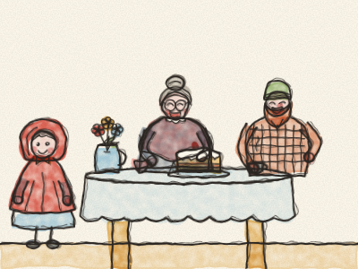

# Little Red Riding Hood

Once upon a time, in a little village at the edge of a big forest, there lived a little girl. Her grandmother loved her very much, and had sewn her a beautiful cape with a hood, as red as a cherry. The little girl wore it everywhere, every single day. So everybody called her Little Red Riding Hood.

Little Red Riding Hood’s grandmother lived on the other side of the forest, in a little cottage under three big oak trees. One morning, Mother said: “Grandmother is not very well. She has a cold, and she is staying in bed. Shall we send her something nice?”

“Yes!” said Little Red Riding Hood. “A cake!”

So Mother baked a little cake, *mmm*, and put it in a basket with a pot of honey and a bottle of apple juice. She covered it all with a clean white cloth.

“Take this to Grandmother,” she said, at the door. “But listen carefully. Stay on the path. Don’t wander off into the trees. And don’t stop to talk to strangers. Promise?”

“I promise,” said Little Red Riding Hood. She gave her mother a kiss, took the basket on her arm, and off she went.

*Tip-tap, tip-tap*, along the path and into the forest. The birds were singing. The sun was shining through the leaves. *(Whistle a little tune.)* What a lovely morning it was.

She had not gone very far when — *rustle, rustle* — out from behind a tree came a Wolf. A big grey Wolf, with pointed ears, a long nose and a very big smile.

“Good morning, little girl,” said the Wolf, in his sweetest voice. *(Make a deep, honey-sweet voice.)* “Where are you going so early?”

Little Red Riding Hood did not know that wolves can be tricky. “Good morning, Mr Wolf,” she said. “I’m going to see my grandmother. She’s poorly, and I’m bringing her a cake.”

“How kind,” said the Wolf. “And where does your grandmother live?”

“On the other side of the forest, in the little cottage under the three big oak trees.”

The Wolf thought: *(whisper)* “A little girl, a grandmother AND a cake. What a lucky day!” Out loud, he said: “Look at all these pretty flowers, little girl! Why don’t you pick some for your grandmother? She would love them.”

Little Red Riding Hood looked. There were flowers everywhere: red ones, yellow ones, blue ones. “Grandmother would love some flowers,” she thought. And she stepped off the path, just for a moment.

She picked one flower, and then she saw a prettier one, a little further on. And then a prettier one, a little further still. Deeper and deeper into the trees she went.

And while she was picking flowers, the Wolf ran off, straight to Grandmother’s cottage, as fast as his legs would go. *Whoosh!*

*Knock, knock, knock.*

“Who’s there?” called Grandmother from her bed.

“It’s me, Little Red Riding Hood,” said the Wolf, in a squeaky little voice. *(Squeak it!)* “I’ve brought you a cake.”

“Lift the latch, my dear, and come in,” said Grandmother. “I’m too poorly to get up.”

The Wolf lifted the latch. *Creeeak!* went the door. And in came the Wolf, big grey nose first.

But Grandmother had very good glasses. She took one look and said: “You are NOT Little Red Riding Hood!” And quick as a flash, she jumped out of bed, ran into the big wardrobe and shut the door behind her. *Click!*

The Wolf scratched his head. “Never mind,” he grumbled. “The little girl will be here soon. I’ll wait for her.”

So he put on Grandmother’s frilly nightcap. He put on Grandmother’s pink nightdress. He even put on Grandmother’s round glasses. Then he jumped into her bed, pulled the blanket up to his nose, and waited. *(Pull an imaginary blanket up to your nose.)*

Inside the wardrobe, Grandmother kept as still as a mouse. *Shhh.*

Meanwhile, Little Red Riding Hood had picked so many flowers, she could hardly carry them. “Oh!” she said. “Grandmother!” She found the path again and hurried on, until she came to the little cottage under the three big oak trees.

The door was open. How strange. “Hello, Grandmother!” she called. Nobody answered. She went in and walked up to the bed.

There lay Grandmother, with her nightcap pulled down low and her blanket pulled up high. She looked very strange indeed.

“Oh, Grandmother,” said Little Red Riding Hood, “what big ears you have!”

“All the better to hear you with, my dear,” said the Wolf, in his squeaky voice.

“Oh, Grandmother, what big eyes you have!”

“All the better to see you with, my dear.”

“Oh, Grandmother, what big hands you have!”

“All the better to hug you with, my dear.”

*(Slower and slower…)* “And oh, Grandmother… what a big mouth you have!”

“All the better to EAT you with!” roared the Wolf, and he jumped out of bed. *WHOOSH!*

“AAAH!” screamed Little Red Riding Hood. Her flowers flew up into the air. She ran round the table. The Wolf ran after her. She ran round the chair. The Wolf ran after her, but he tripped over Grandmother’s long nightdress. *Bump! Crash!* Down he went, with the nightcap over his eyes.

Then the wardrobe door flew open. *Bang!* Out came Grandmother with her broom. “Get out of my house, you naughty Wolf!” she cried. *Whack!*

“HELP! HELP!” shouted Little Red Riding Hood, as loud as she could.

Not far away, a woodcutter was chopping wood. *Chop, chop, chop.* He heard the shouting, and he came running. *Thump, thump, thump!* He burst through the door, with his big axe over his shoulder. “What’s going on here?” he boomed.

The Wolf took one look at the woodcutter. He took one look at Grandmother and her broom. And he jumped straight out of the window, still wearing Grandmother’s nightcap! *Crash!*

He ran away, deep into the forest, as fast as his legs could carry him. “Ow-ooo!” he howled. And he never, ever came back.

The woodcutter laughed so much he had to sit down. “Well,” he said, “I’ve never seen a wolf in a nightcap before!”

Grandmother put the kettle on. Little Red Riding Hood picked up her flowers and put them in a jug. Then the three of them sat down at the table and shared the cake, with honey and apple juice. *Mmm!* Grandmother felt much better already.

“Grandmother,” said Little Red Riding Hood, “I’m sorry. Mother told me to stay on the path, and not to talk to strangers. And I forgot.”

Grandmother gave her a big hug. “Never mind, my dear. You’ll remember next time, won’t you?”

“I will,” said Little Red Riding Hood. And she did. From that day on, she always stayed on the path, all the way to Grandmother’s house.

> Stay on the path, and don’t talk to strangers, however sweet their voice.
