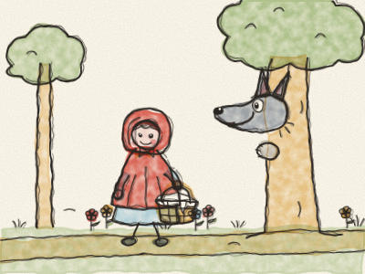
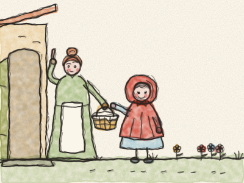
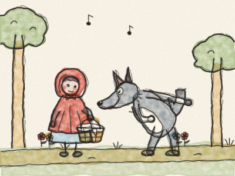
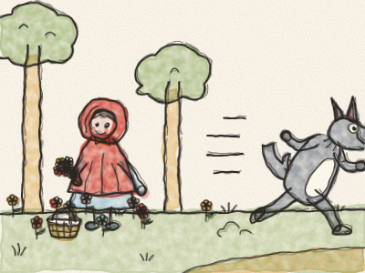
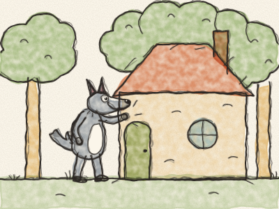
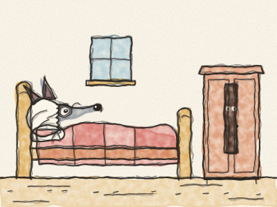
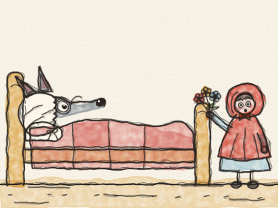
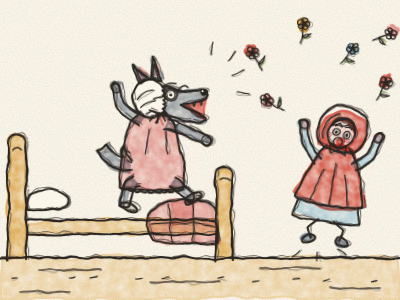
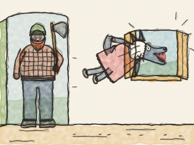
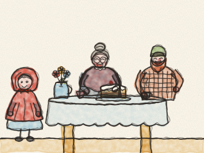

# Le Petit Chaperon rouge

Il était une fois, dans un petit village au bord d’une grande forêt, une petite fille. Sa grand-mère l’aimait très fort, et elle lui avait cousu une belle cape avec un capuchon, rouge comme une cerise. La petite fille la portait partout, tous les jours. Alors tout le monde l’appelait le Petit Chaperon rouge.

La grand-mère du Petit Chaperon rouge habitait de l’autre côté de la forêt, dans une petite maison sous trois grands chênes. Un matin, Maman dit : « Grand-mère n’est pas très bien. Elle a un rhume, et elle reste au lit. Si on lui envoyait quelque chose de bon ? »

« Oui ! dit le Petit Chaperon rouge. Un gâteau ! »

Alors Maman fit cuire un petit gâteau, *mmm*, et le mit dans un panier avec un pot de miel et une bouteille de jus de pomme. Elle couvrit le tout d’un joli torchon blanc.

« Porte ça à Grand-mère, dit-elle, sur le pas de la porte. Mais écoute-moi bien. Reste sur le chemin. Ne t’en va pas entre les arbres. Et ne t’arrête pas pour parler aux inconnus. Promis ? »

« Promis », dit le Petit Chaperon rouge. Elle fit un bisou à sa maman, prit le panier à son bras, et partit.

*Trip-trap, trip-trap*, le long du chemin, dans la forêt. Les oiseaux chantaient. Le soleil brillait à travers les feuilles. *(Siffle un petit air.)* Quelle belle matinée !

Elle n’était pas allée bien loin quand — *frrr, frrr* — de derrière un arbre sortit un Loup. Un grand Loup gris, avec des oreilles pointues, un long museau et un très grand sourire.

« Bonjour, petite fille, dit le Loup de sa voix la plus douce. *(Prends une grosse voix toute sucrée.)* Où vas-tu de si bon matin ? »

Le Petit Chaperon rouge ne savait pas que les loups peuvent être rusés. « Bonjour, Monsieur le Loup, dit-elle. Je vais voir ma grand-mère. Elle est malade, et je lui apporte un gâteau. »

« Comme c’est gentil, dit le Loup. Et où habite-t-elle, ta grand-mère ? »

« De l’autre côté de la forêt, dans la petite maison sous les trois grands chênes. »

Le Loup pensa : *(en chuchotant)* « Une petite fille, une grand-mère ET un gâteau. Quelle chance ! » Et tout haut, il dit : « Regarde toutes ces jolies fleurs, petite fille ! Pourquoi n’en cueilles-tu pas pour ta grand-mère ? Elle serait si contente. »

Le Petit Chaperon rouge regarda. Il y avait des fleurs partout : des rouges, des jaunes, des bleues. « Grand-mère aimerait bien des fleurs », pensa-t-elle. Et elle quitta le chemin, juste un instant.

Elle cueillit une fleur, puis elle en vit une plus jolie, un peu plus loin. Et puis une plus jolie encore, encore un peu plus loin. Et elle s’enfonça de plus en plus entre les arbres.

Et pendant qu’elle cueillait des fleurs, le Loup fila tout droit chez Grand-mère, aussi vite que ses pattes pouvaient le porter. *Zoum !*

*Toc, toc, toc.*

« Qui est là ? » demanda Grand-mère depuis son lit.

« C’est moi, le Petit Chaperon rouge, dit le Loup d’une petite voix aiguë. *(Fais une toute petite voix !)* Je t’apporte un gâteau. »

« Tire la chevillette, la bobinette cherra, dit Grand-mère. Je suis trop malade pour me lever. »

Le Loup tira la chevillette. *Crrrriii !* fit la porte. Et le Loup entra, son gros museau gris en premier.

Mais Grand-mère avait de très bonnes lunettes. Elle le regarda et dit : « Tu n’es PAS le Petit Chaperon rouge ! » Et vite comme l’éclair, elle sauta du lit, courut dans la grande armoire et ferma la porte derrière elle. *Clic !*

Le Loup se gratta la tête. « Tant pis, grogna-t-il. La petite fille va bientôt arriver. Je vais l’attendre. »

Alors il mit le bonnet de nuit à volants de Grand-mère. Il mit la chemise de nuit rose de Grand-mère. Il mit même les lunettes rondes de Grand-mère. Puis il sauta dans son lit, tira la couverture jusqu’à son museau, et attendit. *(Tire une couverture imaginaire jusqu’à ton nez.)*

Dans l’armoire, Grand-mère ne bougeait pas plus qu’une souris. *Chut.*

Pendant ce temps, le Petit Chaperon rouge avait cueilli tant de fleurs qu’elle pouvait à peine les porter. « Oh ! dit-elle. Grand-mère ! » Elle retrouva le chemin et se dépêcha, jusqu’à la petite maison sous les trois grands chênes.

La porte était ouverte. Comme c’était bizarre. « Bonjour, Grand-mère ! » appela-t-elle. Personne ne répondit. Elle entra et s’approcha du lit.

Grand-mère était là, avec son bonnet tiré très bas et sa couverture tirée très haut. Elle avait l’air vraiment bizarre.

« Oh, Grand-mère, dit le Petit Chaperon rouge, comme vous avez de grandes oreilles ! »

« C’est pour mieux t’entendre, mon enfant », dit le Loup de sa petite voix aiguë.

« Oh, Grand-mère, comme vous avez de grands yeux ! »

« C’est pour mieux te voir, mon enfant. »

« Oh, Grand-mère, comme vous avez de grandes mains ! »

« C’est pour mieux te serrer dans mes bras, mon enfant. »

*(De plus en plus lentement…)* « Et oh, Grand-mère… comme vous avez une grande bouche ! »

« C’est pour mieux te MANGER ! » rugit le Loup. Et il sauta hors du lit. *VLOUF !*

« AAAH ! » cria le Petit Chaperon rouge. Ses fleurs s’envolèrent en l’air. Elle courut autour de la table. Le Loup courut derrière elle. Elle courut autour de la chaise. Le Loup courut derrière elle, mais il se prit les pattes dans la longue chemise de nuit de Grand-mère. *Boum ! Patatras !* Il tomba par terre, le bonnet sur les yeux.

Alors la porte de l’armoire s’ouvrit d’un coup. *Bang !* Grand-mère en sortit avec son balai. « Sors de ma maison, vilain Loup ! » cria-t-elle. *Paf !*

« AU SECOURS ! AU SECOURS ! » cria le Petit Chaperon rouge, aussi fort qu’elle put.

Pas très loin, un bûcheron coupait du bois. *Toc, toc, toc.* Il entendit les cris et arriva en courant. *Boum, boum, boum !* Il ouvrit la porte en grand, sa grosse hache sur l’épaule. « Qu’est-ce qui se passe ici ? » tonna-t-il.

Le Loup regarda le bûcheron. Il regarda Grand-mère et son balai. Et il sauta tout droit par la fenêtre, avec le bonnet de nuit de Grand-mère encore sur la tête ! *Crac !*

Il s’enfuit tout au fond de la forêt, aussi vite que ses pattes pouvaient le porter. « Aouuuh ! » hurla-t-il. Et on ne le revit plus jamais.

Le bûcheron rit tellement qu’il dut s’asseoir. « Eh bien, dit-il, je n’avais jamais vu un loup en bonnet de nuit ! »

Grand-mère mit l’eau à chauffer. Le Petit Chaperon rouge ramassa ses fleurs et les mit dans un pichet. Puis ils s’assirent tous les trois à table et partagèrent le gâteau, avec le miel et le jus de pomme. *Mmm !* Grand-mère se sentait déjà beaucoup mieux.

« Grand-mère, dit le Petit Chaperon rouge, je suis désolée. Maman m’avait dit de rester sur le chemin, et de ne pas parler aux inconnus. Et j’ai oublié. »

Grand-mère la serra très fort dans ses bras. « Ce n’est rien, mon enfant. Tu t’en souviendras la prochaine fois, n’est-ce pas ? »

« Oui », dit le Petit Chaperon rouge. Et elle s’en souvint. À partir de ce jour-là, elle resta toujours sur le chemin, jusqu’à la maison de sa grand-mère.

> Reste sur le chemin, et ne parle pas aux inconnus, même quand leur voix est toute douce.
