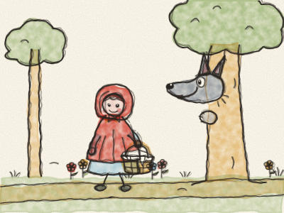
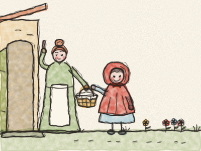
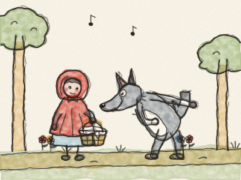
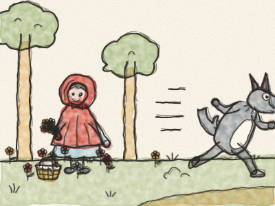
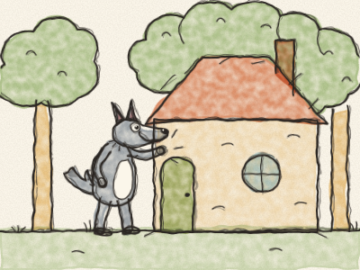
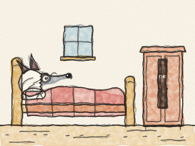
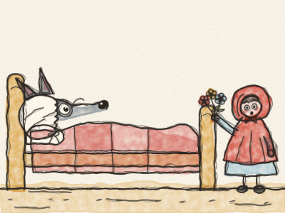
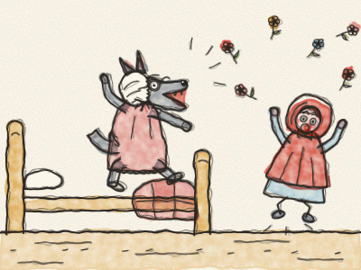
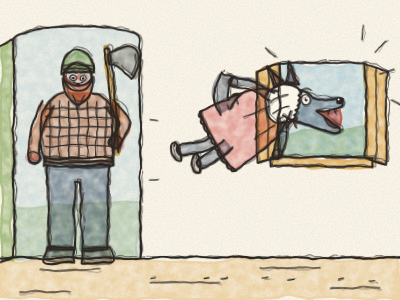
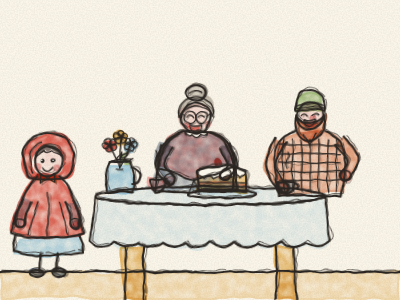

# O Capuchinho Vermelho

Era uma vez, numa pequena aldeia à beira de uma grande floresta, uma menina. A avó gostava muito dela e tinha-lhe costurado uma linda capa com capuz, vermelha como uma cereja. A menina usava-a em todo o lado, todos os dias. Por isso, toda a gente lhe chamava o Capuchinho Vermelho.

A avó do Capuchinho Vermelho morava do outro lado da floresta, numa casinha debaixo de três grandes carvalhos. Uma manhã, a Mãe disse: — A avó não está muito bem. Está constipada e ficou na cama. E se lhe mandássemos uma coisa boa?

— Sim! — disse o Capuchinho Vermelho. — Um bolo!

Então a Mãe cozeu um bolinho, *hum*, e pô-lo num cesto com um frasco de mel e uma garrafa de sumo de maçã. Tapou tudo com um pano branco e limpinho.

— Leva isto à avó — disse ela, à porta. — Mas ouve bem. Não saias do caminho. Não te metas pelo meio das árvores. E não pares para falar com estranhos. Prometes?

— Prometo — disse o Capuchinho Vermelho. Deu um beijinho à mãe, pôs o cesto no braço e lá foi ela.

*Tip-tap, tip-tap*, pelo caminho fora, floresta adentro. Os passarinhos cantavam. O sol brilhava por entre as folhas. *(Assobia uma cantiga.)* Que manhã tão bonita!

Ainda não tinha ido muito longe quando — *frrr, frrr* — de trás de uma árvore saiu um Lobo. Um grande Lobo cinzento, com orelhas bicudas, um focinho comprido e um sorriso muito grande.

— Bom dia, menina — disse o Lobo, com a sua voz mais doce. *(Faz uma voz grossa e muito melosa.)* — Aonde vais tão cedo?

O Capuchinho Vermelho não sabia que os lobos podem ser manhosos. — Bom dia, senhor Lobo — disse ela. — Vou visitar a minha avó. Está doente, e eu levo-lhe um bolo.

— Que simpática — disse o Lobo. — E onde é que mora a tua avó?

— Do outro lado da floresta, na casinha debaixo dos três grandes carvalhos.

O Lobo pensou: *(a sussurrar)* «Uma menina, uma avó E um bolo. Que sorte a minha!» E em voz alta disse: — Olha para estas flores tão bonitas, menina! Porque é que não apanhas umas para a tua avó? Ela ia adorar.

O Capuchinho Vermelho olhou. Havia flores por todo o lado: vermelhas, amarelas, azuis. «A avó ia gostar de umas flores», pensou ela. E saiu do caminho, só por um bocadinho.

Apanhou uma flor, e depois viu outra mais bonita, um pouco mais à frente. E depois outra ainda mais bonita, um pouco mais à frente ainda. E foi entrando cada vez mais no meio das árvores.

E enquanto ela apanhava flores, o Lobo correu direitinho a casa da avó, o mais depressa que as patas o deixavam. *Zum!*

*Truz, truz, truz.*

— Quem é? — perguntou a avó, lá da cama.

— Sou eu, o Capuchinho Vermelho — disse o Lobo, com uma vozinha fininha. *(Faz uma vozinha fininha!)* — Trago-te um bolo.

— Levanta o trinco, querida, e entra — disse a avó. — Estou doente demais para me levantar.

O Lobo levantou o trinco. *Nhééééc!* fez a porta. E o Lobo entrou, com o grande focinho cinzento à frente.

Mas a avó tinha uns óculos muito bons. Olhou para ele e disse: — Tu NÃO és o Capuchinho Vermelho! — E, num instante, saltou da cama, correu para dentro do grande guarda-fatos e fechou a porta. *Clique!*

O Lobo coçou a cabeça. — Não faz mal — resmungou ele. — A menina deve estar a chegar. Fico à espera dela.

Então pôs a touca de dormir de folhos da avó. Vestiu a camisa de noite cor-de-rosa da avó. Até pôs os óculos redondos da avó. Depois saltou para a cama, puxou o cobertor até ao focinho e ficou à espera. *(Puxa um cobertor imaginário até ao nariz.)*

Dentro do guarda-fatos, a avó estava quietinha como um rato. *Chiu.*

Entretanto, o Capuchinho Vermelho tinha apanhado tantas flores que quase não as conseguia segurar. — Oh! — disse ela. — A avó! — Encontrou o caminho outra vez e despachou-se, até chegar à casinha debaixo dos três grandes carvalhos.

A porta estava aberta. Que esquisito. — Olá, avó! — chamou ela. Ninguém respondeu. Entrou e aproximou-se da cama.

Ali estava a avó, com a touca puxada muito para baixo e o cobertor puxado muito para cima. Estava mesmo muito esquisita.

— Oh, avó — disse o Capuchinho Vermelho —, que orelhas tão grandes tu tens!

— São para te ouvir melhor, querida — disse o Lobo, com a sua vozinha fininha.

— Oh, avó, que olhos tão grandes tu tens!

— São para te ver melhor, querida.

— Oh, avó, que mãos tão grandes tu tens!

— São para te abraçar melhor, querida.

*(Cada vez mais devagar…)* — E oh, avó… que boca tão grande tu tens!

— É para te COMER melhor! — rugiu o Lobo. E saltou da cama. *ZÁS!*

— AAAH! — gritou o Capuchinho Vermelho. As flores voaram pelo ar. Ela correu à volta da mesa. O Lobo correu atrás dela. Ela correu à volta da cadeira. O Lobo correu atrás dela, mas tropeçou na comprida camisa de noite da avó. *Bum! Catrapum!* Lá foi ele ao chão, com a touca por cima dos olhos.

Então a porta do guarda-fatos abriu-se de repente. *Pum!* Lá de dentro saiu a avó, com a vassoura. — Fora da minha casa, Lobo malcriado! — gritou ela. *Zás!*

— SOCORRO! SOCORRO! — gritou o Capuchinho Vermelho, o mais alto que conseguiu.

Ali perto, um lenhador estava a cortar lenha. *Toc, toc, toc.* Ouviu os gritos e veio a correr. *Pum, pum, pum!* Abriu a porta de rompante, com o grande machado ao ombro. — O que se passa aqui? — trovejou ele.

O Lobo olhou para o lenhador. Olhou para a avó e para a vassoura. E saltou direitinho pela janela, ainda com a touca da avó na cabeça! *Crás!*

Fugiu para o fundo da floresta, o mais depressa que as patas o levavam. — Auuuu! — uivou ele. E nunca, nunca mais voltou.

O lenhador riu-se tanto que teve de se sentar. — Ora esta — disse ele —, nunca tinha visto um lobo de touca!

A avó pôs a chaleira ao lume. O Capuchinho Vermelho apanhou as flores e pô-las num jarro. Depois sentaram-se os três à mesa e partilharam o bolo, com mel e sumo de maçã. *Hum!* A avó já se sentia muito melhor.

— Avó — disse o Capuchinho Vermelho —, desculpa. A Mãe disse-me para não sair do caminho e para não falar com estranhos. E eu esqueci-me.

A avó deu-lhe um grande abraço. — Não faz mal, querida. Para a próxima já te lembras, não é?

— Lembro — disse o Capuchinho Vermelho. E lembrou-se mesmo. A partir desse dia, nunca mais saiu do caminho, até casa da avó.

> Não saias do caminho, e não fales com estranhos, por mais doce que seja a voz deles.
