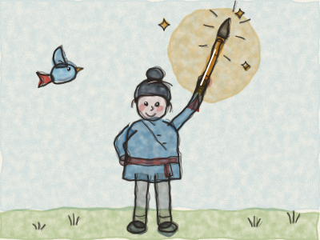
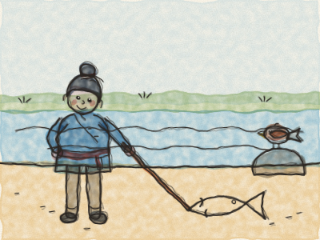
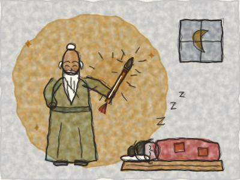
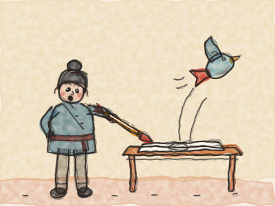
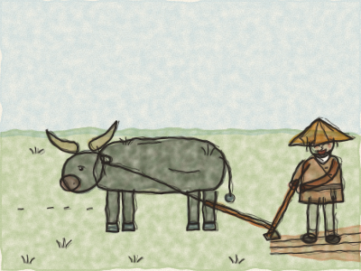
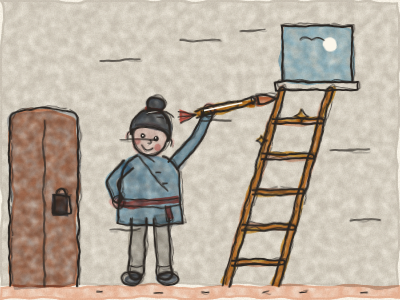
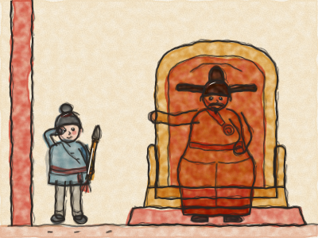
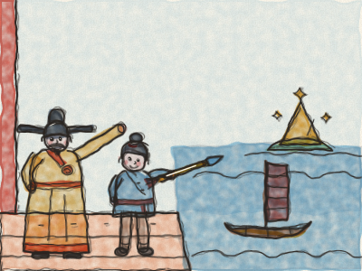
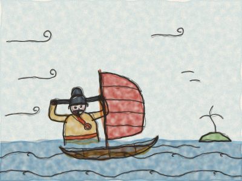
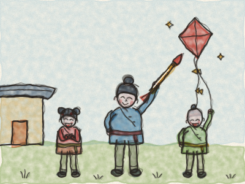

# Ma Liang and the Magic Paintbrush

Long, long ago, in a little village in China, there lived a boy called Ma Liang. He was very poor. Every day he gathered sticks for the fire and cut grass for the farmers, and in return they gave him a bowl of rice.

But more than anything in the world, Ma Liang loved to draw. He wanted a paintbrush so very much! A paintbrush cost money, though, and Ma Liang did not have a single coin.

One day he passed a school where a rich painter was teaching.

“Please, sir,” said Ma Liang, “could you lend me a brush?”

The painter laughed. “A poor boy like you, painting pictures? Go away!”

Ma Liang did not cry. He said to himself, “I will learn to draw anyway.”

And so he drew with anything he could find. By the river, he drew fish in the sand with a stick. *Scritch, scratch.* On the big grey rocks, he drew birds with a piece of black charcoal. At home, he drew on the walls with his finger dipped in water.

He drew in the morning and he drew at night. He drew the clouds, the trees and the ducks on the pond.

Day after day, his drawings grew better and better. They looked so real that the sparrows came and chirped at the birds on the rocks, and the cats crept up to sniff the fish in the sand!

One evening, Ma Liang was so tired that he fell asleep on his little mat, still holding his piece of charcoal.

In his sleep, Ma Liang had a dream. A soft golden light filled his little room, and there stood a kind old man with a long white beard.

“Ma Liang,” said the old man gently, “you have worked so hard. Here is a gift for you.” And he gave the boy a paintbrush. It was not an ordinary paintbrush. It was made of gold, and it shone like the sun.

“This is a magic paintbrush,” said the old man. “Use it to help people who need it. Never use it for greed.”

“I promise,” said Ma Liang.

When he woke up, the room was dark again and the old man was gone. But there, in Ma Liang’s hand, was the golden paintbrush!

Ma Liang jumped up. He found an old piece of paper and painted a little bird, with a red tail and bright black eyes.

*Swish, swish, swoosh…* and it came to life! The little bird shook its feathers, sang *tweet-tweet*, and flew right off the paper and out of the window.

Ma Liang ran to the river. He painted a fish on a flat stone. *Swish, swish, swoosh…* and it came to life! *Splash!* The fish jumped into the water and swam away.

Just then, an old farmer came by. He was pulling a heavy plough across his field all by himself, and he was puffing and panting.

“I have no buffalo to pull my plough,” he sighed.

What do you think Ma Liang painted? *(Pause, and let Constance guess.)*

He painted a big, strong water buffalo, with long curly horns. *Swish, swish, swoosh…* and it came to life! *Mmmooo!* said the buffalo, and it began to pull the plough. The old farmer laughed with joy.

The next day, a little girl came carrying water from far away, and her arms ached. Ma Liang painted her two new buckets. Then the fields were dry, because it had not rained for weeks, so he painted a deep well with a big wooden water-wheel. *Swish, swish, swoosh…* Cool water came splashing out, and the rice grew green again.

Every day, Ma Liang painted for the poor people of the village. And he never asked for anything in return.

But a greedy rich man lived in the village too. When he heard about the magic paintbrush, he sent his servants to fetch Ma Liang.

“Paint me gold!” said the rich man. “Gold coins! Lots and lots of them!”

“No,” said Ma Liang. “My brush is for people who need help.”

The rich man was furious. He locked Ma Liang in a room with only one little window, high, high up. “You will stay there until you paint me gold!”

But Ma Liang was not afraid. He took out his golden brush and painted a ladder on the wall, right up to the window. *Swish, swish, swoosh…* and it came to life! Ma Liang climbed up, up, up, slipped out of the window, and ran far away from that greedy man.

Now, the news of the magic paintbrush travelled all the way to the palace of the Emperor. And the Emperor loved gold even more than the rich man did.

His soldiers found Ma Liang and brought him to the palace. The Emperor sat on his golden throne, in a long yellow robe and a tall black hat.

“So you are the boy with the magic brush,” said the Emperor. “Paint me a mountain of gold! At once!”

Ma Liang thought for a long time. Then he smiled. “Very well, Your Majesty. But a mountain of gold must stand on an island in the middle of the sea. So first, I must paint the sea.”

He painted the sea, wide and blue. *Swish, swish, swoosh…* and it came to life! Little waves came lapping up to the palace steps, and fish jumped in the water. Far, far away, he painted an island, and on the island a mountain of gold that sparkled in the sun.

“Gold!” cried the Emperor. “My gold! Quick, paint me a boat!”

So Ma Liang painted a big wooden boat with a red sail. The Emperor climbed in, and sat down in the middle with his arms folded.

“It is not moving!” he grumbled. “Paint me some wind!”

Ma Liang painted a little wind. *Whooo…* The sail filled, and the boat began to move.

“More wind!” shouted the Emperor. “Faster!”

Ma Liang painted more wind. *WHOOOSH!* The waves grew bigger, and the boat sailed faster and faster.

“Enough! Enough!” cried the Emperor, holding on to his hat. But the wind blew and blew, and the boat sailed far, far away, right past the mountain of gold, until it reached a little green island where there was no gold at all.

And there the Emperor stayed. He learned to catch fish, to grow rice and to share his supper with the passing sailors. And he never troubled anyone ever again.

As for Ma Liang, he went home to his village. And he went on painting, just as he had promised the kind old man.

He painted a kite for the children, and *swish, swish, swoosh…* it flew up into the sky. He painted a warm roof for an old grandmother whose house let in the rain. He painted a little bridge across the river, so that everyone could go to market.

He never painted gold. Not once.

And they say that if you ever see a picture so beautiful that you think it might fly away, perhaps it was painted by Ma Liang.

> A gift is most precious when we use it to help others.
