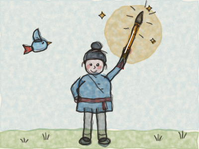
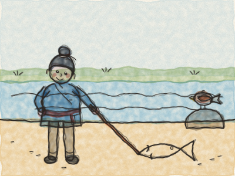
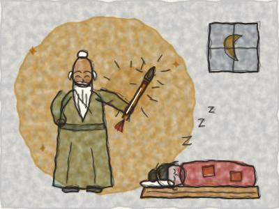
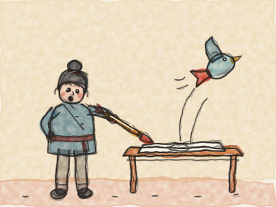
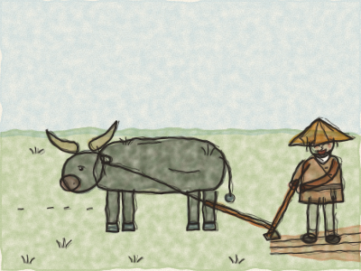
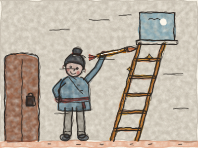
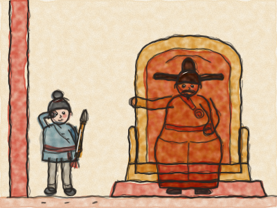
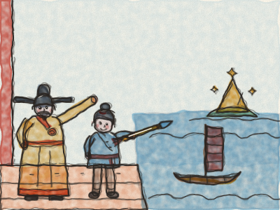
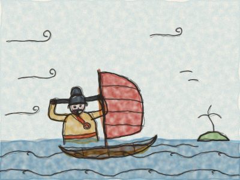
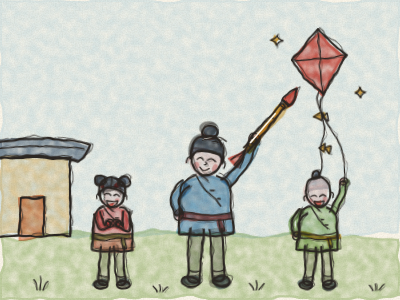

# Ma Liang et le pinceau magique

Il y a très, très longtemps, dans un petit village de Chine, vivait un garçon qui s’appelait Ma Liang. Il était très pauvre. Chaque jour, il ramassait du bois pour le feu et coupait de l’herbe pour les paysans, et en échange ils lui donnaient un bol de riz.

Mais plus que tout au monde, Ma Liang aimait dessiner. Il rêvait tellement d’avoir un pinceau ! Seulement, un pinceau, ça coûte de l’argent, et Ma Liang n’avait pas une seule pièce.

Un jour, il passa devant une école où un riche peintre donnait sa leçon.

« S’il vous plaît, monsieur, dit Ma Liang, pourriez-vous me prêter un pinceau ? »

Le peintre éclata de rire. « Un pauvre garçon comme toi, peindre des tableaux ? Va-t’en ! »

Ma Liang ne pleura pas. Il se dit : « J’apprendrai à dessiner quand même. »

Alors il dessina avec tout ce qu’il trouvait. Au bord de la rivière, il dessinait des poissons dans le sable avec un bâton. *Scritch, scratch.* Sur les gros rochers gris, il dessinait des oiseaux avec un morceau de charbon noir. À la maison, il dessinait sur les murs avec son doigt trempé dans l’eau.

Il dessinait le matin et il dessinait le soir. Il dessinait les nuages, les arbres et les canards sur la mare.

Jour après jour, ses dessins devenaient de plus en plus beaux. Ils avaient l’air si vrais que les moineaux venaient pépier devant les oiseaux des rochers, et que les chats s’approchaient pour renifler les poissons dans le sable !

Un soir, Ma Liang était si fatigué qu’il s’endormit sur sa petite natte, son morceau de charbon encore à la main.

Pendant son sommeil, Ma Liang fit un rêve. Une douce lumière dorée remplit sa petite chambre, et devant lui se tenait un vieil homme très gentil, avec une longue barbe blanche.

« Ma Liang, dit doucement le vieil homme, tu as tant travaillé. Voici un cadeau pour toi. » Et il donna au garçon un pinceau. Ce n’était pas un pinceau ordinaire. Il était en or, et il brillait comme le soleil.

« C’est un pinceau magique, dit le vieil homme. Sers-t’en pour aider ceux qui en ont besoin. Jamais par avidité. »

« Je vous le promets », dit Ma Liang.

Quand il se réveilla, la chambre était de nouveau sombre et le vieil homme avait disparu. Mais là, dans la main de Ma Liang, il y avait le pinceau doré !

Ma Liang bondit. Il trouva un vieux morceau de papier et peignit un petit oiseau, avec une queue rouge et des yeux noirs tout brillants.

*Flic, flac, flouch…* et il prit vie ! Le petit oiseau secoua ses plumes, chanta *cui-cui* et s’envola hors de la feuille, puis par la fenêtre.

Ma Liang courut à la rivière. Il peignit un poisson sur une pierre plate. *Flic, flac, flouch…* et il prit vie ! *Plouf !* Le poisson sauta dans l’eau et s’en alla en nageant.

Juste à ce moment, un vieux paysan passa par là. Il tirait tout seul une lourde charrue à travers son champ, et il soufflait et haletait.

« Je n’ai pas de buffle pour tirer ma charrue », soupira-t-il.

À ton avis, qu’est-ce que Ma Liang a peint ? *(Faire une pause, et laisser Constance deviner.)*

Il peignit un gros buffle d’eau, bien fort, avec de longues cornes recourbées. *Flic, flac, flouch…* et il prit vie ! *Meuuuh !* fit le buffle, et il se mit à tirer la charrue. Le vieux paysan riait de joie.

Le lendemain, une petite fille arriva en portant de l’eau de très loin, et ses bras lui faisaient mal. Ma Liang lui peignit deux seaux tout neufs. Puis, comme les champs étaient secs parce qu’il n’avait pas plu depuis des semaines, il peignit un puits profond avec une grande roue à eau en bois. *Flic, flac, flouch…* L’eau fraîche jaillit, et le riz redevint tout vert.

Chaque jour, Ma Liang peignait pour les pauvres gens du village. Et il ne demandait jamais rien en échange.

Mais dans le village vivait aussi un homme riche et avide. Quand il entendit parler du pinceau magique, il envoya ses serviteurs chercher Ma Liang.

« Peins-moi de l’or ! dit l’homme riche. Des pièces d’or ! Des tas et des tas ! »

« Non, dit Ma Liang. Mon pinceau est pour les gens qui ont besoin d’aide. »

L’homme riche était furieux. Il enferma Ma Liang dans une pièce avec une seule petite fenêtre, tout là-haut. « Tu resteras là jusqu’à ce que tu me peignes de l’or ! »

Mais Ma Liang n’avait pas peur. Il sortit son pinceau doré et peignit une échelle sur le mur, jusqu’à la fenêtre. *Flic, flac, flouch…* et elle prit vie ! Ma Liang grimpa, grimpa, grimpa, se glissa par la fenêtre et s’enfuit bien loin de cet homme avide.

Or, la nouvelle du pinceau magique arriva jusqu’au palais de l’Empereur. Et l’Empereur aimait l’or encore plus que l’homme riche.

Ses soldats trouvèrent Ma Liang et l’amenèrent au palais. L’Empereur était assis sur son trône doré, dans une longue robe jaune, avec un haut chapeau noir.

« Alors c’est toi, le garçon au pinceau magique, dit l’Empereur. Peins-moi une montagne d’or ! Tout de suite ! »

Ma Liang réfléchit longtemps. Puis il sourit. « Bien, Votre Majesté. Mais une montagne d’or doit se trouver sur une île, au milieu de la mer. Alors d’abord, je dois peindre la mer. »

Il peignit la mer, immense et bleue. *Flic, flac, flouch…* et elle prit vie ! De petites vagues vinrent clapoter jusqu’aux marches du palais, et des poissons sautaient dans l’eau. Très, très loin, il peignit une île, et sur l’île une montagne d’or qui scintillait au soleil.

« De l’or ! s’écria l’Empereur. Mon or ! Vite, peins-moi un bateau ! »

Alors Ma Liang peignit un grand bateau en bois avec une voile rouge. L’Empereur monta dedans et s’assit au milieu, les bras croisés.

« Il n’avance pas ! grogna-t-il. Peins-moi du vent ! »

Ma Liang peignit un petit vent. *Hou…* La voile se gonfla, et le bateau se mit à avancer.

« Plus de vent ! cria l’Empereur. Plus vite ! »

Ma Liang peignit encore du vent. *HOUUUUCH !* Les vagues devinrent plus grosses, et le bateau fila de plus en plus vite.

« Assez ! Assez ! » cria l’Empereur en tenant son chapeau. Mais le vent soufflait, soufflait, et le bateau s’en alla très, très loin. Il passa devant la montagne d’or sans s’arrêter, et arriva enfin à une petite île verte où il n’y avait pas d’or du tout.

Et l’Empereur y resta. Il apprit à pêcher, à cultiver le riz et à partager son dîner avec les marins de passage. Et il ne causa plus jamais d’ennuis à personne.

Quant à Ma Liang, il rentra dans son village. Et il continua à peindre, comme il l’avait promis au vieil homme.

Il peignit un cerf-volant pour les enfants, et *flic, flac, flouch…* il monta dans le ciel. Il peignit un toit bien chaud pour une vieille grand-mère dont la maison laissait entrer la pluie. Il peignit un petit pont sur la rivière, pour que tout le monde puisse aller au marché.

Il ne peignit jamais d’or. Pas une seule fois.

Et l’on dit que si un jour tu vois une image si belle que tu crois qu’elle va s’envoler, c’est peut-être Ma Liang qui l’a peinte.

> Un don est plus précieux quand on s’en sert pour aider les autres.
