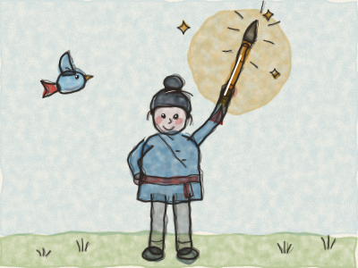
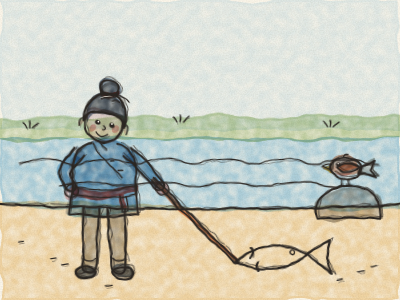
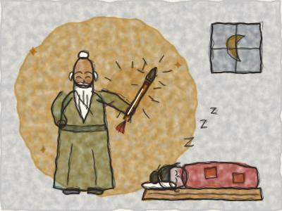
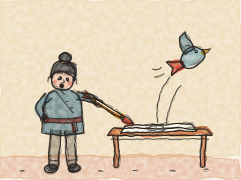
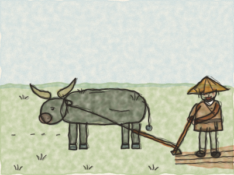
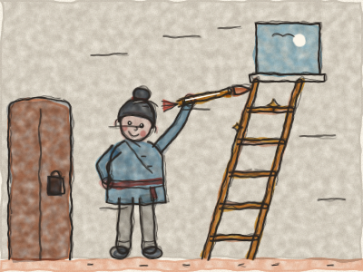
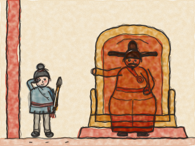
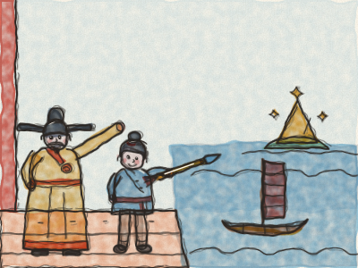
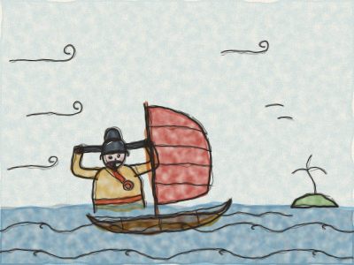
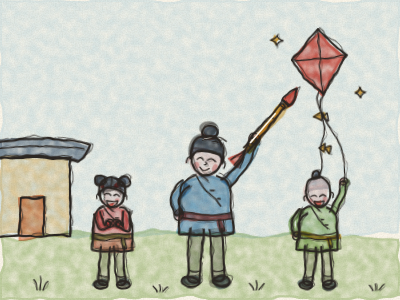

# Ma Liang e o pincel mágico

Há muito, muito tempo, numa pequena aldeia da China, vivia um rapaz chamado Ma Liang. Era muito pobre. Todos os dias apanhava lenha para a fogueira e cortava erva para os lavradores, e em troca eles davam-lhe uma tigela de arroz.

Mas, mais do que tudo no mundo, o Ma Liang adorava desenhar. Queria tanto ter um pincel! Só que um pincel custava dinheiro, e o Ma Liang não tinha nem uma moeda.

Um dia, passou por uma escola onde um pintor rico dava aulas.

— Por favor, senhor — disse o Ma Liang —, pode emprestar-me um pincel?

O pintor desatou a rir. — Um rapaz pobre como tu, a pintar quadros? Vai-te embora!

O Ma Liang não chorou. Disse para si mesmo: — Hei de aprender a desenhar na mesma.

E assim desenhava com tudo o que encontrava. À beira do rio, desenhava peixes na areia com um pau. *Risca, rasca.* Nas grandes rochas cinzentas, desenhava pássaros com um bocado de carvão preto. Em casa, desenhava nas paredes com o dedo molhado em água.

Desenhava de manhã e desenhava à noite. Desenhava as nuvens, as árvores e os patos no lago.

Dia após dia, os desenhos ficavam cada vez mais bonitos. Pareciam tão verdadeiros que os pardais vinham chilrear para os pássaros das rochas, e os gatos aproximavam-se para cheirar os peixes na areia!

Uma noite, o Ma Liang estava tão cansado que adormeceu na sua esteirinha, ainda com o bocado de carvão na mão.

Enquanto dormia, o Ma Liang teve um sonho. Uma luz dourada e suave encheu o seu quartinho, e ali estava um velhinho bondoso, com uma longa barba branca.

— Ma Liang — disse o velhinho com doçura —, trabalhaste tanto. Aqui tens um presente para ti. — E deu ao rapaz um pincel. Não era um pincel qualquer. Era feito de ouro, e brilhava como o sol.

— Este é um pincel mágico — disse o velhinho. — Usa-o para ajudar quem precisa. Nunca por ganância.

— Prometo — disse o Ma Liang.

Quando acordou, o quarto estava outra vez às escuras e o velhinho tinha desaparecido. Mas ali, na mão do Ma Liang, estava o pincel dourado!

O Ma Liang deu um salto. Encontrou um papel velho e pintou um passarinho, com a cauda vermelha e uns olhos pretos muito brilhantes.

*Zás, zás, zás…* e ganhou vida! O passarinho sacudiu as penas, cantou *piu-piu* e saiu a voar do papel e pela janela fora.

O Ma Liang correu até ao rio. Pintou um peixe numa pedra lisa. *Zás, zás, zás…* e ganhou vida! *Chape!* O peixe saltou para a água e foi-se embora a nadar.

Nesse momento, passou por ali um velho lavrador. Puxava sozinho um arado pesado pelo campo, e bufava e arfava.

— Não tenho nenhum búfalo para puxar o meu arado — suspirou ele.

O que achas que o Ma Liang pintou? *(Faz uma pausa e deixa a Constance adivinhar.)*

Pintou um búfalo de água grande e forte, com uns chifres compridos e curvos. *Zás, zás, zás…* e ganhou vida! *Muuuu!*, fez o búfalo, e começou a puxar o arado. O velho lavrador ria-se de alegria.

No dia seguinte, apareceu uma menina que trazia água de muito longe, e doíam-lhe os braços. O Ma Liang pintou-lhe dois baldes novos. Depois, como os campos estavam secos porque não chovia há semanas, pintou um poço fundo com uma grande nora de madeira. *Zás, zás, zás…* A água fresquinha saiu aos borbotões, e o arroz voltou a ficar verde.

Todos os dias, o Ma Liang pintava para a gente pobre da aldeia. E nunca pedia nada em troca.

Mas na aldeia também vivia um homem rico e ganancioso. Quando ouviu falar do pincel mágico, mandou os criados irem buscar o Ma Liang.

— Pinta-me ouro! — disse o homem rico. — Moedas de ouro! Montes e montes delas!

— Não — disse o Ma Liang. — O meu pincel é para as pessoas que precisam de ajuda.

O homem rico ficou furioso. Fechou o Ma Liang num quarto com uma única janelinha, lá muito no alto. — Vais ficar aí até me pintares ouro!

Mas o Ma Liang não tinha medo. Pegou no pincel dourado e pintou uma escada na parede, até à janela. *Zás, zás, zás…* e ganhou vida! O Ma Liang subiu, subiu, subiu, escapuliu-se pela janela e fugiu para bem longe daquele homem ganancioso.

Ora, a notícia do pincel mágico chegou até ao palácio do Imperador. E o Imperador gostava de ouro ainda mais do que o homem rico.

Os soldados encontraram o Ma Liang e levaram-no ao palácio. O Imperador estava sentado no seu trono dourado, com uma longa túnica amarela e um chapéu preto alto.

— Então és tu o rapaz do pincel mágico — disse o Imperador. — Pinta-me uma montanha de ouro! Já!

O Ma Liang pensou durante muito tempo. Depois sorriu. — Muito bem, Majestade. Mas uma montanha de ouro tem de ficar numa ilha, no meio do mar. Por isso, primeiro tenho de pintar o mar.

Pintou o mar, imenso e azul. *Zás, zás, zás…* e ganhou vida! Pequenas ondas vieram bater nos degraus do palácio, e os peixes saltavam na água. Muito, muito ao longe, pintou uma ilha, e na ilha uma montanha de ouro que cintilava ao sol.

— Ouro! — gritou o Imperador. — O meu ouro! Depressa, pinta-me um barco!

Então o Ma Liang pintou um grande barco de madeira com uma vela vermelha. O Imperador subiu para o barco e sentou-se no meio, de braços cruzados.

— Não anda! — resmungou ele. — Pinta-me vento!

O Ma Liang pintou um ventinho. *Fuuu…* A vela encheu-se, e o barco começou a andar.

— Mais vento! — gritou o Imperador. — Mais depressa!

O Ma Liang pintou mais vento. *FUUUUUCH!* As ondas ficaram maiores, e o barco navegava cada vez mais depressa.

— Chega! Chega! — gritava o Imperador, a agarrar o chapéu. Mas o vento soprava e soprava, e o barco foi para muito, muito longe. Passou pela montanha de ouro sem parar e chegou, por fim, a uma pequena ilha verde onde não havia ouro nenhum.

E o Imperador lá ficou. Aprendeu a pescar, a cultivar arroz e a partilhar o jantar com os marinheiros que por ali passavam. E nunca mais incomodou ninguém.

Quanto ao Ma Liang, voltou para a sua aldeia. E continuou a pintar, tal como tinha prometido ao velhinho bondoso.

Pintou um papagaio de papel para as crianças, e *zás, zás, zás…* ele subiu até ao céu. Pintou um telhado quentinho para uma avozinha cuja casa deixava entrar a chuva. Pintou uma pequena ponte sobre o rio, para que toda a gente pudesse ir ao mercado.

Nunca pintou ouro. Nem uma única vez.

E dizem que, se alguma vez vires uma imagem tão bonita que te parece que vai sair a voar, talvez tenha sido o Ma Liang a pintá-la.

> Um dom é mais precioso quando o usamos para ajudar os outros.
