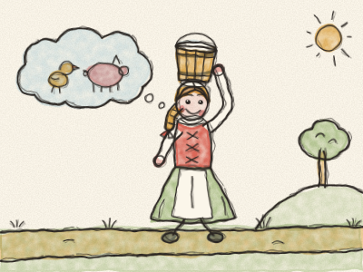
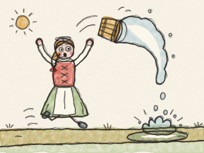

# The Milkmaid and Her Pail

Once upon a time, there was a milkmaid called Perrette. One sunny morning, she put a big pail of fresh milk on her head and set off to sell it at the market. *Step, step, step.*

As she walked, she began to dream. “With the money for my milk,” she said, “I shall buy a hundred eggs.

“The eggs will hatch into a hundred little chicks. *Cheep, cheep, cheep!* The chicks will grow into fine fat hens, and I shall sell them.

“With the money for my hens, I shall buy a little pig. *Oink, oink!* I shall feed him, and he will grow big and round, and I shall sell him too.

“And with the money for my pig, I shall buy a cow, and a little calf that jumps and skips about in the meadow, just like this!”

And Perrette gave a happy little skip. *Hop!*

*Wobble, wobble… SPLOSH!* The pail tipped off her head, and all the milk spilled out onto the road.

*(Pause, and ask Constance: where did the milk go?)*

Goodbye, milk. Goodbye, eggs and chicks and hens. Goodbye, pig. Goodbye, cow and little calf.

Perrette looked at the white puddle, and then she laughed. “Oh well,” she said. “Tomorrow I shall carry my pail very carefully, and think about one thing at a time.”

> Don’t count your chickens before they hatch.
