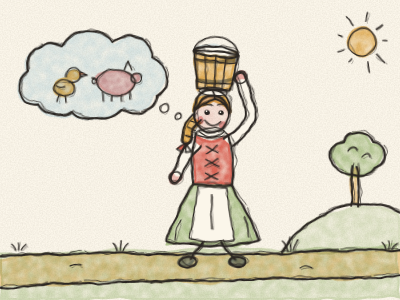
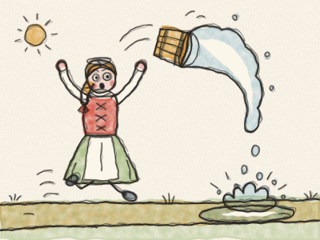

# La Laitière et le Pot au lait

Il était une fois une laitière qui s’appelait Perrette. Un beau matin, elle posa sur sa tête un grand pot de lait frais et partit le vendre au marché. *Pas, pas, pas.*

En marchant, elle se mit à rêver. « Avec l’argent de mon lait, dit-elle, j’achèterai cent œufs.

« Les œufs deviendront cent petits poussins. *Piou, piou, piou !* Les poussins deviendront de belles poules bien grasses, et je les vendrai.

« Avec l’argent de mes poules, j’achèterai un petit cochon. *Groin, groin !* Je le nourrirai, il deviendra gros et rond, et je le vendrai aussi.

« Et avec l’argent de mon cochon, j’achèterai une vache, et un petit veau qui sautera et gambadera dans le pré, comme ça ! »

Et Perrette fit un petit saut de joie. *Hop !*

*Bascule, bascule… PLOUF !* Le pot glissa de sa tête, et tout le lait se renversa sur la route.

*(Faites une pause et demandez à Constance : où est passé le lait ?)*

Adieu le lait. Adieu les œufs, les poussins et les poules. Adieu le cochon. Adieu la vache et le petit veau.

Perrette regarda la flaque blanche, puis elle éclata de rire. « Tant pis, dit-elle. Demain, je porterai mon pot bien doucement, et je penserai à une seule chose à la fois. »

> Il ne faut pas vendre la peau de l’ours avant de l’avoir tué.
