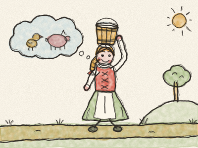
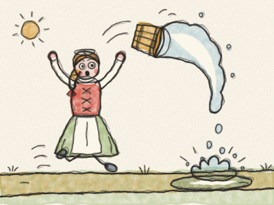

# A Leiteira e o Cântaro de Leite

Era uma vez uma leiteira chamada Perrette. Numa bela manhã de sol, pôs na cabeça um grande cântaro de leite fresquinho e partiu para o vender no mercado. *Passo, passo, passo.*

Enquanto caminhava, começou a sonhar. «Com o dinheiro do leite», disse ela, «vou comprar cem ovos.

«Dos ovos vão nascer cem pintainhos. *Piu, piu, piu!* Os pintainhos vão crescer e ser galinhas bonitas e gordas, e eu vendo-as.

«Com o dinheiro das galinhas, compro um porquinho. *Oinc, oinc!* Dou-lhe de comer, ele fica grande e redondo, e também o vendo.

«E com o dinheiro do porco, compro uma vaca, e um vitelinho que salta e corre pelo prado, assim mesmo!»

E a Perrette deu um saltinho de alegria. *Hop!*

*Abana, abana… CHAPE!* O cântaro caiu-lhe da cabeça, e o leite todo entornou-se na estrada.

*(Faça uma pausa e pergunte à Constance: para onde foi o leite?)*

Adeus, leite. Adeus, ovos, pintainhos e galinhas. Adeus, porquinho. Adeus, vaca e vitelinho.

A Perrette olhou para a poça branca, e depois desatou a rir. — Paciência — disse ela. — Amanhã levo o cântaro com muito cuidado, e penso numa coisa de cada vez.

> Não se deve contar com os pintainhos antes de saírem da casca.
