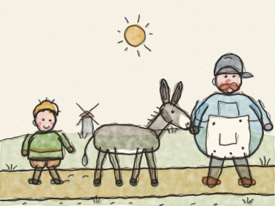
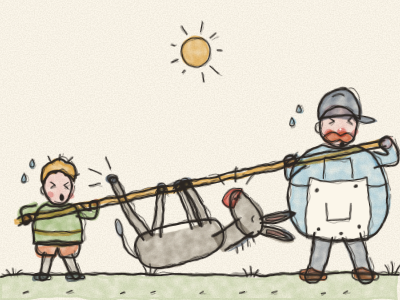

# The Miller, His Son and the Donkey

One morning, a miller and his son set off to sell their donkey at the market. They walked along the road beside him, *clip-clop, clip-clop*.

Soon they met some girls by a well. “Look at those two!” giggled the girls. “They have a donkey, and they walk!”

So the miller put his son on the donkey’s back. *Clip-clop, clip-clop.*

Then they passed some old men. “Shame on you, boy!” said the old men. “You ride, and your poor old father has to walk!”

So the son got down, and the miller climbed up. *Clip-clop, clip-clop.*

Then they passed some mothers. “What a lazy father!” said the mothers. “He rides, and his poor little boy has to walk!”

So the son climbed up behind his father, and they both rode. *Clip… clop… puff… puff…*

Then they met a farmer. “Two of you on one little donkey?” cried the farmer. “You’re strong enough to carry him yourselves!”

So the miller and his son tied the donkey’s legs to a long pole and carried him upside down. *Puff, pant, puff.*

*(Ask Constance: do you think the donkey liked that?)*

Everybody laughed. *Ha ha ha!* The donkey didn’t like it at all. He kicked, *hee-haw!*, the rope came loose, and the miller, the son and the donkey all tumbled into a soft heap on the grass.

The miller sat up, picked a daisy out of his hair, and began to laugh too. “Well, son,” he said, “we tried to please everybody, and we pleased nobody, not even the donkey. From now on, we shall do what we think is best.”

And they walked home together, side by side, *clip-clop, clip-clop*.

> If you try to please everyone, you will please no one.
