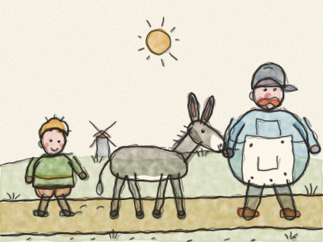
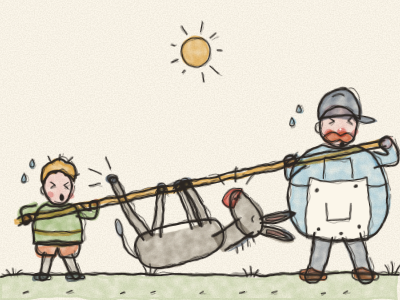

# Le Meunier, son Fils et l’Âne

Un matin, un meunier et son fils partirent vendre leur âne au marché. Ils marchaient sur la route à côté de lui, *clip-clop, clip-clop*.

Bientôt, ils croisèrent des jeunes filles près d’un puits. « Regardez-moi ces deux-là ! » pouffèrent les jeunes filles. « Ils ont un âne, et ils vont à pied ! »

Alors le meunier fit monter son fils sur le dos de l’âne. *Clip-clop, clip-clop.*

Puis ils passèrent devant de vieux messieurs. « Quelle honte, petit ! » dirent les vieux messieurs. « Tu es sur l’âne, et ton pauvre vieux père doit marcher ! »

Alors le fils descendit, et le meunier monta à sa place. *Clip-clop, clip-clop.*

Puis ils passèrent devant des mamans. « Quel père paresseux ! » dirent les mamans. « Il est sur l’âne, et son pauvre petit garçon doit marcher ! »

Alors le fils grimpa derrière son père, et ils montèrent tous les deux. *Clip… clop… pff… pff…*

Puis ils rencontrèrent un fermier. « À deux sur un si petit âne ? » s’écria le fermier. « Vous êtes bien assez forts pour le porter vous-mêmes ! »

Alors le meunier et son fils attachèrent les pattes de l’âne à une longue perche et le portèrent la tête en bas. *Pff, ouf, pff.*

*(Demandez à Constance : à ton avis, l’âne était-il content ?)*

Tout le monde éclata de rire. *Ha ha ha !* L’âne n’aimait pas ça du tout. Il donna un grand coup de pied, *hi-han !*, la corde se défit, et le meunier, le fils et l’âne roulèrent tous ensemble dans l’herbe toute douce.

Le meunier se redressa, retira une pâquerette de ses cheveux et se mit à rire lui aussi. « Eh bien, mon fils, dit-il, nous avons voulu plaire à tout le monde, et nous n’avons plu à personne, pas même à l’âne. Désormais, nous ferons ce qui nous semble juste. »

Et ils rentrèrent ensemble à la maison, côte à côte, *clip-clop, clip-clop*.

> Est bien fou du cerveau qui prétend contenter tout le monde et son père.
