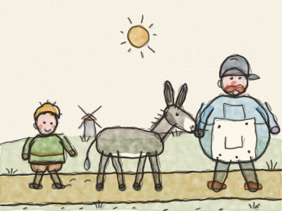
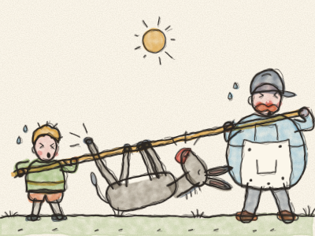

# O Moleiro, o Filho e o Burro

Numa manhã, um moleiro e o filho partiram para vender o burro no mercado. Iam pela estrada a pé, ao lado dele, *cloc-cloc, cloc-cloc*.

Pouco depois, encontraram umas raparigas junto a um poço. — Olhem para aqueles dois! — riram-se as raparigas. — Têm um burro e vão a pé!

Então o moleiro pôs o filho em cima do burro. *Cloc-cloc, cloc-cloc.*

Depois passaram por uns senhores velhotes. — Que vergonha, rapaz! — disseram os velhotes. — Tu vais montado, e o teu pobre pai, já velho, tem de ir a pé!

Então o filho desceu, e o moleiro subiu para o burro. *Cloc-cloc, cloc-cloc.*

Depois passaram por umas mães. — Que pai tão preguiçoso! — disseram as mães. — Ele vai montado, e o pobre do filho pequenino tem de ir a pé!

Então o filho subiu para trás do pai, e foram os dois montados. *Cloc… cloc… uf… uf…*

Depois encontraram um lavrador. — Dois num burrinho tão pequeno? — exclamou o lavrador. — Vocês são bem fortes para o levarem às costas!

Então o moleiro e o filho amarraram as patas do burro a uma vara comprida e levaram-no de pernas para o ar. *Uf, ai, uf.*

*(Pergunte à Constance: achas que o burro gostou?)*

Toda a gente se riu. *Ah ah ah!* O burro não gostou nada. Deu um coice, *ió-ió!*, a corda soltou-se, e o moleiro, o filho e o burro caíram todos num monte, na erva macia.

O moleiro sentou-se, tirou um malmequer do cabelo e começou a rir-se também. — Ora bem, filho — disse ele —, quisemos agradar a toda a gente e não agradámos a ninguém, nem sequer ao burro. De hoje em diante, vamos fazer o que achamos melhor.

E voltaram juntos para casa, lado a lado, *cloc-cloc, cloc-cloc*.

> Quem quer agradar a todos não agrada a ninguém.
