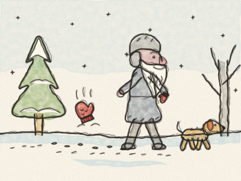
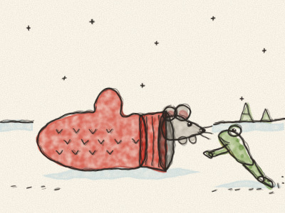
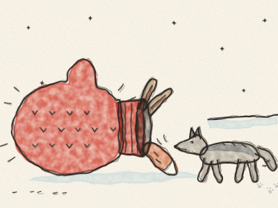
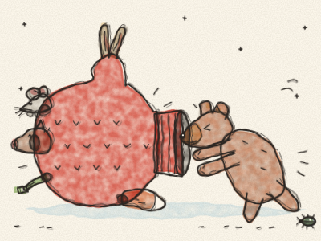
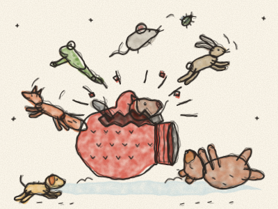

# The Mitten

One cold, cold winter morning, an old Grandfather went into the forest to gather wood. His little dog trotted beside him, *crunch, crunch*, through the snow. Grandfather wore a warm red mitten on each hand, knitted by Grandmother. But on the way home, one of the mittens slipped off and fell into the snow. *Flump.* And Grandfather didn’t notice at all.

Soon a little Mouse came scampering by. *Scritch, scratch.* She saw the red mitten lying in the snow. “Oh, what a lovely house!” she squeaked. And in she went.

Then a Frog came hopping along. *Hop, hop.* “Knock, knock! Who lives in the mitten?”

“I do, Squeaky Mouse! And who are you?”

“I’m Froggy Frog. It’s so cold out here. May I come in?”

“Of course! Come in!” So now there were two.

Then a Hare came bounding along. *Boing, boing.* “Knock, knock! Who lives in the mitten?”

“Squeaky Mouse and Froggy Frog! And who are you?”

“I’m Jumpy Hare. May I come in too?”

“Of course! Come in!” So now there were three.

Then a Fox came trotting along, with her fluffy tail. “Knock, knock! Who lives in the mitten?”

“Squeaky Mouse, Froggy Frog and Jumpy Hare! And who are you?”

“I’m Sister Fox. May I come in?”

“Come in!” So now there were four, and the mitten was getting rather full.

Then a grey Wolf came padding along. *Pad, pad.* “Knock, knock! Who lives in the mitten?”

“Squeaky Mouse, Froggy Frog, Jumpy Hare and Sister Fox! And who are you?”

“I’m Grey Wolf. May I come in?”

“Well… we’ll squeeze up!” *Squish!* So now there were five.

Then a Wild Boar came stomping along. *Snort, snort.* “Knock, knock! Who lives in the mitten?”

“Squeaky Mouse, Froggy Frog, Jumpy Hare, Sister Fox and Grey Wolf! And who are you?”

“I’m Snorty Boar. May I come in?”

“Oh dear, it’s very full… but come in!” *Squash!* So now there were six. The mitten was stretched as tight as a drum, and its little stitches went *creak, creak*.

And then, *thump, thump, thump*, along came a great big Bear. “Knock, knock! Who lives in the mitten?”

“Squeaky Mouse, Froggy Frog, Jumpy Hare, Sister Fox, Grey Wolf and Snorty Boar! And who are you?”

“I’m Big Brown Bear,” said the Bear in his deep, deep voice. “May I come in?”

“There’s no room!” they all cried.

“Oh, please,” said the Bear. “Just a teeny little corner.”

So everybody breathed in, and the Bear pushed, and pushed, and squeezed himself inside. *SQUEEEEZE!* So now there were seven, all squashed in together, nose to tail, as warm as toast.

Just then, a tiny little Beetle came crawling over the snow. “Knock, knock,” she said in the smallest voice. “May I come in too?”

“Well,” said the Mouse, “you are very small…”

The Beetle climbed in. And the mitten went *creak*… and *crack*… and…

*POP!*

The mitten burst open, and out tumbled everyone, *whoosh*, into the soft snow: the Mouse, the Frog, the Hare, the Fox, the Wolf, the Boar, the Bear and the tiny Beetle, rolling and laughing.

At that very moment, Grandfather’s little dog came running back along the path. *Woof! Woof!* All the animals scampered off into the forest, still giggling, and the dog found the red mitten lying in the snow.

Grandfather picked it up. It was very stretched, and it had a big hole in it. “Goodness me,” he said. “What happened to you?”

When they got home, Grandmother sewed it up again, with a smile. And nobody ever told them that, for one cold morning, the little red mitten had been the warmest house in the whole forest.

> There is always room for one more friend, as long as everyone squeezes up a little.
