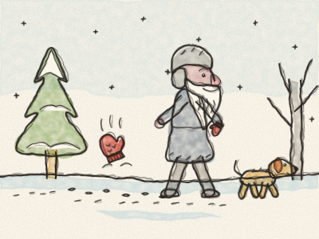
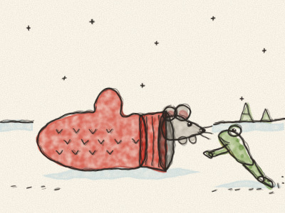
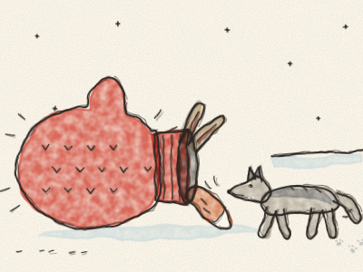
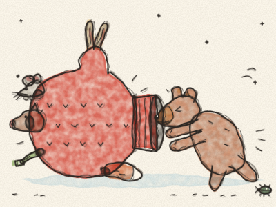
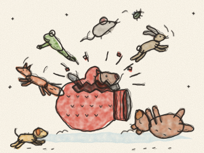

# La Moufle

Par un froid, froid matin d’hiver, un vieux Grand-père partit dans la forêt ramasser du bois. Son petit chien trottait à côté de lui, *crouch, crouch*, dans la neige. Grand-père portait une belle moufle rouge à chaque main, tricotée par Grand-mère. Mais sur le chemin du retour, une des moufles glissa et tomba dans la neige. *Flomp.* Et Grand-père ne remarqua rien du tout.

Bientôt, une petite Souris passa en trottinant. *Gratte, gratte.* Elle vit la moufle rouge dans la neige. « Oh, quelle jolie maison ! » couina-t-elle. Et elle entra.

Puis arriva une Grenouille, en sautillant. *Hop, hop.* « Toc, toc ! Qui habite dans la moufle ? »

« Moi, Souris Couinette ! Et toi, qui es-tu ? »

« Je suis Grenouille Sauteuse. Il fait si froid dehors. Je peux entrer ? »

« Bien sûr ! Entre ! » Et maintenant, elles étaient deux.

Puis arriva un Lièvre, en bondissant. *Boing, boing.* « Toc, toc ! Qui habite dans la moufle ? »

« Souris Couinette et Grenouille Sauteuse ! Et toi, qui es-tu ? »

« Je suis Lièvre Bondissant. Je peux entrer, moi aussi ? »

« Bien sûr ! Entre ! » Et maintenant, ils étaient trois.

Puis arriva une Renarde, avec sa queue toute touffue. « Toc, toc ! Qui habite dans la moufle ? »

« Souris Couinette, Grenouille Sauteuse et Lièvre Bondissant ! Et toi, qui es-tu ? »

« Je suis Sœur Renarde. Je peux entrer ? »

« Entre ! » Et maintenant, ils étaient quatre, et la moufle commençait à être bien pleine.

Puis arriva un Loup gris, à pas de velours. *Pad, pad.* « Toc, toc ! Qui habite dans la moufle ? »

« Souris Couinette, Grenouille Sauteuse, Lièvre Bondissant et Sœur Renarde ! Et toi, qui es-tu ? »

« Je suis Loup Gris. Je peux entrer ? »

« Eh bien… on va se serrer ! » *Scrouitch !* Et maintenant, ils étaient cinq.

Puis arriva un Sanglier, en tapant des pattes. *Groin, groin.* « Toc, toc ! Qui habite dans la moufle ? »

« Souris Couinette, Grenouille Sauteuse, Lièvre Bondissant, Sœur Renarde et Loup Gris ! Et toi, qui es-tu ? »

« Je suis Sanglier Grognon. Je peux entrer ? »

« Oh là là, c’est très plein… mais entre ! » *Scrouatch !* Et maintenant, ils étaient six. La moufle était tendue comme un tambour, et ses petites mailles faisaient *cric, crac*.

Et alors, *boum, boum, boum*, arriva un très gros Ours. « Toc, toc ! Qui habite dans la moufle ? »

« Souris Couinette, Grenouille Sauteuse, Lièvre Bondissant, Sœur Renarde, Loup Gris et Sanglier Grognon ! Et toi, qui es-tu ? »

« Je suis Gros Ours Brun », dit l’Ours de sa voix grave, grave. « Je peux entrer ? »

« Il n’y a plus de place ! » crièrent-ils tous.

« Oh, s’il vous plaît », dit l’Ours. « Juste un tout petit coin. »

Alors tout le monde rentra le ventre, et l’Ours poussa, poussa, et se faufila à l’intérieur. *SCROUIIIITCH !* Et maintenant, ils étaient sept, tous serrés ensemble, le nez contre la queue, bien au chaud comme du pain grillé.

Juste à ce moment, un tout petit Scarabée arriva en marchant sur la neige. « Toc, toc », dit-il d’une toute petite voix. « Je peux entrer, moi aussi ? »

« Eh bien, dit la Souris, tu es tout petit… »

Le Scarabée grimpa dedans. Et la moufle fit *cric*… et *crac*… et…

*POP !*

La moufle éclata, et tout le monde roula dehors, *wouch*, dans la neige toute douce : la Souris, la Grenouille, le Lièvre, la Renarde, le Loup, le Sanglier, l’Ours et le tout petit Scarabée, en culbutant et en riant.

Au même moment, le petit chien de Grand-père revint en courant sur le chemin. *Ouaf ! Ouaf !* Tous les animaux filèrent dans la forêt, en riant encore, et le chien trouva la moufle rouge dans la neige.

Grand-père la ramassa. Elle était toute distendue, et il y avait un grand trou dedans. « Ça alors, dit-il. Que t’est-il arrivé ? »

À la maison, Grand-mère la recousit en souriant. Et personne ne leur raconta jamais que, pendant un froid matin, la petite moufle rouge avait été la maison la plus chaude de toute la forêt.

> Il y a toujours de la place pour un ami de plus, si chacun se serre un peu.
