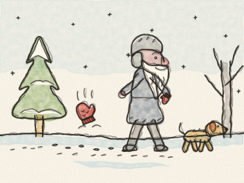
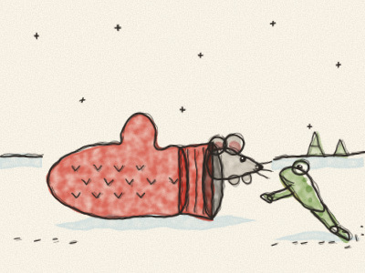
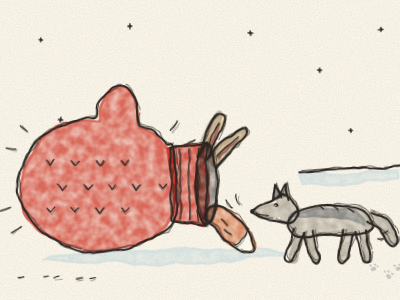
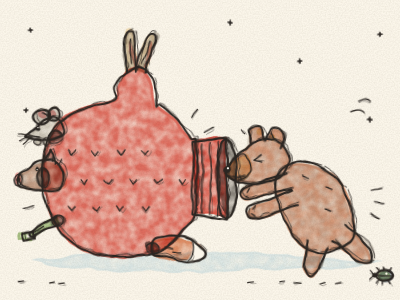
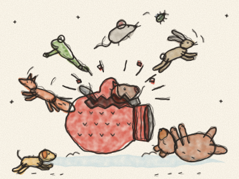

# A Luva

Numa manhã de inverno muito, muito fria, um Avô velhinho foi à floresta apanhar lenha. O seu cãozinho trotava ao lado dele, *crunch, crunch*, pela neve. O Avô levava uma luva vermelha bem quentinha em cada mão, tricotada pela Avó. Mas no caminho para casa, uma das luvas escorregou e caiu na neve. *Flump.* E o Avô nem reparou.

Pouco depois, passou por ali uma Ratinha, a correr. *Risca, rasca.* Viu a luva vermelha deitada na neve. — Oh, que casa tão bonita! — guinchou ela. E entrou.

Depois chegou uma Rã, aos saltinhos. *Hop, hop.* — Truz, truz! Quem mora na luva?

— Eu, a Ratinha Guincha! E tu, quem és?

— Sou a Rã Saltitona. Está tanto frio cá fora. Posso entrar?

— Claro! Entra! — E agora eram duas.

Depois chegou uma Lebre, aos pulos. *Boing, boing.* — Truz, truz! Quem mora na luva?

— A Ratinha Guincha e a Rã Saltitona! E tu, quem és?

— Sou a Lebre Pula-Pula. Também posso entrar?

— Claro! Entra! — E agora eram três.

Depois chegou uma Raposa, com a sua cauda fofa. — Truz, truz! Quem mora na luva?

— A Ratinha Guincha, a Rã Saltitona e a Lebre Pula-Pula! E tu, quem és?

— Sou a Comadre Raposa. Posso entrar?

— Entra! — E agora eram quatro, e a luva começava a ficar bem cheia.

Depois chegou um Lobo cinzento, de mansinho. *Pad, pad.* — Truz, truz! Quem mora na luva?

— A Ratinha Guincha, a Rã Saltitona, a Lebre Pula-Pula e a Comadre Raposa! E tu, quem és?

— Sou o Lobo Cinzento. Posso entrar?

— Bem… a gente aperta-se! — *Esmaga!* E agora eram cinco.

Depois chegou um Javali, a bater com as patas. *Ronc, ronc.* — Truz, truz! Quem mora na luva?

— A Ratinha Guincha, a Rã Saltitona, a Lebre Pula-Pula, a Comadre Raposa e o Lobo Cinzento! E tu, quem és?

— Sou o Javali Resmungão. Posso entrar?

— Ai, está muito cheia… mas entra! — *Espreme!* E agora eram seis. A luva estava esticada como um tambor, e os pontinhos de lã faziam *crec, crec*.

E então, *tum, tum, tum*, chegou um Urso enorme. — Truz, truz! Quem mora na luva?

— A Ratinha Guincha, a Rã Saltitona, a Lebre Pula-Pula, a Comadre Raposa, o Lobo Cinzento e o Javali Resmungão! E tu, quem és?

— Sou o Grande Urso Castanho — disse o Urso com a sua voz grossa, grossa. — Posso entrar?

— Não há espaço! — gritaram todos.

— Oh, por favor — disse o Urso. — Só um cantinho pequenino.

Então toda a gente encolheu a barriga, e o Urso empurrou, empurrou, e enfiou-se lá dentro. *ESPREEEME!* E agora eram sete, todos apertadinhos, focinho contra cauda, quentinhos como pão acabado de sair do forno.

Nesse momento, um Escaravelho pequenino chegou a andar pela neve. — Truz, truz — disse ele com a voz mais pequenina do mundo. — Também posso entrar?

— Bem — disse a Ratinha —, tu és muito pequenino…

O Escaravelho trepou lá para dentro. E a luva fez *crec*… e *crac*… e…

*PUM!*

A luva rebentou, e saíram todos a rebolar, *zás*, para a neve fofinha: a Ratinha, a Rã, a Lebre, a Raposa, o Lobo, o Javali, o Urso e o Escaravelho pequenino, aos trambolhões e às gargalhadas.

Nesse preciso momento, o cãozinho do Avô voltou a correr pelo caminho. *Ão! Ão!* Os animais fugiram todos para a floresta, ainda a rir, e o cão encontrou a luva vermelha deitada na neve.

O Avô apanhou-a. Estava toda esticada e tinha um grande buraco. — Ora esta! — disse ele. — O que te aconteceu?

Em casa, a Avó coseu-a outra vez, a sorrir. E ninguém lhes contou que, numa manhã fria, a pequena luva vermelha tinha sido a casa mais quentinha de toda a floresta.

> Há sempre lugar para mais um amigo, se cada um se apertar um bocadinho.
