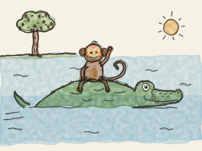
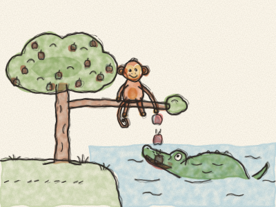
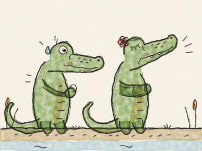
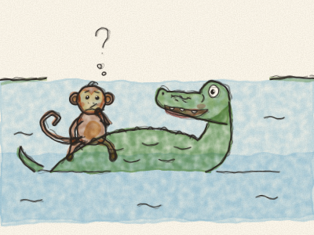
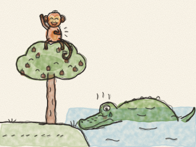

# The Monkey and the Crocodile

On the bank of a wide, wide river there grew a big rose-apple tree, and in that tree lived a little Monkey. Every day he swung from branch to branch, *wheee!*, and ate the sweet purple rose-apples that grew there.

One day, a big green Crocodile swam up the river, *swish, swish*, and lay down in the mud under the tree to rest.

“Hello!” called the Monkey. “You look tired. Would you like some rose-apples? They’re the sweetest in the whole jungle!” And he threw down a handful. *Plop, plop, plop!*

The Crocodile caught them in his big mouth. *Snap!* “Mmm,” he said. “Delicious! Thank you, little Monkey.”

After that, the Crocodile came back every day. The Monkey threw him rose-apples, and they talked and laughed together for hours. The Monkey told stories about the jungle, and the Crocodile told stories about the river. They became the very best of friends.

Every evening, the Crocodile took some rose-apples home to his wife.

Mrs Crocodile ate them all up. *Crunch, munch, crunch.* Then she licked her teeth and had a very greedy idea.

“If these rose-apples are so sweet,” she said, “then the heart of the Monkey who eats them every day must be the sweetest thing in the world. I want to taste it! Bring your friend home for dinner.”

“But he is my friend!” said the Crocodile.

Mrs Crocodile folded her arms and sulked. “If you don’t bring him,” she said, “I shall never speak to you again!” *Humph!*

The poor Crocodile didn’t know what to do. At last he swam back to the rose-apple tree.

“Little Monkey,” he said, “my wife wants to thank you for all your lovely fruit. She has cooked a special dinner, and you are invited. Climb on my back, and I’ll carry you across the river to our house.”

“How kind!” said the Monkey, and he jumped onto the Crocodile’s back. *Hop!*

Off they went, *swish, swish*, across the wide river. The Monkey held on tight. The water splashed all around him, and he couldn’t swim one little bit.

When they were right in the middle of the river, the Crocodile began to feel sorry. “Little Monkey,” he said, “I must tell you the truth. My wife doesn’t really want to thank you. She wants to eat your heart, because she thinks it will be as sweet as your rose-apples.”

The Monkey’s fur stood on end. He was in the middle of the river, far from his tree! But he didn’t cry and he didn’t shout. He took a deep breath and thought very fast. *(Pause, and ask Constance: what would you do?)*

“Oh, dear Crocodile!” he said. “Why didn’t you tell me before? Don’t you know? Monkeys never take their hearts with them when they go out. I left mine at home, hanging in the rose-apple tree! We must go back and fetch it.”

The Crocodile was not very clever. “Oh, what a nuisance,” he said. And he turned round and swam all the way back to the tree. *Swish, swish, swish.*

As soon as they reached the bank, the Monkey jumped off his back and scrambled up, up, up to the very top of the tree.

“Hurry up!” called the Crocodile. “Get your heart and come back down!”

The Monkey laughed. “Silly Crocodile! Everyone keeps their heart inside them. Mine is right here, going *boom-boom, boom-boom*, and here it’s going to stay! And a real friend would never try to trick his friend.”

The Crocodile hung his head. He felt very ashamed, and he swam slowly away, *swish… swish…*

And the little Monkey stayed in his rose-apple tree, swinging from branch to branch and eating his sweet purple fruit, safe and sound, for ever after.

> When you are in trouble, keep calm and think. A clever head can get you out of the deepest river.
