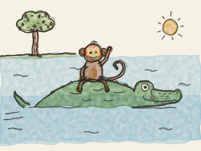
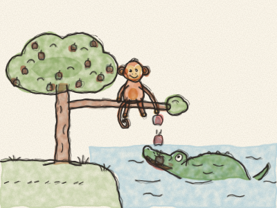
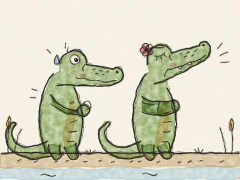
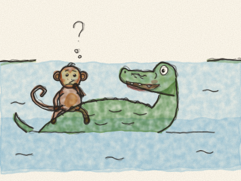
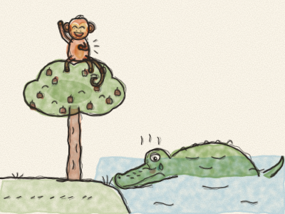

# Le Singe et le Crocodile

Au bord d’un grand, grand fleuve poussait un gros pommier-rose, et dans cet arbre vivait un petit Singe. Chaque jour, il se balançait de branche en branche, *youpiii !*, et mangeait les pommes-roses violettes et sucrées qui poussaient là.

Un jour, un gros Crocodile vert remonta le fleuve, *flich, flich*, et s’allongea dans la boue sous l’arbre pour se reposer.

« Bonjour ! » lança le Singe. « Tu as l’air fatigué. Tu veux des pommes-roses ? Ce sont les plus sucrées de toute la jungle ! » Et il en jeta une poignée. *Ploc, ploc, ploc !*

Le Crocodile les attrapa dans sa grande gueule. *Clac !* « Mmm, dit-il. Délicieux ! Merci, petit Singe. »

Après cela, le Crocodile revint tous les jours. Le Singe lui lançait des pommes-roses, et ils bavardaient et riaient ensemble pendant des heures. Le Singe racontait des histoires de la jungle, et le Crocodile des histoires du fleuve. Ils devinrent les meilleurs amis du monde.

Chaque soir, le Crocodile rapportait quelques pommes-roses à sa femme.

Madame Crocodile les mangeait toutes. *Crunch, miam, crunch.* Puis elle se lécha les dents et eut une idée très gourmande.

« Si ces pommes-roses sont si sucrées, dit-elle, alors le cœur du Singe qui en mange tous les jours doit être la chose la plus sucrée du monde. Je veux y goûter ! Invite ton ami à dîner. »

« Mais c’est mon ami ! » dit le Crocodile.

Madame Crocodile croisa les bras et se mit à bouder. « Si tu ne l’amènes pas, dit-elle, je ne te parlerai plus jamais ! » *Hmpf !*

Le pauvre Crocodile ne savait plus quoi faire. Finalement, il retourna à la nage jusqu’au pommier-rose.

« Petit Singe, dit-il, ma femme veut te remercier pour tous tes bons fruits. Elle a préparé un dîner spécial, et tu es invité. Monte sur mon dos, je vais te porter de l’autre côté du fleuve, jusqu’à notre maison. »

« Comme c’est gentil ! » dit le Singe, et il sauta sur le dos du Crocodile. *Hop !*

Les voilà partis, *flich, flich*, à travers le grand fleuve. Le Singe se tenait bien fort. L’eau éclaboussait tout autour de lui, et il ne savait pas nager du tout.

Quand ils furent en plein milieu du fleuve, le Crocodile eut des remords. « Petit Singe, dit-il, je dois te dire la vérité. Ma femme ne veut pas vraiment te remercier. Elle veut manger ton cœur, parce qu’elle croit qu’il sera aussi sucré que tes pommes-roses. »

Le Singe en eut les poils tout hérissés. Il était au milieu du fleuve, loin de son arbre ! Mais il ne pleura pas et il ne cria pas. Il respira un grand coup et réfléchit très vite. *(Faites une pause et demandez à Constance : et toi, qu’est-ce que tu ferais ?)*

« Oh, cher Crocodile ! dit-il. Pourquoi ne me l’as-tu pas dit plus tôt ? Tu ne savais pas ? Les singes n’emportent jamais leur cœur quand ils sortent. J’ai laissé le mien à la maison, accroché dans le pommier-rose ! Il faut retourner le chercher. »

Le Crocodile n’était pas très malin. « Oh, quelle barbe », dit-il. Et il fit demi-tour et nagea jusqu’à l’arbre. *Flich, flich, flich.*

Dès qu’ils arrivèrent sur la rive, le Singe sauta de son dos et grimpa, grimpa, grimpa tout en haut de l’arbre.

« Dépêche-toi ! » cria le Crocodile. « Prends ton cœur et redescends ! »

Le Singe éclata de rire. « Crocodile, gros nigaud ! Tout le monde garde son cœur à l’intérieur. Le mien est juste là, il fait *boum-boum, boum-boum*, et il va y rester ! Et un vrai ami ne cherche jamais à piéger son ami. »

Le Crocodile baissa la tête. Il avait très honte, et il s’éloigna lentement à la nage, *flich… flich…*

Et le petit Singe resta dans son pommier-rose, à se balancer de branche en branche et à manger ses fruits violets et sucrés, sain et sauf, pour toujours.

> Quand tu as un problème, garde ton calme et réfléchis. Une tête maligne peut te sortir du fleuve le plus profond.
