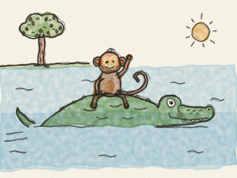
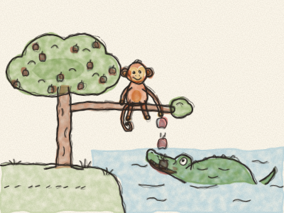
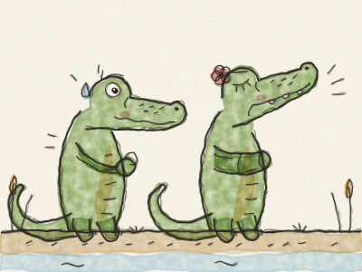
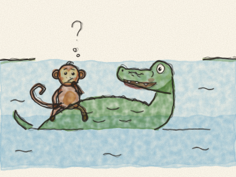
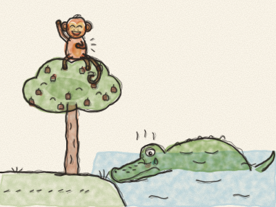

# O Macaco e o Crocodilo

Na margem de um rio muito, muito largo, crescia um grande jambeiro, e nessa árvore vivia um Macaquinho. Todos os dias ele saltava de ramo em ramo, *uiii!*, e comia os jambos roxos e docinhos que lá cresciam.

Um dia, um grande Crocodilo verde subiu o rio a nadar, *chape, chape*, e deitou-se na lama debaixo da árvore para descansar.

— Olá! — chamou o Macaquinho. — Pareces cansado. Queres uns jambos? São os mais doces da selva inteira! — E atirou-lhe uma mão-cheia. *Ploc, ploc, ploc!*

O Crocodilo apanhou-os com a sua bocarra. *Nhac!* — Mmm — disse ele. — Que delícia! Obrigado, Macaquinho.

A partir daí, o Crocodilo voltava todos os dias. O Macaquinho atirava-lhe jambos, e os dois conversavam e riam juntos durante horas. O Macaquinho contava histórias da selva, e o Crocodilo contava histórias do rio. Ficaram os melhores amigos do mundo.

Todas as tardes, o Crocodilo levava uns jambos para casa, para a mulher.

A senhora Crocodilo comia-os todos. *Crunch, nham, crunch.* Depois lambeu os dentes e teve uma ideia muito gulosa.

— Se estes jambos são tão doces — disse ela —, então o coração do Macaco que os come todos os dias deve ser a coisa mais doce do mundo. Quero prová-lo! Traz o teu amigo cá a casa para jantar.

— Mas ele é meu amigo! — disse o Crocodilo.

A senhora Crocodilo cruzou os braços e ficou amuada. — Se não o trouxeres — disse ela —, nunca mais falo contigo! *Hunf!*

O pobre Crocodilo não sabia o que fazer. Por fim, voltou a nadar até ao jambeiro.

— Macaquinho — disse ele —, a minha mulher quer agradecer-te por toda a tua fruta tão boa. Fez um jantar especial, e tu estás convidado. Sobe para as minhas costas, que eu levo-te até à nossa casa, do outro lado do rio.

— Que simpático! — disse o Macaquinho, e saltou para as costas do Crocodilo. *Hop!*

E lá foram eles, *chape, chape*, a atravessar o grande rio. O Macaquinho agarrava-se com força. A água salpicava tudo à volta dele, e ele não sabia nadar nem um bocadinho.

Quando estavam mesmo no meio do rio, o Crocodilo começou a ficar arrependido. — Macaquinho — disse ele —, tenho de te dizer a verdade. A minha mulher não quer agradecer-te. Quer comer o teu coração, porque acha que vai ser tão doce como os teus jambos.

O Macaquinho ficou com o pelo todo eriçado. Estava no meio do rio, longe da sua árvore! Mas não chorou nem gritou. Respirou fundo e pensou muito depressa. *(Faça uma pausa e pergunte à Constance: o que farias tu?)*

— Oh, querido Crocodilo! — disse ele. — Porque é que não me disseste antes? Então não sabes? Os macacos nunca levam o coração quando saem de casa. Deixei o meu pendurado no jambeiro! Temos de voltar para o ir buscar.

O Crocodilo não era muito esperto. — Oh, que maçada — disse ele. E deu meia-volta e nadou até à árvore. *Chape, chape, chape.*

Assim que chegaram à margem, o Macaquinho saltou das costas dele e trepou, trepou, trepou até ao cimo da árvore.

— Despacha-te! — chamou o Crocodilo. — Vai buscar o teu coração e desce!

O Macaquinho riu-se. — Crocodilo tonto! Toda a gente guarda o coração cá dentro. O meu está mesmo aqui, a fazer *tum-tum, tum-tum*, e daqui não sai! E um verdadeiro amigo nunca tenta enganar o seu amigo.

O Crocodilo baixou a cabeça. Estava cheio de vergonha, e foi-se embora a nadar devagarinho, *chape… chape…*

E o Macaquinho ficou no seu jambeiro, a saltar de ramo em ramo e a comer a sua fruta roxa e docinha, são e salvo, para sempre.

> Quando estiveres em apuros, mantém a calma e pensa. Uma cabeça esperta tira-te do rio mais fundo.
