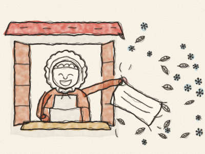
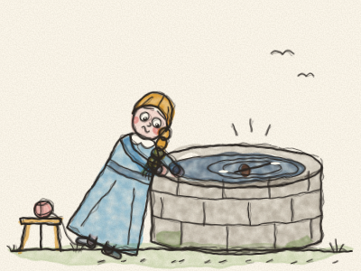
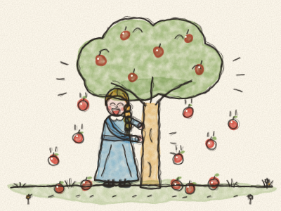
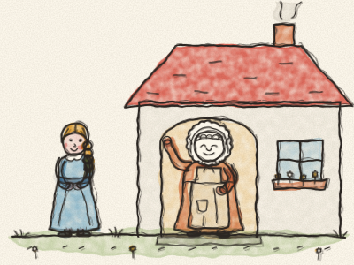
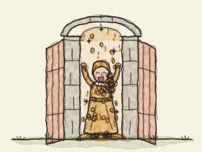
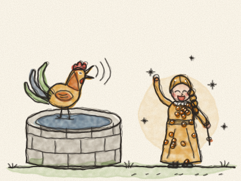
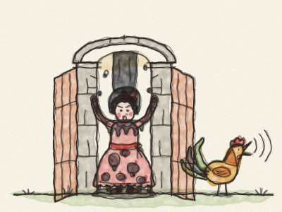

# Mother Holle

Once upon a time, there was a mother who had two daughters. One was her stepdaughter, Marie, and the other was her own daughter, Lotte.

Marie was kind and hard-working. Every day she swept the floor, fed the hens, fetched the water and baked the bread, and she always sang while she worked.

Lotte was not like that at all. Lotte liked to lie in bed until lunchtime, eating cake and doing nothing. “Marie will do it,” she always said, with a big yawn. *Aaaah-hmm.*

And every afternoon, Marie had to sit on a little stool beside the well in the garden and spin wool on her spindle, round and round, round and round, until her fingers were sore.

One afternoon, Marie spun so much that her finger pricked on the spindle. *Ouch!* She leaned over the well to wash it in the cool water — and *plop!* — the spindle slipped out of her hand and fell into the well.

“Oh no!” cried Marie. “That’s our only spindle!” She leaned further and further, trying to see it, until — *whoooosh!* — she slipped, and down, down, down she fell.

But this was a magic well. Marie did not land in the water at all. She landed softly, *flump*, on a beautiful green meadow, full of daisies and buttercups, with the sun shining in a blue sky.

Marie rubbed her eyes. “Where am I?” she whispered. Then she stood up and began to walk across the meadow.

Soon she came to a big round oven, standing all by itself in the grass. And from inside the oven came little voices:

“Take us out! Take us out! Or we will burn! We have been baked a long, long time!”

It was the bread! Marie found a long wooden paddle lying beside the oven. Carefully, one by one, she slid out all the loaves. *One, two, three, four, five, six.* They were golden brown and smelled delicious. *(Count the loaves with Constance.)*

She set them in a neat row on the grass to cool. “There you are,” she said kindly. “Now you won’t burn.”

“Thank you!” sang the little loaves. And Marie walked on, across the meadow.

A little further on, she came to a tree heavy with apples. Its branches were bending right down to the ground. And the tree called out:

“Shake me! Shake me! My apples are all ripe, and they are so heavy!”

So Marie put her arms around the trunk and shook it. *Shake, shake, shake!* The apples came tumbling down, *pom, pom, pom, pom*, like red rain all around her.

When not a single apple was left on the tree, Marie gathered them up and put them in a big neat pile. The branches sprang back up, light and happy.

“Thank you!” rustled the tree. And Marie walked on again, until she saw a little white house with a red roof and smoke curling out of the chimney.

At the window of the little house was an old woman with a big white bonnet and a big round face. Marie felt a little shy. But the old woman smiled the kindest smile.

“Don’t be afraid, my dear,” she said. “I am Mother Holle. Come in! Stay with me and help me with my housework, and I will look after you.”

Then she said, “There is one thing you must do very well. Every morning, you must make my bed and shake my feather pillows hard, so hard that the feathers fly. Because when the feathers fly up here, it snows down there in the world.”

“So that’s where snow comes from!” said Marie. And she stayed.

Every morning, Marie opened the window and shook the pillows. *Fluff! Fluff! Fluff!* White feathers flew out, and far below, snow fell softly on the rooftops of the world. The children down there laughed and built snowmen. *(Shall we shake a pillow too? Fluff!)*

Marie cooked, and swept, and sang while she worked. Mother Holle was always kind. There was roast chicken and warm soup every day, and never a cross word.

But after a while, Marie began to feel a little sad. One evening, she said, “Mother Holle, I am very happy here. But I miss my home. Even if things are hard there, I would like to go back.”

Mother Holle nodded. “You have worked so well,” she said. “I will take you home myself.”

Mother Holle took Marie by the hand and led her to a great big gate. The gate opened slowly. *Creeeeak.*

And just as Marie walked under it — *tinkle, tinkle, tinkle!* — a shower of gold came pouring down from the top of the gate. It fell on her hair, on her shoulders, on her dress, until she was shining all over like the sun.

“That is for being so kind and so hard-working,” said Mother Holle. And she gave Marie her little spindle back, too.

Then the gate closed behind her. *Clunk.* And Marie found herself back in the world, just outside her own house, golden from head to toe.

The cockerel was sitting on the edge of the well. When he saw her, he flapped his wings and crowed:

*“Cock-a-doodle-doo! Our golden girl’s come home to you!”*

Marie went inside and told her mother and Lotte everything: the oven, the apple tree, Mother Holle and the gate of gold.

Her stepmother’s eyes went wide. “Gold!” she said. “Lotte, you must go too! Then you will come back golden!”

Lotte did not like the idea of work. But she liked the idea of gold very much. So she sat by the well, threw her spindle into the water — *plop!* — and climbed down after it on the bucket rope. Then she slipped, and down, down, down she fell, onto the same green meadow.

She came to the oven, and the bread called: “Take us out! Take us out! Or we will burn!”

“What? And get my hands dirty?” said Lotte. And she walked straight past with her nose in the air.

She came to the apple tree, which called: “Shake me! Shake me! My apples are ripe!”

“What? And have an apple fall on my head?” said Lotte, and she walked on.

At Mother Holle’s house, she worked hard on the first day, thinking about the gold. On the second day, she worked a little. On the third day, she stayed in bed until lunchtime. She never shook the pillows, so not one single snowflake fell on the world.

At last Mother Holle said, “I think it is time for you to go home.” Lotte was delighted. “Now comes the gold!” she thought.

But as she walked under the gate — *SPLOSH!* — a big pot of sticky black soot poured down all over her.

“That is for the work you didn’t do,” said Mother Holle, and the gate closed. *Clunk.*

When Lotte came home, the cockerel crowed: *“Cock-a-doodle-doo! Our sooty girl’s come home to you!”*

It took a whole week of baths to wash the soot off. *Scrub, scrub, scrub!* And after that, Lotte always shook her pillows in the morning, very hard. And sometimes, just sometimes, it snowed.

> Kindness and hard work bring their own reward; laziness only brings a lot of scrubbing.
