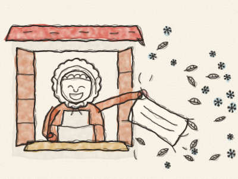
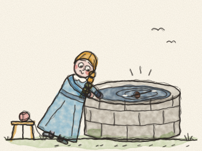
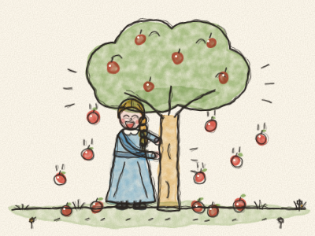
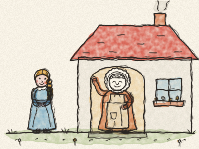
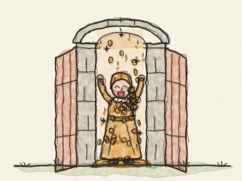
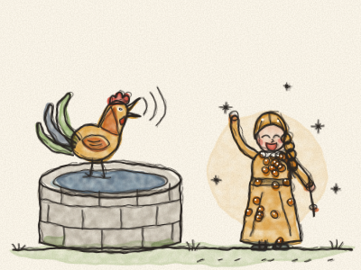
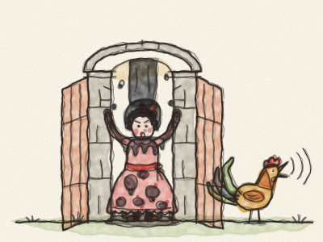

# Dame Holle

Il était une fois une mère qui avait deux filles. L’une était sa belle-fille, Marie, et l’autre était sa propre fille, Lotte.

Marie était gentille et travailleuse. Chaque jour, elle balayait le sol, nourrissait les poules, allait chercher l’eau et faisait cuire le pain, et elle chantait toujours en travaillant.

Lotte, elle, n’était pas du tout comme ça. Lotte aimait rester au lit jusqu’à midi, à manger du gâteau sans rien faire. « Marie le fera », disait-elle toujours, avec un grand bâillement. *Aaaah-hmm.*

Et chaque après-midi, Marie devait s’asseoir sur un petit tabouret, à côté du puits du jardin, et filer la laine sur son fuseau, et ça tourne, et ça tourne, jusqu’à en avoir mal aux doigts.

Un après-midi, Marie fila tant et tant qu’elle se piqua le doigt sur le fuseau. *Aïe !* Elle se pencha au-dessus du puits pour le laver dans l’eau fraîche — et *plouf !* — le fuseau lui glissa des mains et tomba dans le puits.

« Oh non ! » s’écria Marie. « C’est notre seul fuseau ! » Elle se pencha de plus en plus pour essayer de le voir, jusqu’à ce que — *fffiiiou !* — elle glisse, et tombe, tombe, tombe.

Mais c’était un puits magique. Marie ne tomba pas du tout dans l’eau. Elle atterrit tout doucement, *flop*, sur une belle prairie verte, pleine de pâquerettes et de boutons d’or, sous un soleil brillant et un ciel tout bleu.

Marie se frotta les yeux. « Où suis-je ? » murmura-t-elle. Puis elle se leva et se mit à traverser la prairie.

Bientôt, elle arriva devant un grand four rond, posé tout seul dans l’herbe. Et de l’intérieur du four sortaient de petites voix :

« Sors-nous ! Sors-nous ! Sinon nous allons brûler ! Il y a longtemps, très longtemps, que nous sommes cuits ! »

C’était le pain ! Marie trouva une longue pelle en bois posée à côté du four. Avec soin, un par un, elle sortit tous les pains. *Un, deux, trois, quatre, cinq, six.* Ils étaient bien dorés et sentaient délicieusement bon. *(Comptez les pains avec Constance.)*

Elle les posa bien en rang sur l’herbe pour qu’ils refroidissent. « Voilà », dit-elle gentiment. « Maintenant, vous ne brûlerez pas. »

« Merci ! » chantèrent les petits pains. Et Marie continua à traverser la prairie.

Un peu plus loin, elle arriva devant un arbre chargé de pommes. Ses branches pliaient jusqu’au sol. Et l’arbre cria :

« Secoue-moi ! Secoue-moi ! Mes pommes sont toutes mûres, et elles sont si lourdes ! »

Alors Marie entoura le tronc de ses bras et le secoua. *Secoue, secoue, secoue !* Les pommes dégringolèrent, *pom, pom, pom, pom*, comme une pluie rouge tout autour d’elle.

Quand il ne resta plus une seule pomme sur l’arbre, Marie les ramassa et en fit un grand tas bien rangé. Les branches se redressèrent, légères et contentes.

« Merci ! » bruissa l’arbre. Et Marie reprit son chemin, jusqu’à ce qu’elle voie une petite maison blanche au toit rouge, avec de la fumée qui sortait de la cheminée.

À la fenêtre de la petite maison se tenait une vieille dame avec un grand bonnet blanc et un grand visage tout rond. Marie se sentit un peu intimidée. Mais la vieille dame lui fit le plus gentil des sourires.

« N’aie pas peur, ma chérie », dit-elle. « Je suis Dame Holle. Entre ! Reste avec moi pour m’aider à tenir la maison, et je prendrai soin de toi. »

Puis elle ajouta : « Il y a une chose que tu dois très bien faire. Chaque matin, tu feras mon lit et tu secoueras fort mes oreillers de plumes, si fort que les plumes s’envolent. Car quand les plumes volent ici, en haut, il neige en bas, dans le monde. »

« C’est donc de là que vient la neige ! » dit Marie. Et elle resta.

Chaque matin, Marie ouvrait la fenêtre et secouait les oreillers. *Flouf ! Flouf ! Flouf !* Les plumes blanches s’envolaient et, tout en bas, la neige tombait doucement sur les toits du monde. Les enfants riaient et faisaient des bonshommes de neige. *(On secoue un oreiller, nous aussi ? Flouf !)*

Marie cuisinait, balayait, et chantait en travaillant. Dame Holle était toujours gentille. Il y avait du poulet rôti et de la bonne soupe chaude tous les jours, et jamais un mot fâché.

Mais au bout d’un moment, Marie commença à se sentir un peu triste. Un soir, elle dit : « Dame Holle, je suis très heureuse ici. Mais ma maison me manque. Même si la vie y est dure, j’aimerais y retourner. »

Dame Holle hocha la tête. « Tu as si bien travaillé », dit-elle. « Je vais te ramener moi-même. »

Dame Holle prit Marie par la main et la conduisit devant un grand, grand portail. Le portail s’ouvrit lentement. *Crrrriii.*

Et juste au moment où Marie passait dessous — *ding, ding, ding !* — une pluie d’or tomba du haut du portail. Elle tomba sur ses cheveux, sur ses épaules, sur sa robe, jusqu’à ce qu’elle brille de partout comme le soleil.

« C’est parce que tu as été si gentille et si travailleuse », dit Dame Holle. Et elle lui rendit aussi son petit fuseau.

Puis le portail se referma derrière elle. *Clonc.* Et Marie se retrouva dans le monde, juste devant sa maison, dorée de la tête aux pieds.

Le coq était perché sur le bord du puits. Quand il la vit, il battit des ailes et chanta :

*« Cocorico ! Notre fille en or est de retour, oh oh ! »*

Marie entra et raconta tout à sa belle-mère et à Lotte : le four, le pommier, Dame Holle et le portail d’or.

Sa belle-mère ouvrit de grands yeux. « De l’or ! » dit-elle. « Lotte, tu dois y aller aussi ! Comme ça, tu reviendras toute dorée ! »

Lotte n’aimait pas l’idée de travailler. Mais l’idée de l’or lui plaisait beaucoup. Alors elle s’assit près du puits, jeta son fuseau dans l’eau — *plouf !* — et descendit le chercher par la corde du seau. Puis elle glissa, et tomba, tomba, tomba, sur la même prairie verte.

Elle arriva devant le four, et le pain l’appela : « Sors-nous ! Sors-nous ! Sinon nous allons brûler ! »

« Quoi ? Et me salir les mains ? » dit Lotte. Et elle passa tout droit, le nez en l’air.

Elle arriva devant le pommier, qui cria : « Secoue-moi ! Secoue-moi ! Mes pommes sont mûres ! »

« Quoi ? Et recevoir une pomme sur la tête ? » dit Lotte, et elle continua son chemin.

Chez Dame Holle, le premier jour, elle travailla dur, en pensant à l’or. Le deuxième jour, elle travailla un peu. Le troisième jour, elle resta au lit jusqu’à midi. Elle ne secoua jamais les oreillers, alors pas un seul flocon ne tomba sur le monde.

Enfin, Dame Holle dit : « Je crois qu’il est temps pour toi de rentrer chez toi. » Lotte était ravie. « Voilà l’or ! » pensa-t-elle.

Mais quand elle passa sous le portail — *SPLOUCH !* — une grosse marmite de suie noire et collante se renversa sur elle.

« C’est pour le travail que tu n’as pas fait », dit Dame Holle, et le portail se referma. *Clonc.*

Quand Lotte rentra, le coq chanta : *« Cocorico ! Notre fille toute noire est de retour, oh oh ! »*

Il fallut une semaine entière de bains pour enlever la suie. *Frotte, frotte, frotte !* Et après ça, Lotte secoua toujours ses oreillers le matin, très fort. Et parfois, juste parfois, il neigeait.

> La gentillesse et le travail portent leur récompense ; la paresse n’apporte qu’un grand bain à frotter.
