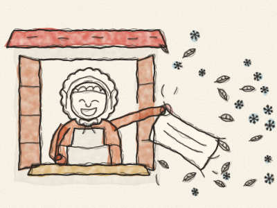
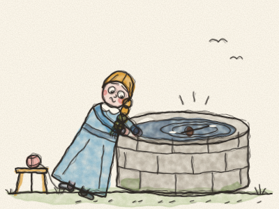
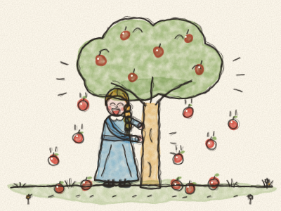
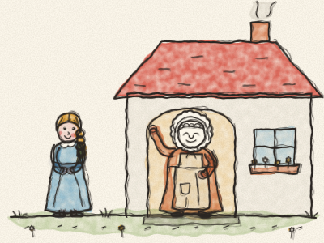
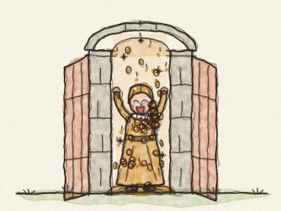
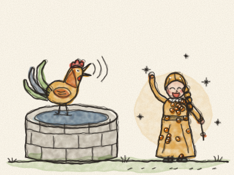
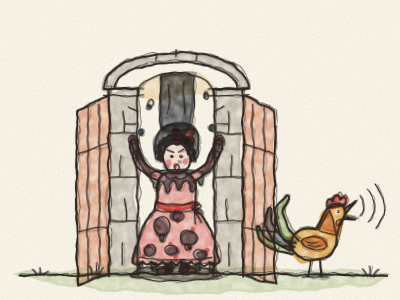

# A Senhora Holle

Era uma vez uma mãe que tinha duas filhas. Uma era a sua enteada, a Marie, e a outra era a sua própria filha, a Lotte.

A Marie era bondosa e trabalhadora. Todos os dias varria o chão, dava de comer às galinhas, ia buscar água e cozia o pão, e cantava sempre enquanto trabalhava.

A Lotte não era nada assim. A Lotte gostava de ficar na cama até à hora do almoço, a comer bolo sem fazer nada. — A Marie faz isso — dizia sempre, com um grande bocejo. *Aaaah-hum.*

E todas as tardes a Marie tinha de se sentar num banquinho ao lado do poço do quintal e fiar lã no seu fuso, roda que roda, roda que roda, até lhe doerem os dedos.

Numa tarde, a Marie fiou tanto que picou o dedo no fuso. *Ai!* Debruçou-se sobre o poço para o lavar na água fresca — e *plim!* — o fuso escorregou-lhe da mão e caiu dentro do poço.

— Oh, não! — gritou a Marie. — É o único fuso que temos! — Debruçou-se mais e mais, a tentar vê-lo, até que — *fiuuuu!* — escorregou, e caiu, caiu, caiu.

Mas aquele era um poço mágico. A Marie não caiu na água. Aterrou devagarinho, *flump*, num lindo prado verde, cheio de margaridas e botões-de-ouro, com o sol a brilhar num céu muito azul.

A Marie esfregou os olhos. — Onde é que eu estou? — sussurrou. Depois levantou-se e começou a atravessar o prado.

Pouco depois, chegou a um grande forno redondo, sozinho no meio da erva. E de dentro do forno vinham vozinhas:

— Tira-nos daqui! Tira-nos daqui! Senão queimamo-nos! Já estamos cozidos há muito, muito tempo!

Era o pão! A Marie encontrou uma pá de madeira comprida ao lado do forno. Com cuidado, um a um, tirou todos os pães. *Um, dois, três, quatro, cinco, seis.* Estavam douradinhos e cheiravam lindamente. *(Conte os pães com a Constance.)*

Pô-los em fila, muito arrumadinhos, em cima da erva, a arrefecer. — Pronto — disse ela com carinho. — Agora já não se queimam.

— Obrigado! — cantaram os pãezinhos. E a Marie continuou a atravessar o prado.

Um pouco mais à frente, chegou a uma árvore carregada de maçãs. Os ramos dobravam-se até ao chão. E a árvore chamou:

— Abana-me! Abana-me! As minhas maçãs estão todas maduras, e pesam tanto!

Então a Marie abraçou o tronco e abanou-o. *Abana, abana, abana!* As maçãs caíram aos trambolhões, *pum, pum, pum, pum*, como uma chuva vermelha à volta dela.

Quando já não havia nem uma maçã na árvore, a Marie apanhou-as todas e fez um grande monte muito arrumado. Os ramos endireitaram-se, leves e contentes.

— Obrigada! — sussurrou a árvore. E a Marie voltou a pôr-se a caminho, até que viu uma casinha branca de telhado vermelho, com fumo a sair da chaminé.

À janela da casinha estava uma velhinha com uma grande touca branca e uma cara grande e redonda. A Marie ficou um bocadinho envergonhada. Mas a velhinha fez-lhe o sorriso mais bondoso do mundo.

— Não tenhas medo, minha querida — disse ela. — Eu sou a Senhora Holle. Entra! Fica comigo e ajuda-me na lida da casa, e eu trato bem de ti.

Depois acrescentou: — Há uma coisa que tens de fazer muito bem. Todas as manhãs, fazes a minha cama e sacodes com força as minhas almofadas de penas, com tanta força que as penas voem. Porque, quando as penas voam aqui em cima, neva lá em baixo, no mundo.

— Então é daí que vem a neve! — disse a Marie. E ficou.

Todas as manhãs, a Marie abria a janela e sacudia as almofadas. *Fluf! Fluf! Fluf!* As penas brancas voavam e, lá muito em baixo, a neve caía devagarinho nos telhados do mundo. As crianças riam-se e faziam bonecos de neve. *(Vamos sacudir uma almofada também? Fluf!)*

A Marie cozinhava, varria, e cantava enquanto trabalhava. A Senhora Holle era sempre bondosa. Havia frango assado e sopa quentinha todos os dias, e nunca uma palavra zangada.

Mas, passado algum tempo, a Marie começou a sentir-se um pouco triste. Uma noite, disse: — Senhora Holle, sou muito feliz aqui. Mas tenho saudades de casa. Mesmo que lá a vida seja difícil, gostava de voltar.

A Senhora Holle acenou com a cabeça. — Trabalhaste tão bem — disse ela. — Eu própria te levo a casa.

A Senhora Holle pegou na mão da Marie e levou-a até um portão muito, muito grande. O portão abriu-se devagar. *Nhééééc.*

E, mesmo quando a Marie passava por baixo dele — *tlim, tlim, tlim!* — caiu do cimo do portão uma chuva de ouro. Caiu-lhe no cabelo, nos ombros, no vestido, até ela ficar toda a brilhar como o sol.

— Isto é por teres sido tão bondosa e tão trabalhadora — disse a Senhora Holle. E também lhe devolveu o fusinho.

Depois, o portão fechou-se atrás dela. *Clonc.* E a Marie viu-se de volta ao mundo, mesmo à porta de casa, dourada da cabeça aos pés.

O galo estava empoleirado na borda do poço. Quando a viu, bateu as asas e cantou:

*— Cocorocó! A nossa menina de ouro voltou, olé, olá!*

A Marie entrou e contou tudo à madrasta e à Lotte: o forno, a macieira, a Senhora Holle e o portão de ouro.

A madrasta arregalou os olhos. — Ouro! — disse ela. — Lotte, tens de ir também! Assim voltas toda dourada!

A Lotte não gostava nada da ideia de trabalhar. Mas da ideia do ouro gostava muito. Então sentou-se ao pé do poço, atirou o fuso para a água — *plim!* — e desceu atrás dele pela corda do balde. Depois escorregou, e caiu, caiu, caiu, no mesmo prado verde.

Chegou ao forno, e o pão chamou: — Tira-nos daqui! Tira-nos daqui! Senão queimamo-nos!

— O quê? E sujar as mãos? — disse a Lotte. E passou direitinha, de nariz no ar.

Chegou à macieira, que chamou: — Abana-me! Abana-me! As minhas maçãs estão maduras!

— O quê? E levar com uma maçã na cabeça? — disse a Lotte, e seguiu caminho.

Em casa da Senhora Holle, no primeiro dia trabalhou muito, a pensar no ouro. No segundo dia, trabalhou um bocadinho. No terceiro dia, ficou na cama até à hora do almoço. Nunca sacudiu as almofadas, e por isso nem um floco de neve caiu no mundo.

Por fim, a Senhora Holle disse: — Acho que está na hora de voltares para casa. — A Lotte ficou encantada. «Agora vem o ouro!», pensou ela.

Mas, quando passou por baixo do portão — *CHAPLUF!* — um grande caldeirão de fuligem preta e pegajosa despejou-se todo em cima dela.

— Isto é pelo trabalho que não fizeste — disse a Senhora Holle, e o portão fechou-se. *Clonc.*

Quando a Lotte chegou a casa, o galo cantou: *— Cocorocó! A nossa menina mascarrada voltou, olé, olá!*

Foi precisa uma semana inteira de banhos para tirar a fuligem. *Esfrega, esfrega, esfrega!* E, depois disso, a Lotte passou a sacudir sempre as almofadas de manhã, com muita força. E às vezes, só às vezes, nevava.

> A bondade e o trabalho trazem a sua recompensa; a preguiça só traz muito que esfregar.
