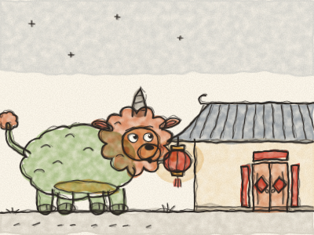
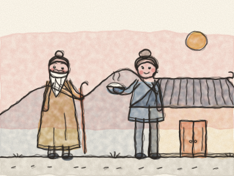
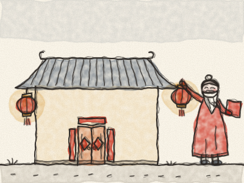
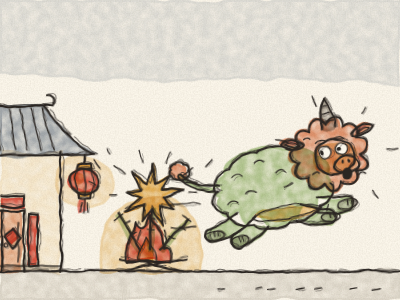
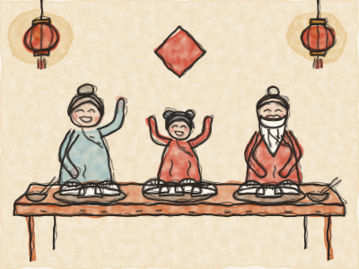

# Nian and the First New Year

Long, long ago, in a little village at the foot of the mountains, the houses had grey tiled roofs and wooden doors. The people grew rice and vegetables, and kept ducks and chickens. All year long they worked hard, and at the end of the year their storerooms were full of good things to eat: rice, cabbages, sweet potatoes and big round pumpkins.

But up in the mountains lived a beast called Nian. Nian was enormous, round and fluffy, with one horn on his head, a long swishy tail and a very, very big tummy. Once a year, on the last night of winter, Nian woke up hungry. *Grumble, grumble* went his tummy. And down the mountain he came. *Stomp! Stomp! Stomp!*

Nian was not interested in people at all. He only wanted their food! He gobbled up the rice. *Gulp!* He crunched the cabbages. *Crunch!* He swallowed the pumpkins whole. *Gloop!* So every year, before Nian came, the villagers packed their bags and hurried up into the hills to hide until morning.

One year, on the last night of winter, everybody was packing in a great hurry. Just then, an old man came walking down the road. He had a long white beard, a walking stick and a little bag on his back. Nobody had ever seen him before.

“Quick, quick!” said the villagers. “Nian is coming! No time to talk!” And they hurried past. But one kind grandmother stopped. She gave the old man a warm bowl of rice and a cup of tea. “Come with us up into the hills,” she said. “You will be safe there.”

The old man smiled and stroked his beard. “Thank you, Grandmother. But if you let me stay in your house tonight, I will send Nian away.” The grandmother shook her head. “Nobody can send Nian away!” But the old man just smiled. So she gave him her key, and off she went into the hills.

As soon as she had gone, the old man got busy. He opened his little bag. Out came sheets of red paper, and he stuck them on the doors. *Pat, pat, pat.* Out came round red lanterns, and he hung them by the gate, with little candles glowing inside. Then he put on a bright red coat. The whole house glowed red, like a warm sunset.

Last of all, he lit a fire in the yard and put a pile of bamboo sticks beside it. Then he sat down by the door to wait. The wind blew. The stars came out. And far away, up in the mountains, something began to stomp. *(What do you think the old man is going to do?)*

*Stomp! Stomp! STOMP!* Down came Nian, sniffing for food. *Sniff, sniff.* “Mmm, rice! Mmm, pumpkins!” He trotted up to the grandmother’s house… and stopped. Red paper on the door! Red lanterns at the gate! And a man in a bright red coat! Nian blinked. “Red?” he grumbled. “I don’t like red. Red makes my eyes go funny!”

Just then, the old man threw the bamboo into the fire. *Crack! Bang! Pop! BANG!* “Oh! Oh! Too noisy!” cried Nian. He jumped high in the air, put his paws over his ears and ran all the way back up the mountain, as fast as his fluffy legs could go. *Stomp-stomp-stomp-stomp!* And he did not stop until he was safe in his cave.

The next morning, the villagers came down from the hills. They could not believe their eyes. The grandmother’s house was safe! The rice was safe! The pumpkins were safe! The old man laughed. “Nian does not like the colour red, and he does not like loud bangs. Now you know how to send him away!”

And so, ever since, when the New Year comes, families stick red paper on their doors and hang up red lanterns. They wear red clothes and set off firecrackers, *crack! bang! pop!* And everybody comes home to share a big meal together, with lots and lots of dumplings. Then they hug each other and say: *“Xīn nián kuài lè!”* That means “Happy New Year!”

> The best way to start a new year is together, at home, with the people you love.
