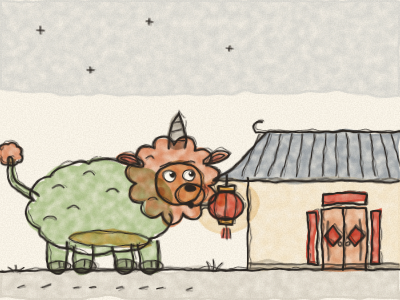
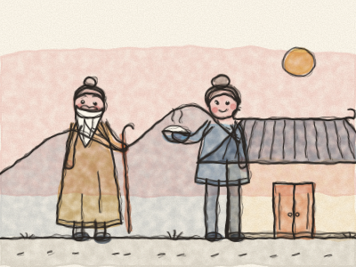
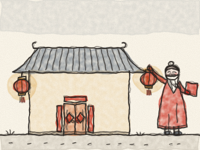
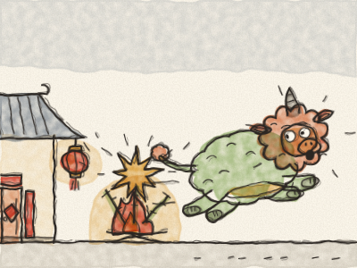
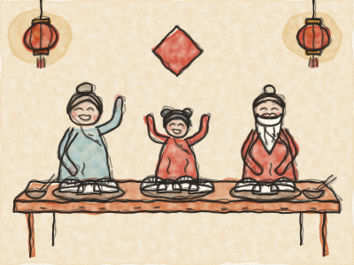

# Nian et le premier Nouvel An

Il y a très, très longtemps, dans un petit village au pied des montagnes, les maisons avaient des toits de tuiles grises et des portes en bois. Les gens cultivaient le riz et les légumes, et élevaient des canards et des poules. Toute l’année, ils travaillaient dur, et à la fin de l’année, leurs réserves étaient pleines de bonnes choses à manger : du riz, des choux, des patates douces et de grosses citrouilles toutes rondes.

Mais là-haut, dans les montagnes, vivait une bête qui s’appelait Nian. Nian était énorme, tout rond et tout duveteux, avec une seule corne sur la tête, une longue queue qui se balançait et un très, très gros ventre. Une fois par an, la dernière nuit de l’hiver, Nian se réveillait affamé. *Grrou, grrou*, faisait son ventre. Et il descendait de la montagne. *Boum ! Boum ! Boum !*

Les gens, Nian s’en moquait bien. Lui, il voulait seulement leur nourriture ! Il engloutissait le riz. *Gloups !* Il croquait les choux. *Crac !* Il avalait les citrouilles tout entières. *Glop !* Alors chaque année, avant l’arrivée de Nian, les villageois faisaient leurs bagages et se dépêchaient de monter se cacher dans les collines jusqu’au matin.

Une année, la dernière nuit de l’hiver, tout le monde faisait ses bagages en vitesse. Juste à ce moment-là, un vieil homme arriva par la route. Il avait une longue barbe blanche, un bâton de marche et un petit sac sur le dos. Personne ne l’avait jamais vu.

« Vite, vite ! dirent les villageois. Nian arrive ! Pas le temps de parler ! » Et ils passèrent en courant. Mais une gentille grand-mère s’arrêta. Elle donna au vieil homme un bol de riz bien chaud et une tasse de thé. « Venez avec nous dans les collines, dit-elle. Là-haut, vous serez à l’abri. »

Le vieil homme sourit et caressa sa barbe. « Merci, Grand-mère. Mais si vous me laissez dormir chez vous cette nuit, je chasserai Nian. » La grand-mère secoua la tête. « Personne ne peut chasser Nian ! » Mais le vieil homme se contenta de sourire. Alors elle lui donna sa clé, et partit vers les collines.

Dès qu’elle fut partie, le vieil homme se mit au travail. Il ouvrit son petit sac. Il en sortit des feuilles de papier rouge, et il les colla sur les portes. *Pat, pat, pat.* Il en sortit des lanternes rouges toutes rondes, et il les accrocha près du portail, avec de petites bougies qui brillaient dedans. Puis il enfila un manteau rouge vif. Toute la maison brillait de rouge, comme un beau coucher de soleil.

Pour finir, il alluma un feu dans la cour et posa un tas de tiges de bambou à côté. Puis il s’assit près de la porte pour attendre. Le vent souffla. Les étoiles s’allumèrent. Et loin, là-haut dans les montagnes, quelque chose se mit à marcher lourdement. *(À ton avis, que va faire le vieil homme ?)*

*Boum ! Boum ! BOUM !* Nian descendit, en reniflant pour trouver à manger. *Snif, snif.* « Miam, du riz ! Miam, des citrouilles ! » Il trotta jusqu’à la maison de la grand-mère… et s’arrêta net. Du papier rouge sur la porte ! Des lanternes rouges au portail ! Et un homme en manteau rouge vif ! Nian cligna des yeux. « Du rouge ? grogna-t-il. Je n’aime pas le rouge. Le rouge me fait tout drôle dans les yeux ! »

Juste à ce moment-là, le vieil homme jeta le bambou dans le feu. *Crac ! Bang ! Pop ! BANG !* « Oh ! Oh ! Trop de bruit ! » cria Nian. Il fit un grand bond en l’air, mit ses pattes sur ses oreilles et remonta en courant jusqu’en haut de la montagne, aussi vite que ses pattes duveteuses le pouvaient. *Boum-boum-boum-boum !* Et il ne s’arrêta qu’une fois bien à l’abri dans sa grotte.

Le lendemain matin, les villageois redescendirent des collines. Ils n’en croyaient pas leurs yeux. La maison de la grand-mère était intacte ! Le riz était là ! Les citrouilles étaient là ! Le vieil homme éclata de rire. « Nian n’aime pas le rouge, et il n’aime pas les grands bangs. Maintenant, vous savez comment le chasser ! »

Et depuis ce jour, quand arrive le Nouvel An, les familles collent du papier rouge sur leurs portes et accrochent des lanternes rouges. Elles s’habillent en rouge et font éclater des pétards, *crac ! bang ! pop !* Et tout le monde rentre à la maison pour partager un grand repas, avec des raviolis chinois, encore et encore des raviolis. Puis on s’embrasse et on se dit : *« Xīn nián kuài lè ! »* Ça veut dire « Bonne année ! »

> La plus belle façon de commencer une nouvelle année, c’est ensemble, à la maison, avec ceux qu’on aime.
