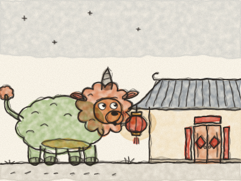
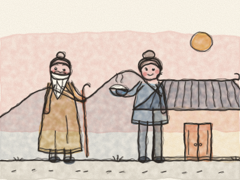
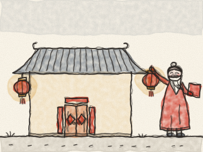
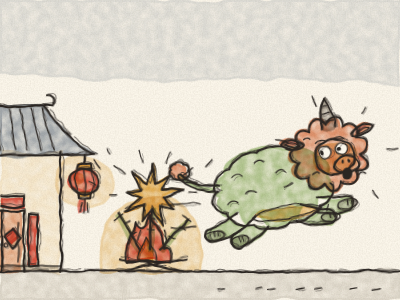
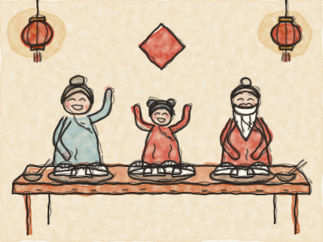

# Nian e o primeiro Ano Novo

Há muito, muito tempo, numa pequena aldeia ao pé das montanhas, as casas tinham telhados de telhas cinzentas e portas de madeira. As pessoas cultivavam arroz e legumes, e criavam patos e galinhas. O ano inteiro trabalhavam muito, e no fim do ano as despensas estavam cheias de coisas boas para comer: arroz, couves, batatas-doces e abóboras grandes e redondas.

Mas lá em cima, nas montanhas, vivia um bicho chamado Nian. O Nian era enorme, redondo e fofinho, com um só corno na cabeça, uma cauda comprida a abanar e uma barriga muito, muito grande. Uma vez por ano, na última noite do inverno, o Nian acordava cheio de fome. *Ronc, ronc*, fazia a barriga dele. E lá descia ele a montanha. *Pum! Pum! Pum!*

As pessoas não interessavam nada ao Nian. Ele só queria a comida delas! Engolia o arroz. *Glup!* Trincava as couves. *Crac!* Comia as abóboras inteirinhas. *Gulp!* Por isso, todos os anos, antes de o Nian chegar, os aldeões faziam as malas e subiam à pressa para as colinas, para se esconderem até de manhã.

Um ano, na última noite do inverno, toda a gente fazia as malas à pressa. Nesse momento, apareceu um velhinho a caminhar pela estrada. Tinha uma barba branca comprida, uma bengala e uma saquinha às costas. Ninguém o tinha visto antes.

— Depressa, depressa! — disseram os aldeões. — O Nian vem aí! Não há tempo para conversas! — E passaram a correr. Mas uma avó bondosa parou. Deu ao velhinho uma tigela de arroz quentinho e uma chávena de chá. — Venha connosco para as colinas — disse ela. — Lá fica em segurança.

O velhinho sorriu e afagou a barba. — Obrigado, avó. Mas se me deixar ficar em sua casa esta noite, eu mando o Nian embora. — A avó abanou a cabeça. — Ninguém consegue mandar o Nian embora! — Mas o velhinho limitou-se a sorrir. Então ela deu-lhe a chave e lá foi para as colinas.

Assim que ela se foi embora, o velhinho pôs mãos à obra. Abriu a saquinha. Dela saíram folhas de papel vermelho, e ele colou-as nas portas. *Pat, pat, pat.* Saíram também lanternas vermelhas redondas, e ele pendurou-as junto ao portão, com velinhas a brilhar lá dentro. Depois vestiu um casaco vermelho vivo. A casa inteira brilhava de vermelho, como um pôr do sol quentinho.

Por fim, acendeu uma fogueira no pátio e pôs um monte de canas de bambu ao lado. Depois sentou-se junto à porta, à espera. O vento soprou. As estrelas apareceram. E lá longe, nas montanhas, alguma coisa começou a caminhar com passos pesados. *(O que achas que o velhinho vai fazer?)*

*Pum! Pum! PUM!* Lá desceu o Nian, a farejar à procura de comida. *Snif, snif.* — Hum, arroz! Hum, abóboras! — Foi a trote até à casa da avó… e parou de repente. Papel vermelho na porta! Lanternas vermelhas no portão! E um homem de casaco vermelho vivo! O Nian piscou os olhos. — Vermelho? — resmungou ele. — Não gosto de vermelho. O vermelho faz-me os olhos esquisitos!

Nesse momento, o velhinho atirou o bambu para a fogueira. *Crac! Pum! Pop! PUM!* — Ai! Ai! Que barulheira! — gritou o Nian. Deu um grande salto no ar, tapou as orelhas com as patas e fugiu montanha acima, o mais depressa que as patas fofinhas o deixavam. *Pum-pum-pum-pum!* E só parou quando chegou, são e salvo, à sua gruta.

Na manhã seguinte, os aldeões desceram das colinas. Nem queriam acreditar no que viam. A casa da avó estava intacta! O arroz estava lá! As abóboras estavam lá! O velhinho deu uma gargalhada. — O Nian não gosta da cor vermelha, e não gosta de estoiros. Agora já sabem como o mandar embora!

E foi assim que, desde então, quando chega o Ano Novo, as famílias colam papel vermelho nas portas e penduram lanternas vermelhas. Vestem roupa vermelha e lançam petardos, *crac! pum! pop!* E toda a gente volta para casa para partilhar uma grande refeição, com muitos, muitos pastéis chineses. Depois abraçam-se e dizem: *«Xīn nián kuài lè!»* Quer dizer «Feliz Ano Novo!»

> A melhor maneira de começar um ano novo é juntos, em casa, com as pessoas de quem gostamos.
