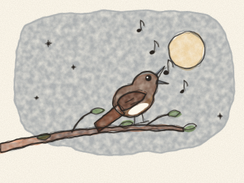
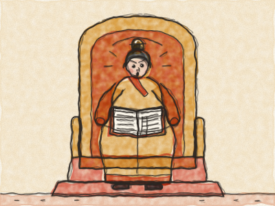
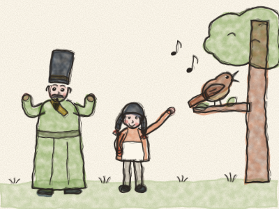
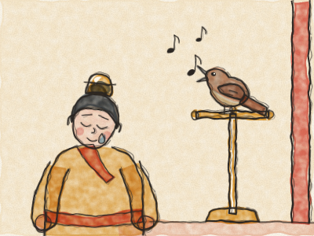
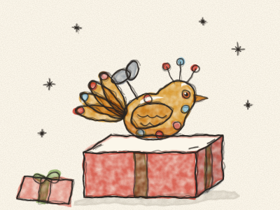
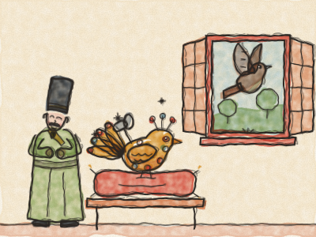
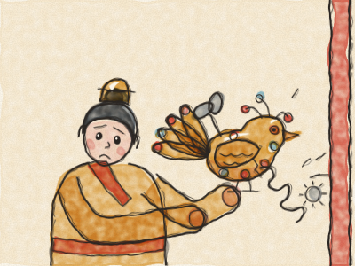
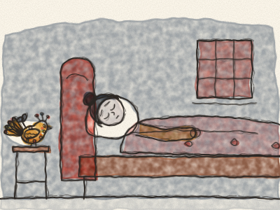
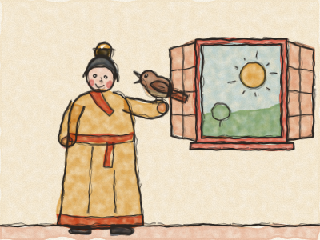

# The Nightingale

Long, long ago, in China, there lived an Emperor in the most beautiful palace in the world. It was made all of fine white porcelain, so delicate that you had to tiptoe through the rooms. *Tip, tip, tip.* In the palace garden grew the strangest flowers, with little silver bells tied to them, which tinkled when anyone walked by. *Ting-a-ling!*

Beyond the garden there was a deep green forest, and beyond the forest, the blue sea. And in that forest, on a branch above the water, lived a little nightingale.

She was a small bird, plain and brown. But oh, how she sang! When the poor fisherman came out at night to pull in his nets, he stopped to listen. “How beautiful,” he whispered.

Travellers came from all over the world to visit the Emperor’s city. They admired the palace, and the garden, and the silver bells. But when they heard the nightingale, they all said the same thing: “That is the best of all!”

When they went home, they wrote books about it. And one day, one of those books reached the Emperor himself. He sat on his golden throne and read it, nodding his head. *Nod, nod.* Then he came to the words: “But the nightingale is the best of all.”

“What?” said the Emperor. “A nightingale? I have never heard of it! Is there such a bird in my own garden, and nobody told me?”

He called his Chamberlain, a very grand gentleman. “Find this nightingale,” said the Emperor, “and bring her to sing for me tonight!”

The Chamberlain ran up and down all the stairs, and through all the halls, asking everybody. But nobody at court had ever heard of the nightingale. At last, he found a little girl who worked in the kitchen.

“Oh, yes, I know the nightingale!” she said. “I hear her every evening, when I walk home through the forest. She sings so sweetly, it makes my eyes fill with tears.”

So off they all went into the forest, the little kitchen girl in front and half the court behind her. On the way, a cow began to moo. *Mooo!* “There she is!” cried a courtier. “What a powerful voice!” “No, that’s a cow,” said the little girl.

Then some frogs croaked in the pond. *Croak, croak!* “Lovely,” said the Chamberlain. “Like little church bells.” “No, those are frogs,” said the little girl. “But listen… there she is!”

And she pointed up at a little grey-brown bird on a branch. “Is that all?” said the Chamberlain. “How plain she looks!” But the nightingale did not mind. She came to the palace and, that evening, she sat on a golden perch in the great hall and sang for the Emperor.

She sang so beautifully that tears came into the Emperor’s eyes and rolled down his cheeks. *(Pause, and let Constance listen to the quiet.)*

“You shall have my golden slipper to wear round your neck,” said the Emperor. But the nightingale said, “No, thank you. I have seen tears in the Emperor’s eyes. That is the best reward of all.”

So the nightingale stayed at court. She had her own golden cage, and she was allowed out twice a day and once at night, with twelve servants holding silk ribbons tied to her legs. It was not much fun for a little wild bird.

Then one day a big parcel arrived, with a label: “The Nightingale.” Inside was a golden bird, covered all over with diamonds, rubies and sapphires. It had a little key in its side. When you wound it up, *click, click, click*, it sang one of the real nightingale’s songs and wagged its shiny tail up and down.

“How wonderful!” cried the whole court. “Now the two birds must sing together!”

But that did not work at all, for the real nightingale sang in her own way, and the golden bird could only sing the same tune, again and again. So the golden bird sang alone. It sang its song thirty-three times, and it never got tired. And it sparkled like a bracelet.

“Now let the real nightingale sing,” said the Emperor. But where was she? Nobody had noticed her fly out of the open window, back to her green forest by the sea. *Flutter, flutter.*

“What an ungrateful bird!” said the courtiers. “Never mind. We have the better one.” And the golden bird was put on a silk cushion beside the Emperor’s bed.

For a whole year, the Emperor, the court and everybody in the city listened to the golden bird. They knew every note of its song by heart, and they all sang along. *Tweedle-dee, tweedle-dee!*

But one evening, as the golden bird was singing, something went *whirr!* inside it. Then *SPROING!* Then *clunk*. All the little wheels whizzed round, and the music stopped.

The Emperor jumped out of bed and called for his doctor. But what could a doctor do? Then he called for the watchmaker. The watchmaker took the bird to pieces and put it back together again. “It is very worn,” he said. “It can only sing once a year now, or it will break for ever.”

Five years went by. Then the Emperor became very ill. He lay in his big bed, cold and pale, and he could hardly move. The whole court thought that he would never get better, and they tiptoed away. The room was dark and very quiet.

The Emperor felt so heavy and so sad. “Music, music!” he whispered. “Little golden bird, sing for me! I gave you gold and jewels. Sing!”

But the golden bird stayed silent. Nobody was there to wind it up.

Then, suddenly, through the open window, came the most beautiful song. *(Whistle softly, like a little bird.)* It was the real nightingale, sitting on a branch outside. She had heard that the Emperor was ill, and she had come to sing to him, to bring him comfort and hope.

As she sang, the heavy sad feeling went away. The Emperor’s cheeks grew pink again, and the blood flowed warm in his arms and legs. He began to feel stronger and stronger.

“Thank you, little bird,” said the Emperor. “I sent you away, and you came back to make me well. How can I ever reward you?”

“You have already rewarded me,” said the nightingale. “The first time I sang for you, you cried. I shall never forget it.”

“Stay with me always,” said the Emperor. “You shall sing only when you want to. And I shall break the golden bird into a thousand pieces!”

“Don’t do that,” said the nightingale kindly. “It did its best. And I cannot live in a palace. But I will come every evening, and sit on the branch by your window, and sing to you. I will sing about the happy people and the sad ones, about the fisherman and the little kitchen girl. Then you will know everything that happens in your land.”

The next morning, when the servants came in, the Emperor was standing at the window in the sunshine. “Good morning!” he said, and he smiled.

> A real friend, who comes back when you need her, is worth more than all the gold and jewels in the world.
