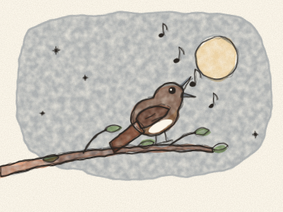
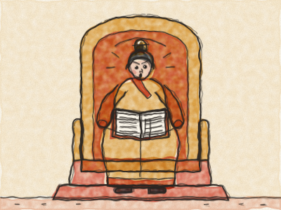
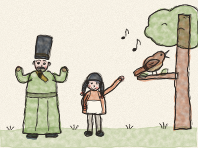
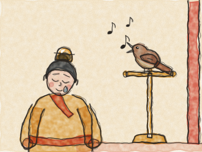
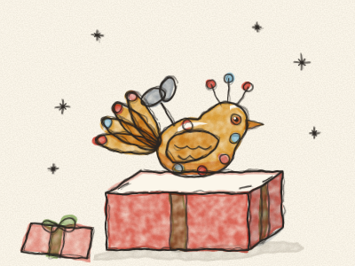
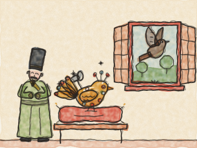
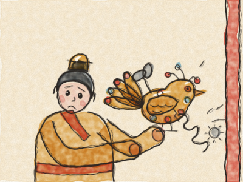
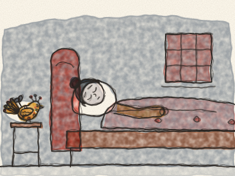
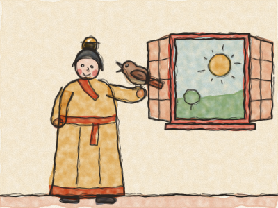

# Le Rossignol et l’Empereur de Chine

Il y a très, très longtemps, en Chine, vivait un Empereur dans le plus beau palais du monde. Il était tout en fine porcelaine blanche, si fragile qu’il fallait traverser les salles sur la pointe des pieds. *Tip, tip, tip.* Dans le jardin du palais poussaient les fleurs les plus étranges, avec de petites clochettes d’argent attachées à leurs tiges, qui tintaient dès qu’on passait. *Drelin, drelin !*

Au-delà du jardin, il y avait une profonde forêt verte, et au-delà de la forêt, la mer bleue. Et dans cette forêt, sur une branche au-dessus de l’eau, vivait un petit rossignol.

C’était un petit oiseau, tout simple et tout brun. Mais oh, comme il chantait ! Quand le pauvre pêcheur sortait la nuit pour relever ses filets, il s’arrêtait pour l’écouter. « Que c’est beau », murmurait-il.

Des voyageurs venaient du monde entier pour visiter la ville de l’Empereur. Ils admiraient le palais, le jardin et les clochettes d’argent. Mais quand ils entendaient le rossignol, ils disaient tous la même chose : « C’est ce qu’il y a de plus beau ! »

De retour chez eux, ils écrivaient des livres. Et un jour, l’un de ces livres arriva jusqu’à l’Empereur lui-même. Il s’assit sur son trône d’or et le lut en hochant la tête. *Oui, oui.* Puis il arriva à ces mots : « Mais le rossignol est ce qu’il y a de plus beau. »

« Comment ? dit l’Empereur. Un rossignol ? Je n’en ai jamais entendu parler ! Il y a un tel oiseau dans mon propre jardin, et personne ne me l’a dit ? »

Il appela son Chambellan, un monsieur très important. « Trouvez ce rossignol, dit l’Empereur, et qu’il vienne chanter pour moi ce soir ! »

Le Chambellan monta et descendit tous les escaliers, courut dans toutes les salles, et interrogea tout le monde. Mais personne à la cour n’avait jamais entendu parler du rossignol. Enfin, il trouva une petite fille qui travaillait à la cuisine.

« Oh oui, je connais le rossignol ! dit-elle. Je l’entends tous les soirs, quand je rentre chez moi par la forêt. Il chante si doucement que les larmes me montent aux yeux. »

Alors tout le monde partit dans la forêt, la petite fille de cuisine devant et la moitié de la cour derrière. En chemin, une vache se mit à meugler. *Meuh !* « Le voilà ! s’écria un courtisan. Quelle voix puissante ! » « Non, ça, c’est une vache », dit la petite fille.

Puis des grenouilles coassèrent dans la mare. *Croâ, croâ !* « Charmant, dit le Chambellan. On dirait de petites cloches d’église. » « Non, ce sont des grenouilles, dit la petite fille. Mais écoutez… le voilà ! »

Et elle montra du doigt un petit oiseau gris-brun sur une branche. « C’est tout ? dit le Chambellan. Comme il a l’air ordinaire ! » Mais le rossignol ne s’en vexa pas. Il vint au palais et, ce soir-là, perché sur un perchoir d’or dans la grande salle, il chanta pour l’Empereur.

Il chanta si merveilleusement que les larmes montèrent aux yeux de l’Empereur et roulèrent sur ses joues. *(Faites une pause, et laissez Constance écouter le silence.)*

« Tu porteras ma pantoufle d’or autour du cou », dit l’Empereur. Mais le rossignol répondit : « Non, merci. J’ai vu des larmes dans les yeux de l’Empereur. C’est la plus belle des récompenses. »

Alors le rossignol resta à la cour. Il avait sa propre cage dorée, et il avait le droit de sortir deux fois par jour et une fois la nuit, avec douze serviteurs qui tenaient des rubans de soie attachés à ses pattes. Ce n’était pas très drôle pour un petit oiseau sauvage.

Puis un jour arriva un gros paquet, avec une étiquette : « Le Rossignol ». Dedans, il y avait un oiseau en or, couvert de diamants, de rubis et de saphirs. Il avait une petite clé dans le flanc. Quand on le remontait, *clic, clic, clic*, il chantait l’une des chansons du vrai rossignol en remuant sa queue brillante de haut en bas.

« Comme c’est merveilleux ! s’écria toute la cour. Maintenant, il faut que les deux oiseaux chantent ensemble ! »

Mais cela ne marcha pas du tout, car le vrai rossignol chantait à sa façon, et l’oiseau d’or ne savait chanter que le même air, encore et encore. Alors l’oiseau d’or chanta tout seul. Il chanta sa chanson trente-trois fois, sans jamais se fatiguer. Et il brillait comme un bracelet.

« Maintenant, que le vrai rossignol chante », dit l’Empereur. Mais où était-il ? Personne ne l’avait vu s’envoler par la fenêtre ouverte, vers sa forêt verte au bord de la mer. *Frrr, frrr.*

« Quel oiseau ingrat ! dirent les courtisans. Tant pis. Nous avons le meilleur. » Et l’oiseau d’or fut posé sur un coussin de soie près du lit de l’Empereur.

Pendant toute une année, l’Empereur, la cour et tous les habitants de la ville écoutèrent l’oiseau d’or. Ils connaissaient chaque note de sa chanson par cœur, et ils chantaient tous avec lui. *Tirelire, tirelire !*

Mais un soir, pendant que l’oiseau d’or chantait, quelque chose fit *vrrr !* à l’intérieur. Puis *BOÏNG !* Puis *clonk*. Toutes les petites roues tournèrent à toute vitesse, et la musique s’arrêta.

L’Empereur sauta de son lit et fit venir son médecin. Mais que pouvait faire un médecin ? Alors il fit venir l’horloger. L’horloger démonta l’oiseau et le remonta. « Il est très usé, dit-il. Il ne pourra plus chanter qu’une fois par an, sinon il se cassera pour toujours. »

Cinq années passèrent. Puis l’Empereur tomba très malade. Il était couché dans son grand lit, froid et pâle, et il pouvait à peine bouger. Toute la cour pensait qu’il ne guérirait jamais, et tout le monde s’en alla sur la pointe des pieds. La chambre était sombre et très silencieuse.

L’Empereur se sentait si lourd et si triste. « De la musique, de la musique ! murmura-t-il. Petit oiseau d’or, chante pour moi ! Je t’ai donné de l’or et des bijoux. Chante ! »

Mais l’oiseau d’or resta muet. Il n’y avait personne pour le remonter.

Alors, soudain, par la fenêtre ouverte, arriva le plus beau des chants. *(Sifflez doucement, comme un petit oiseau.)* C’était le vrai rossignol, perché sur une branche dehors. Il avait appris que l’Empereur était malade, et il était venu chanter pour lui apporter du réconfort et de l’espoir.

Pendant qu’il chantait, la lourde tristesse s’en alla. Les joues de l’Empereur redevinrent roses, et le sang coula, tout chaud, dans ses bras et dans ses jambes. Il se sentit de plus en plus fort.

« Merci, petit oiseau, dit l’Empereur. Je t’ai laissé partir, et tu es revenu pour me guérir. Comment pourrai-je jamais te récompenser ? »

« Tu m’as déjà récompensé, dit le rossignol. La première fois que j’ai chanté pour toi, tu as pleuré. Je ne l’oublierai jamais. »

« Reste toujours avec moi, dit l’Empereur. Tu chanteras seulement quand tu en auras envie. Et je casserai l’oiseau d’or en mille morceaux ! »

« Ne fais pas ça, dit gentiment le rossignol. Il a fait de son mieux. Et moi, je ne peux pas vivre dans un palais. Mais je viendrai tous les soirs me poser sur la branche près de ta fenêtre, et je chanterai pour toi. Je chanterai les gens heureux et les gens tristes, le pêcheur et la petite fille de cuisine. Ainsi, tu sauras tout ce qui se passe dans ton pays. »

Le lendemain matin, quand les serviteurs entrèrent, l’Empereur était debout à la fenêtre, dans le soleil. « Bonjour ! » dit-il, et il sourit.

> Un vrai ami, qui revient quand on a besoin de lui, vaut plus que tout l’or et tous les bijoux du monde.
