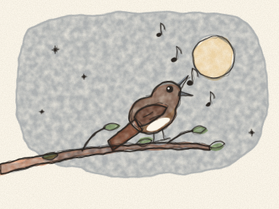
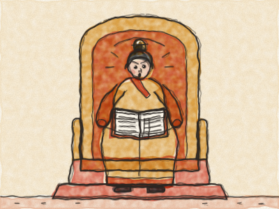
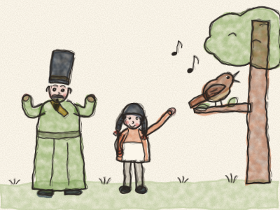
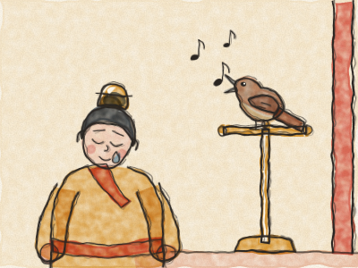
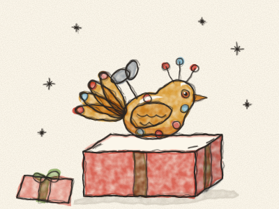
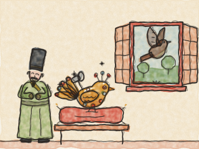
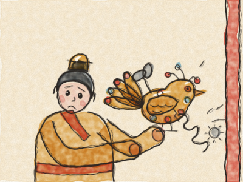
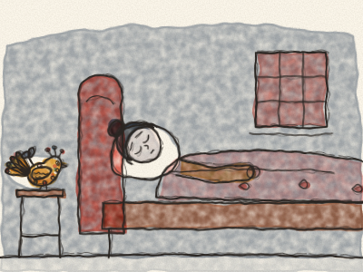
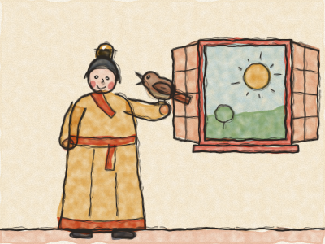

# O Rouxinol

Há muito, muito tempo, na China, vivia um Imperador no palácio mais bonito do mundo. Era todo feito de porcelana branca e fina, tão delicada que era preciso atravessar as salas em bicos de pés. *Tip, tip, tip.* No jardim do palácio cresciam as flores mais estranhas, com pequenos sininhos de prata presos aos caules, que tilintavam sempre que alguém passava. *Tlim, tlim!*

Para lá do jardim havia uma floresta verde e funda, e para lá da floresta, o mar azul. E nessa floresta, num ramo por cima da água, vivia um pequeno rouxinol.

Era um passarinho pequeno, simples e castanho. Mas ah, como ele cantava! Quando o pobre pescador saía à noite para recolher as redes, parava para o ouvir. — Que bonito — murmurava ele.

Vinham viajantes de todo o mundo visitar a cidade do Imperador. Admiravam o palácio, o jardim e os sininhos de prata. Mas quando ouviam o rouxinol, diziam todos a mesma coisa: — Isto é o melhor de tudo!

Quando voltavam para casa, escreviam livros sobre isso. E um dia, um desses livros chegou às mãos do próprio Imperador. Ele sentou-se no trono de ouro e leu-o, a acenar com a cabeça. *Sim, sim.* Depois chegou a estas palavras: «Mas o rouxinol é o melhor de tudo.»

— O quê? — disse o Imperador. — Um rouxinol? Nunca ouvi falar dele! Há um pássaro assim no meu próprio jardim, e ninguém me disse nada?

Chamou o seu Camareiro, um senhor muito importante. — Encontra esse rouxinol — disse o Imperador — e trá-lo para cantar para mim esta noite!

O Camareiro subiu e desceu todas as escadas, correu por todas as salas e perguntou a toda a gente. Mas ninguém na corte tinha alguma vez ouvido falar do rouxinol. Por fim, encontrou uma menina que trabalhava na cozinha.

— Ah, sim, conheço o rouxinol! — disse ela. — Ouço-o todas as noites, quando volto para casa pela floresta. Canta tão docemente que me vêm as lágrimas aos olhos.

Lá foram todos para a floresta, a menina da cozinha à frente e meia corte atrás dela. Pelo caminho, uma vaca pôs-se a mugir. *Muuu!* — Ali está ele! — exclamou um cortesão. — Que voz tão forte! — Não, aquilo é uma vaca — disse a menina.

Depois, umas rãs coaxaram no charco. *Croac, croac!* — Encantador — disse o Camareiro. — Parecem sininhos de igreja. — Não, aquilo são rãs — disse a menina. — Mas escutem… ali está ele!

E apontou para um passarinho cinzento-acastanhado num ramo. — É só isto? — disse o Camareiro. — Que ar tão simples! — Mas o rouxinol não se importou. Foi para o palácio e, nessa noite, pousado num poleiro de ouro no grande salão, cantou para o Imperador.

Cantou tão maravilhosamente que as lágrimas vieram aos olhos do Imperador e correram-lhe pela cara abaixo. *(Faça uma pausa, e deixe a Constance ouvir o silêncio.)*

— Vais usar o meu chinelo de ouro ao pescoço — disse o Imperador. Mas o rouxinol respondeu: — Não, obrigado. Vi lágrimas nos olhos do Imperador. Essa é a melhor recompensa de todas.

Então o rouxinol ficou na corte. Tinha a sua própria gaiola dourada, e podia sair duas vezes por dia e uma vez à noite, com doze criados a segurar fitas de seda atadas às suas patas. Não era nada divertido para um passarinho selvagem.

Até que um dia chegou um grande embrulho, com uma etiqueta: «O Rouxinol». Lá dentro havia um pássaro de ouro, todo coberto de diamantes, rubis e safiras. Tinha uma pequena chave no lado. Quando se lhe dava corda, *clic, clic, clic*, cantava uma das canções do verdadeiro rouxinol e abanava a cauda brilhante para cima e para baixo.

— Que maravilha! — exclamou a corte inteira. — Agora os dois pássaros têm de cantar juntos!

Mas aquilo não resultou nada, porque o verdadeiro rouxinol cantava à sua maneira, e o pássaro de ouro só sabia cantar a mesma música, outra vez e outra vez. Então o pássaro de ouro cantou sozinho. Cantou a sua canção trinta e três vezes, sem nunca se cansar. E brilhava como uma pulseira.

— Agora que cante o verdadeiro rouxinol — disse o Imperador. Mas onde estava ele? Ninguém o tinha visto voar pela janela aberta, de volta à sua floresta verde à beira-mar. *Frrr, frrr.*

— Que pássaro tão ingrato! — disseram os cortesãos. — Não faz mal. Temos o melhor. — E o pássaro de ouro foi posto numa almofada de seda ao lado da cama do Imperador.

Durante um ano inteiro, o Imperador, a corte e toda a gente da cidade ouviram o pássaro de ouro. Sabiam cada nota da canção de cor, e cantavam todos com ele. *Tiruli, tiruli!*

Mas uma noite, enquanto o pássaro de ouro cantava, qualquer coisa fez *zzzz!* lá dentro. Depois *TOING!* Depois *clonc*. Todas as rodinhas giraram a toda a velocidade, e a música parou.

O Imperador saltou da cama e mandou chamar o médico. Mas o que podia fazer um médico? Então mandou chamar o relojoeiro. O relojoeiro desmontou o pássaro e voltou a montá-lo. — Está muito gasto — disse ele. — Agora só pode cantar uma vez por ano, senão avaria-se para sempre.

Passaram cinco anos. E então o Imperador ficou muito doente. Estava deitado na sua grande cama, frio e pálido, e mal se conseguia mexer. A corte inteira achava que ele nunca mais ia ficar bom, e foram-se todos embora em bicos de pés. O quarto estava escuro e muito silencioso.

O Imperador sentia-se tão pesado e tão triste. — Música, música! — murmurou ele. — Passarinho de ouro, canta para mim! Dei-te ouro e joias. Canta!

Mas o pássaro de ouro ficou calado. Não havia ninguém para lhe dar corda.

Então, de repente, pela janela aberta, entrou o canto mais bonito de todos. *(Assobie baixinho, como um passarinho.)* Era o verdadeiro rouxinol, pousado num ramo lá fora. Tinha sabido que o Imperador estava doente, e viera cantar para lhe trazer conforto e esperança.

Enquanto ele cantava, a tristeza pesada foi-se embora. As faces do Imperador ficaram outra vez cor-de-rosa, e o sangue correu quentinho pelos braços e pelas pernas. Sentia-se cada vez mais forte.

— Obrigado, passarinho — disse o Imperador. — Deixei-te partir, e tu voltaste para me curar. Como te poderei alguma vez recompensar?

— Já me recompensaste — disse o rouxinol. — Da primeira vez que cantei para ti, choraste. Nunca me hei de esquecer disso.

— Fica sempre comigo — disse o Imperador. — Só cantarás quando te apetecer. E vou partir o pássaro de ouro em mil bocadinhos!

— Não faças isso — disse o rouxinol com carinho. — Ele fez o melhor que pôde. E eu não consigo viver num palácio. Mas venho todas as noites pousar no ramo junto à tua janela, e canto para ti. Vou cantar sobre as pessoas felizes e as tristes, sobre o pescador e a menina da cozinha. Assim vais saber tudo o que acontece no teu país.

Na manhã seguinte, quando os criados entraram, o Imperador estava de pé à janela, ao sol. — Bom dia! — disse ele, e sorriu.

> Um verdadeiro amigo, que volta quando precisamos dele, vale mais do que todo o ouro e todas as joias do mundo.
