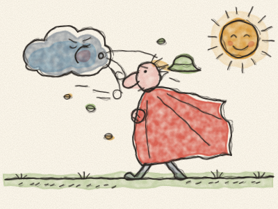
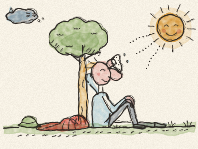

# Le Vent du Nord et le Soleil

Tout là-haut dans le ciel, le Vent du Nord et le Soleil se disputaient.

« C’est moi le plus fort ! » rugit le Vent du Nord. « Je fais plier les plus grands arbres et je soulève des vagues hautes comme des maisons ! »

« Peut-être », répondit le Soleil en souriant. « Faisons un petit concours. Tu vois ce voyageur, là-bas sur la route, avec son long manteau rouge ? Celui qui arrivera à lui faire enlever son manteau sera le plus fort. »

« Facile ! » dit le Vent du Nord. Il prit une énorme inspiration, gonfla ses joues et souffla. *Fouuuuuh !*

Les feuilles s’envolèrent des arbres. Le chapeau du voyageur s’envola de sa tête. Mais le voyageur serra son manteau encore plus fort autour de lui.

Alors le Vent du Nord souffla plus fort. *FOUUUUUH !* Le voyageur grelotta, ferma tous ses boutons et serra son manteau plus fort encore.

Le Vent du Nord souffla, souffla, jusqu’à ne plus avoir de souffle du tout. « Pff… pff… j’abandonne », haleta-t-il.

Alors ce fut le tour du Soleil. Le Soleil ne cria pas et ne poussa pas. Il sortit simplement de derrière un nuage et brilla, doucement, chaudement, sur le voyageur.

Le voyageur arrêta de grelotter. Il défit un bouton. Puis un autre. Il s’essuya le front. « Ma parole, qu’il fait chaud ! » dit-il. Et il enleva son manteau, s’assit sous un arbre et se reposa tranquillement au soleil.

Le Soleil sourit au Vent du Nord. Et pour une fois, le Vent du Nord ne dit plus rien du tout.

> La douceur et la chaleur réussissent là où les cris et la force échouent.
